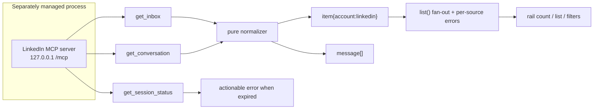
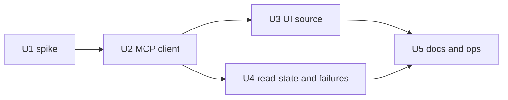

> **Superseded.** LinkedIn reads and writes ship through the plugin's own Chrome profile
> (`decisions/0003`), and observed sends are recorded rather than approved (`decisions/0004`).
> Kept as history; the current contract is `PLUGIN_OVERVIEW.md`.

# feat: Add LinkedIn messages, InMail, and invites as an inbox source

## Summary

Add LinkedIn as a fourth source in the Unified Inbox by reading LinkedIn's own inbox inside the BB browser's signed-in session. Items are real LinkedIn conversations (DMs, InMail) and whatever LinkedIn shows in its own inbox (invites), read-only in v1. No Gmail involvement, no LinkedIn credential inside the plugin, no send or accept path. (The plan below was written for a locally run MCP server; U1 rejected that path before any adapter code existed. See [Outcome](#outcome-2026-10-30-implemented-by-in-page-reads-not-the-sidecar).)

## Outcome (2026-10-30): implemented by in-page reads, not the sidecar

Shipped on `main`: `e403e8c` (read-only source), `3eedb2b` (profile photos), `e6a9d67` (spike record). U2 assumed the MCP sidecar; U1 returned NO-GO and the design changed before U2 was written.

- **U1 spike — NO-GO for the sidecar** ([spike](../research/linkedin/spike-sidecar.md)). It returned DMs and InMail and survived 30 minutes of polling, but one `get_inbox` call was followed by an owner-marked unread conversation becoming read, because its implementation clicks conversation rows to derive thread ids. Reading BB's cookies from Node also worked briefly and then lost `li_at` — LinkedIn invalidated the session used by a second client. Both paths were rejected, the second on evidence.
- **U2 replaced twice.** No `src/linkedin-mcp.ts` and no endpoint configuration exist. The first replacement ran the read in an already-open BB Browser tab, which made a pinned tab a precondition; that design was rejected. `src/linkedin-chrome.ts` now starts its own headless Chrome on a dedicated profile, opens `linkedin.com/feed/`, and evaluates `linkedinPageExpression` there over the DevTools Protocol. The session stays in that profile: no cookie store read, no Keychain, no out-of-browser HTTP. Evidence against the alternatives: reading BB's cookie store and calling Voyager from Node lost `li_at` within minutes, and Aside's `linkedin` helper (also fetch-from-Node) worked once and was then refused at the edge while `example.com` still answered through the same `fetch`.
- **U3 delivered with an explicit-sync refinement.** `linkedin` remains a first-class source in `app.tsx`, but automatic LinkedIn polling was removed. Sync happens on Inbox refresh or when a conversation is opened; rows and threads are cached between syncs, and a cached thread still opens when the browser cannot start.
- **U4 delivered and now verified.** Unread comes from the payload's `unreadCount` and `unseen`, never recomputed locally; server-side LinkedIn actions reject every write; mark/reply controls are absent.
- **Verified on 2026-10-30** against the signed-in dedicated profile, headless over the DevTools Protocol: 24 rows (20 conversations, 4 invitations), 2 unread. Reading Dan Le's conversation returned 18 messages and a re-sync afterwards still reported the same 2 unread rows, so an in-page read of one conversation does not clear its unread flag. Cold start costs about 18-23 s per read on the first attempt.
- **Sender names and avatars fixed.** A participant urn can be a member profile or a company page, and only the urn says which: companies resolve through `/voyager/api/organization/companies/`, people through `/voyager/api/identity/dash/profiles/`. Image payloads differ too — a profile nests `displayImage.vectorImage`, a company logo wraps `{ image }`, invitation MiniProfiles hand over the vector image itself. All 24 rows now carry a sender name and a `media.licdn.com` avatar; the three InMail rows name the company that sent them.
- **Previews and invitation state.** `descriptionText` is usually empty, so the newest inlined message body supplies the preview; a message with no text falls back to its `renderContent` shape (`hostUrnData.type = FEED_UPDATE` reads "Shared a post", plus file/photo/video/audio/reply/forward). All 20 conversations and the one invitation with a note now preview. Received invitations carry their own urn (`urn:li:fs_relInvitation:`) and an "Invitation" chip right of the row's date/time, because they are pending the owner's response. Only a request that carries a note is an inbox row: all four live requests are `invitationType: PENDING`, and three of them have no `message` field at all, so they are dropped rather than shown as empty rows.
- **Cold start halved by keeping one page warm.** Measured: Chrome start plus page load is ~5.4 s of a ~9 s read, and the in-page work is only ~2.4 s (profile `/me` 0.2 s, inbox query 1.8 s, 20 participant lookups 0.5 s). The page is now reused for 90 s after a read and stopped on idle or plugin dispose: first read ~11 s, repeats ~4 s, opening a conversation ~3.3 s.
- **U5 delivered.** README documents the source and the rejected paths; the access-path survey, spike, linkedincli review, and unread-preservation comparison live in `docs/research/linkedin/`.

---

## Problem Frame

LinkedIn is where a meaningful share of inbound professional messages arrive, and the inbox does not show them. There is no official API for a member's DM inbox — self-serve access covers only Sign-In (profile) and Share, and the Marketing API is scoped to advertising and company Pages ([research](../research/linkedin/linkedin-inbox-options.md)). Every practical path is LinkedIn's internal `Voyager` API on a cookie session, and the User Agreement §8.2 prohibits automated access and explicitly names automated message sending.

Given that, the design question is not "which scraping library" but "how little of LinkedIn do we own". A maintained MCP server already owns the browser session, the login recovery, and the `Voyager` surface; the plugin's job is to attach, normalize, render, and fail closed. That keeps the plugin out of the session-owning business, which is where both the maintenance and the account risk live.

---

## Requirements

- R1. LinkedIn appears as its own source in the inbox: row badge, filter chip, and a contribution to the rail unread count.
- R2. Items are real LinkedIn conversations — DMs and InMail — plus whatever LinkedIn itself lists in its inbox, including invitation threads and the note attached to an invitation, rendered as that conversation's first message. No Gmail-derived items of any kind.
- R3. Opening an item returns that conversation's real messages through the MCP conversation tool.
- R4. When the MCP endpoint is absent, unauthenticated, or expired, only LinkedIn degrades: one actionable error, and Gmail and WhatsApp are unaffected.
- R5. Read-only in v1: no send, no reply, no connection accept/decline, and no tool that mutates LinkedIn state beyond what reading requires.
- R6. No LinkedIn credential, cookie, or session token is stored in plugin storage, written to logs, or passed through the plugin RPC contract.
- R7. Existing personal Gmail, business Gmail, and WhatsApp behavior is unchanged: same item ids, same list cardinality, same cache and sync semantics.
- R8. Unattended operation is proven — including what reading does to read-state on LinkedIn — before the adapter is built.

---

## Scope Boundaries

- Writing a `Voyager` HTTP client, or decrypting browser cookies ourselves.
- Shipping or supervising our own headless browser / Patchright driver.
- Sending LinkedIn messages, connecting, inviting, accepting or declining requests.
- LinkedIn notifications, feed, posts, profile lookups, or job search.
- The official partner API route (Marketing Developer Platform application).
- Pagination, attachments, or media in LinkedIn threads.
- Deriving LinkedIn rows from LinkedIn notification email. Explicitly rejected: it shows LinkedIn's mail, not the conversation.
- Auto-starting or restarting the MCP sidecar from inside the plugin.

### Deferred to Follow-Up Work

- Replies behind the existing proposal/confirm gate: separate plan, gated on R5 holding in practice.
- Accept/decline connection requests as an inbox action: separate plan, same confirmation design as WhatsApp replies.
- Managing the sidecar as a bb background service (its own launch agent): separate change once R8's spike proves the process is worth keeping.
- Multiple LinkedIn accounts: not planned.

---

## Context & Research

### Relevant Code and Patterns

- `server.ts` — `account` enum, `item`/`message` zod schemas, `defineRpcContract`, and the `waClient()` / `wa()` pair that this plan mirrors: validate a runtime descriptor, connect over `StreamableHTTPClientTransport`, clear the cached promise on any failure, gate calls through an async queue.
- `src/sync-plan.ts` + `tests/sync-plan.test.ts` — the shape every new pure module here follows (`node:test`, `node:assert`, direct `.ts` import of the module under test).
- `src/inbox-cache.ts` — thread and item caching keyed by `(account, id)`, reused unchanged for LinkedIn rows.
- `app.tsx` — `accounts` label/icon map, `Source` badge, filter chip array, `refresh(sources)` with per-source intervals, and the `account !== 'whatsapp'` guards that currently stand in for a capability check.
- `docs/plans/2026-10-28-001-feat-reliable-unified-inbox-plan.md` — prior plan for this plugin.

### Institutional Learnings

- The README's stated invariant for WhatsAgent: *the plugin only attaches to that backend and never starts or restarts it; if discovery or the process is unavailable, it fails closed rather than risking a second connection*. LinkedIn has the same single-owner constraint — one browser session per profile, and the MCP server serializes tool calls with an explicit "browser is busy" failure — so the same invariant applies.
- The plugin's posture is already "private messages over local RPC, trusted server and clients only". LinkedIn adds account-ban risk, not a new data-class risk.

### External References

- `docs/research/linkedin/linkedin-inbox-options.md` — the access-path survey this plan executes on, with preserved sources.
- `docs/research/linkedin/sources/2026-10-28-linkedin-mcp-server-readme.md` — tools `get_inbox`, `get_conversation`, `search_conversations`, `get_session_status`, `close_session`; `--transport streamable-http` on loopback `/mcp`; persistent profile; `--login` recovery; Apache-2.0.
- LinkedIn User Agreement §8.2, preserved in `docs/research/linkedin/sources/2026-10-28-linkedin-user-agreement.md`.

---

## Key Technical Decisions

- **MCP attachment, not a client we own.** ~~The maintained server owns the browser, the session, and the `Voyager` surface; the plugin owns normalization and rendering.~~ **Rejected by U1:** the maintained server's inbox read clicks conversation rows and destroyed an unread flag, and holding the session outside the browser lost it. The plugin now issues the same reads in-page inside BB's own signed-in tab, which is the one place the session demonstrably survives.
- **Attach and fail closed, never launch.** Mirrors the WhatsAgent invariant exactly: discover the endpoint, validate it is loopback HTTP, connect, and clear the cached promise so the next attempt re-attaches. Auto-supervision is deferred.
- **Read-only means no mutating branch exists.** `action` has no LinkedIn send, reply, connect, or accept case registered at all — not a disabled flag. An agent cannot reach a LinkedIn write path through RPC because there is no code path to reach.
- **Unread is whatever the source reports, and reading may change it.** LinkedIn's own inbox marks threads read on open; whether `get_conversation` does so is a spike question (R8) and, if it does, the UI must not claim an unread state it silently destroyed. This is the one behavioral uncertainty that could reshape the item model, so it is resolved before U2 rather than papered over.
- **Items are keyed on whatever id MCP returns, cached like any other source.** If ids prove unstable, the cache key derives from a stable field instead of being re-plumbed; the spike decides, not guesswork.
- **LinkedIn icon ships as an inline SVG path.** `simple-icons@16.36` no longer contains a LinkedIn glyph (verified: no `icons/linkedin.svg`, no entry in `data/simple-icons.json`), so `siLinkedin` would not compile. Do not add a dependency for one glyph.

---

## Open Questions

### Resolved During Planning

- **Is there a Gmail-derived fallback?** No. Rejected: it surfaces LinkedIn's notification mail, not the conversation, and the user asked for LinkedIn messages, InMail, and invites.
- **Does the plugin own the browser or the session?** No — the MCP server does. The plugin only attaches.
- **Can the plugin send or accept anything on LinkedIn?** No, and not as a disabled flag either: no mutating branch is registered.
- **Does the missing LinkedIn icon block R1?** No — the glyph ships as an inline path rather than through `simple-icons`.
- **Where does the sidecar live?** Loopback `streamable-http` with a default endpoint and a configuration override; U1 confirms the exact path before U2 hard-codes a default.

### Deferred to Implementation

- **Does `get_inbox` include InMail and pending invitations, or only accepted connections' DMs?** This is the make-or-break question for R2 and the first thing U1 answers. If invites are absent, the plan narrows to DMs + InMail and invites become follow-up work, not a silently missing feature.
- **Does an invitation's note come back as message text?** The invite is expected to appear as a conversation whose first message is the note, but that is inference from LinkedIn's own UI, not observed behavior. U1 checks a real invitation with a note. If the payload yields a name with a blank or truncated note, the UI must say the note is unavailable rather than render an empty message as if the person wrote nothing — a silently blank note is the worst outcome, because it looks like the sender chose to send none.
- **Does opening a conversation mark it read on LinkedIn?** If yes, unread counts decay as the user browses and the UI copy must say so; if the read happens on `get_inbox`, the rail count is unusable and the item model needs revisiting.
- **Are conversation ids stable across sessions and re-logins?** U1. If not, U2 keys on a derived stable field.
- **What does an expired session look like at the tool boundary** — an error result, a login-required payload, or empty data? U1 records the exact signature; U2 maps it to one actionable message. An empty-but-successful reply would be the dangerous case, since it looks like an empty inbox.
- **What is the cold-start cost and does the browser survive a 60s poll past its idle close?** U1, with timings — this decides whether the rail poll is 60s or slower.

---

## High-Level Technical Design

> *This illustrates the intended approach and is directional guidance for review, not implementation specification. The implementing agent should treat it as context, not code to reproduce.*

| Failure | Visible result |
|---|---|
| Endpoint not running | Rail keeps Gmail + WhatsApp; one LinkedIn error naming the sidecar |
| Session expired | Same, with the re-authenticate message instead of a connection error |
| Unexpected payload shape | One LinkedIn error; no partial rows |
| "Browser is busy" | LinkedIn retried on the next poll; no error surfaced unless it persists |

Unit dependency shape:

---

## Implementation Units

### U1. Sidecar and inbox-surface spike

**Outcome:** run; NO-GO, see [Outcome](#outcome-2026-10-30-implemented-by-in-page-reads-not-the-sidecar) and the [spike note](../research/linkedin/spike-sidecar.md).

**Goal:** Establish what the LinkedIn MCP server actually returns — conversations, InMail, invites, ids, read-state side effects — and whether it answers unattended, before any adapter code exists (R8, and the deferred questions R2 and R5 depend on).

**Requirements:** R8

**Dependencies:** None

**Human gate:** this unit needs one interactive LinkedIn sign-in on the implementing machine (`uvx mcp-server-linkedin@latest --login`, or `--auto-import` from an already signed-in Chrome). An unattended agent must not fabricate the findings and must not proceed to U2 without them — stop, state the gate, and ask for the login.

**Files:**
- Create: `docs/research/linkedin/spike-sidecar.md`

**Approach:**
- Run the server with `--transport streamable-http` on loopback, authenticate once interactively, then drive it without a human in the loop.
- Enumerate what the inbox payload contains: DM threads, InMail threads, pending invitations, anything else. Record the shape of a single row, not just the count.
- Drive one invitation that arrived with a note, specifically. Confirm whether the note appears as the conversation's first message, whether it is truncated, and whether the invite thread survives being opened. If no suitable invitation exists in the account, say so in the findings rather than inferring the behaviour from documentation.
- Check whether ids are stable across a restart and a re-login.
- Establish the read-state effect: before/after `get_inbox`, and before/after `get_conversation`, does LinkedIn's own unread state change?
- Record cold-start time to first successful call, behaviour past the 600s idle browser close under a 60s poll for at least 30 minutes, the failure signature for an expired session, the failure signature for an absent process, and whether an unauthenticated call fails loudly or returns an empty inbox.
- End with an explicit go / no-go for U2 and a narrowed statement of R2 based on what invitations actually do.

**Test scenarios:**
- Test expectation: none — an investigation whose output is the recorded findings document.

**Verification:**
- `docs/research/linkedin/spike-sidecar.md` answers each deferred question above with observed evidence, states go/no-go, and gives U2 the endpoint, the row shape, the id-stability verdict, the read-state verdict, and the expiry signature.

---

### U2. LinkedIn MCP client and normalization

**Superseded:** the sidecar never reached this unit. Delivered instead as `src/linkedin-page.ts` (in-page read script) plus `src/linkedin-browser.ts` (one reused tab), normalized through `src/linkedin-inbox.ts`. The files, endpoint configuration, and attach semantics described below no longer apply.

**Goal:** Read LinkedIn conversations through the local MCP endpoint into the plugin's item and message shapes, attaching and failing closed exactly like WhatsAgent (R2, R3, R4, R6, R7).

**Requirements:** R2, R3, R4, R6, R7

**Dependencies:** U1 (go)

**Files:**
- Create: `src/linkedin-mcp.ts`
- Create: `tests/linkedin-mcp.test.ts`
- Modify: `server.ts`

**Approach:**
- `src/linkedin-mcp.ts` is the pure half: normalize an inbox payload into `item[]`, a conversation payload into `message[]`, classify a payload as unusable, and map the observed session-expiry signature to one actionable message.
- `server.ts` gains `linkedinMcp()` mirroring `waClient()`: resolve the endpoint, reject anything that is not loopback HTTP, connect via the existing transport, clear the cached promise on any failure so the next poll re-attaches. Endpoint override comes from configuration with U1's loopback default.
- `list_source` gains a LinkedIn branch returning normalized items; `open` returns normalized messages and caches them via the existing thread cache.
- `list()` fans out four sources and keeps the per-source error convention: a LinkedIn failure adds one error string and removes nothing else.
- Unread flags come from the payload and are passed through, not recomputed from local state — with the U1 read-state finding determining whether they can be trusted at all.
- `search`'s account allow-list gains `linkedin` so MCP rows participate in existing BM25 ranking once their threads are cached.
- No connection material enters the RPC contract or logs (R6); the endpoint lives in configuration, not in plugin storage.

**Patterns to follow:**
- `waClient()` / `wa()` in `server.ts` — attach, gate, normalize failures.
- `listWa()` — mapping a foreign list payload into `item`.
- `src/sync-plan.ts` — keep the normalize/decide logic pure and testable.

**Test scenarios:**
- Happy path: an inbox payload with a DM and an InMail becomes two items with stable ids, participant-name titles, snippet previews, and the unread flags the payload reported.
- Happy path: an invitation thread opens with the invitation note as its first message, attributed to the inviting person rather than to the account owner.
- Edge case: an invitation with no note opens as an invitation with an explicit "no note" state, not as a blank message body.
- Edge case: a note truncated by the source is rendered as truncated rather than silently completed.
- Happy path: a conversation payload becomes `message[]` with `fromMe` set for own messages and a usable date ordering.
- Edge case: an empty inbox payload yields `[]` and no error.
- Edge case: a row missing an id or a participant name is dropped rather than rendered as a broken row.
- Edge case: a very long preview is truncated to the item contract's limit rather than rejected.
- Error path: endpoint unreachable produces the fail-closed message, and the returned list still contains the other three sources.
- Error path: the session-expiry signature maps to the re-authenticate message, distinguishable from unreachable.
- Error path: an unrecognized payload shape produces exactly one error and zero items.
- Error path: a non-loopback endpoint value is rejected before any connection attempt.
- Integration: cached LinkedIn threads are re-readable through `cached_open` and participate in `search` results.

**Verification:**
- With the sidecar running, LinkedIn shows real conversations and opening one renders real messages; with it stopped, the rail still shows Gmail and WhatsApp plus one clear, distinct LinkedIn error.

---

### U3. LinkedIn source in the inbox UI

**Goal:** Render LinkedIn as a first-class source — badge, filter chip, icon, unread contribution — with no mail affordances (R1, R5).

**Requirements:** R1, R5

**Dependencies:** U2

**Files:**
- Modify: `app.tsx`
- Create: `assets/linkedin.svg`
- Modify: `inbox.css`

**Approach:**
- Extend the `Account` union and `accounts` map with a LinkedIn label, and add an inline SVG path component for the glyph (see the icon decision — do not import `siLinkedin`).
- Add `linkedin` to the refresh fan-out and the filter chip list, at a slower cadence than WhatsApp: LinkedIn conversations are not chat-speed, and every poll is a browser tool call against a live session.
- Replace the scattered `account !== 'whatsapp'` string comparisons with a small source-capability check (can this source reply, can it compose, can it archive) so LinkedIn does not become the third and fourth ad-hoc exclusion. This is a mechanical refactor inside the units that already touch those guards, not a separate project.
- Source-specific styling via a `ui-linkedin` class alongside the existing per-source treatment.

**Patterns to follow:**
- Existing `AppIcon` / `Source` components and the `ui-source` styling in `inbox.css`.
- The existing `filter` / `refresh(sources)` plumbing rather than a new state path.

**Test scenarios:**
- Test expectation: none — presentational; covered by the verification below.

**Verification:**
- The LinkedIn chip filters to LinkedIn rows; rows show the badge and icon; the rail count includes LinkedIn unread; no reply, reply-all, forward, or compose entry point is reachable for a LinkedIn row; keyboard focus and labels match the other chips.

---

### U4. Read-state honesty and failure surface

**Goal:** Make what reading does to LinkedIn's own state explicit, and make every degradation legible instead of silent (R4, R5).

**Requirements:** R4, R5

**Dependencies:** U2

**Files:**
- Modify: `server.ts`
- Modify: `app.tsx`
- Modify: `src/linkedin-mcp.ts`
- Modify: `tests/linkedin-mcp.test.ts`

**Approach:**
- Encode U1's read-state verdict: if opening a conversation marks it read on LinkedIn, say so in the conversation meta line and stop presenting the row's unread dot as authoritative afterward. If `get_inbox` itself clears unread, drop the unread claim for LinkedIn entirely rather than showing a number the act of reading fabricated.
- `action` for LinkedIn rows answers with an explicit "not supported for LinkedIn" error naming the limitation, so an agent gets a reason rather than a generic failure. No mutating tool is called.
- Distinguish the failure modes in the rail: unreachable, expired session, busy browser. One line each, no stack traces, no silent empty list.

**Patterns to follow:**
- The WhatsAgent "Marked read … no read receipt" status string, which already sets the precedent of telling the user exactly what did and did not happen.
- The existing `status` field on `action` results.

**Test scenarios:**
- Happy path: with the read-state verdict set to "conversation open marks read", the conversation meta states it and the unread indicator is not reasserted after open.
- Happy path: with the verdict set to "inbox read clears unread", LinkedIn rows carry no unread claim and the rail count contribution is zero rather than fabricated.
- Error path: every non-read action on a LinkedIn item throws before any tool call, with a message naming LinkedIn.
- Error path: the three failure modes produce three distinct messages, asserted by their distinguishing text.
- Edge case: a transient "browser is busy" on one poll does not surface an error if the next poll succeeds.

**Verification:**
- An operator can tell from the UI alone whether a LinkedIn unread count is trustworthy, and can tell apart "not running", "session expired", and "busy" without reading logs.

---

### U5. Documentation and operator surface

**Goal:** Make the dependency and the recovery path legible to whoever runs this next (R4, R5, R6).

**Requirements:** R4, R5, R6

**Dependencies:** U3, U4

**Files:**
- Modify: `README.md`
- Modify: `docs/research/linkedin/linkedin-inbox-options.md`

**Approach:**
- README adds LinkedIn to the supported sources with the exact split: thread rows require a separately managed local MCP process; the plugin attaches, never launches; the recovery path for an expired session is documented as an operator action.
- Restate the account-risk caveat once, plainly, next to the supported-sources list — the same breath as the existing trust-boundary note, not buried at the bottom.
- Replace the research doc's tentative recommendation with what was actually decided (MCP-only, no mail-derived fallback) and point it at this plan, so the survey stops recommending a rejected path.

**Test scenarios:**
- Test expectation: none — documentation only.

**Verification:**
- A reader who has never run this can tell that LinkedIn requires a sidecar, how to recover an expired session, and that the plugin will never send, connect, accept, or launch anything on their behalf.

---

## System-Wide Impact

- **Interaction graph:** the RPC contract (`account` enum), `search`'s account allow-list, `list()`'s fan-out and error array, the thread cache, and the UI's `Account` union plus filter/refresh lists move together. Missing any one yields a source that renders but cannot be opened, or opens but cannot be searched.
- **Error propagation:** per-source isolation is load-bearing. A LinkedIn failure must add one error string and must not reject `list()`, because the rail renders on the aggregate result.
- **State lifecycle risks:** reading is not side-effect free on LinkedIn. If opening a conversation clears its unread state, the plugin's own polling silently consumes the signal the user came for. U4 exists specifically because this risk is invisible until someone notices their unread count collapsing.
- **API surface parity:** `bb plugin rpc call unified-inbox list_source` accepts the new account value; an older client that does not know `linkedin` receives rows it cannot label. Acceptable for a single-consumer plugin, noted in the README.
- **Unchanged invariants:** Gmail thread ids, the history-cursor skip, WhatsApp list comparison, the WhatsApp proposal/confirm flow, and `send_gmail`'s disabled state all stay exactly as they are.

---

## Risks & Dependencies

| Risk | Mitigation |
|------|------------|
| `get_inbox` turns out not to include invitations, narrowing R2 | U1 answers this first; if invites are absent, the plan narrows explicitly to DMs + InMail and invites move to follow-up work rather than silently disappearing |
| Invitations appear without their note, so the inbox shows who asked but not why | U1 tests a real invitation with a note; U2 and U4 render an explicit "note unavailable" state instead of an empty message, and the finding is recorded rather than smoothed over |
| Reading conversations marks them read, destroying the unread signal | U1 measures it, U4 makes the consequence visible and stops asserting a count the read consumed |
| Session expires silently and LinkedIn rows stop updating | U1 records the expiry signature; U2 maps it to one actionable message; an empty-but-successful payload is treated as suspicious, not as an empty inbox |
| Unattended polling gets the account restricted | Read-only, no sends, slower cadence than WhatsApp, one browser session reused rather than re-created; the caveat is stated plainly in the README |
| The sidecar's bundled Chromium disagrees with an already-used newer Chrome and refuses to launch | Documented as an operator recovery step (`--login`), surfaced as its own error rather than a generic failure |
| The UI grows a third ad-hoc source exclusion | U3 replaces the guards with a capability check while it is already touching them |
| Sidecar stops being maintained upstream | The plugin's dependency is one HTTP endpoint and a tool contract; replacing it with another MCP server or a managed API does not touch the UI or the cache |

---

## Documentation / Operational Notes

- The plugin documents a trust boundary ("install only on a trusted BB server"). LinkedIn adds an account-risk boundary; the README should say that in the same breath as the supported-sources list.
- No migration or rollout sequencing is needed: the change is additive and inert until an endpoint exists.
- Nothing ships in a state where LinkedIn looks supported but silently returns nothing — an absent endpoint is an error, not an empty list.

---

## Sources & References

- Access-path research: [docs/research/linkedin/linkedin-inbox-options.md](../research/linkedin/linkedin-inbox-options.md)
- Preserved sources: [docs/research/linkedin/sources/](../research/linkedin/sources/)
- Related plan: [docs/plans/2026-10-28-001-feat-reliable-unified-inbox-plan.md](./2026-10-28-001-feat-reliable-unified-inbox-plan.md)
- Related code: `server.ts`, `app.tsx`, `src/inbox-cache.ts`, `src/sync-plan.ts`, `tests/sync-plan.test.ts`
- External: [`stickerdaniel/linkedin-mcp-server`](https://github.com/stickerdaniel/linkedin-mcp-server)
