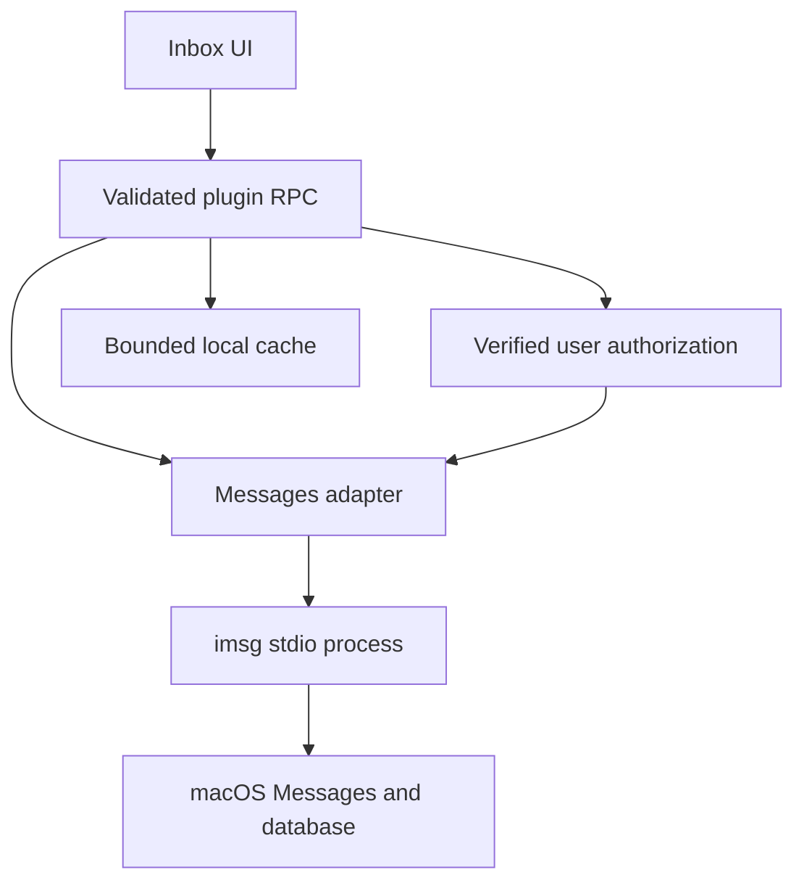

> **Superseded.** Messages ships read and send: `send` is the one permitted `imsg` mutation, and the
> gate in `src/adapters/policy.ts` replaced the `src/whatsapp-confirm.ts` this plan cites as its model
> (that file no longer exists). Current contract: `PLUGIN_OVERVIEW.md`.

# feat: Add local Messages to Unified Inbox

## Summary

Add the user's existing macOS Messages account as a local Unified Inbox channel backed by `imsg`. Support reading, ordinary sending, attachments and existing group conversations, with user-authorized mutations and capability-gated advanced features. Keep SIP enabled and do not use Photon Cloud.

---

## Problem Frame

The inbox already unifies Gmail and WhatsApp but not personal Messages. Research in [the integration survey](../research/imessage/imessage-integration-research.md) established that `imsg` can read this Mac's Messages database after BB received Full Disk Access. Its SIP-on UI-automated standard reactions do not guarantee a message target, and its threaded-reply and exact-target RPC operations require an injected helper whose use is outside the confirmed security boundary. Sending is especially sensitive because plugin RPC is agent-callable; WhatsApp's approval is enforced by WhatsAgent rather than by the inbox button alone.

---

## Requirements

- R1. Show real local Messages conversations as a distinct independently refreshed source, with history, groups, sender identity, unread state where reliable, and iMessage/SMS/RCS distinctions when available.
- R2. Send text and attachments to an existing direct or group conversation through the local account only after verified user authorization; show outcomes honestly and do not duplicate sends after uncertain failures.
- R3. Render supported incoming attachments, reactions, edits, unsends and reply context without inventing state; make outgoing reactions and threaded replies available only if the exact intended target and safe operation are verified with SIP enabled.
- R4. Retain SIP, use no Photon Cloud, do not inject private helpers, and do not change or prompt to weaken system security automatically.
- R5. Fail the Messages source independently on missing binary, permission denial, process failure or unsupported capabilities; leave Gmail and WhatsApp behavior unchanged.
- R6. Protect private content, bound RPC and media resources, validate trust-boundary inputs, and preserve the existing owner-confirmation security invariant.
- R7. Provide tests and operational guidance, including permission, delivery, reconnect, user approval and unsupported-capability cases; do not send real messages without explicit separate approval.

---

## Scope Boundaries

- No disabling SIP, installing a helper into Messages, Photon Cloud, or use of a different messaging identity.
- No claim of full feature parity: edit, unsend, exact-target reactions, read receipt changes, threaded sends, chat creation and other actions stay unavailable unless actually demonstrated under R4 and authorized under R6.
- No automatic fallback to SMS without explicit policy and accurate user-visible transport; default to no fallback when dispatch could change service unexpectedly.
- No speculative refactoring of unrelated Gmail or WhatsApp behavior.

### Deferred to Follow-Up Work

- Private-helper features or a separate dedicated Mac with reduced protections require a new user decision and separate plan.
- Broader Messages search, pagination beyond what the current inbox supports, and account management are deferred unless needed for correctness of existing flows.

---

## Context & Research

- [`server.ts`](../../server.ts) owns validated RPC contracts, Gmail and WhatsAgent dispatch, cache and WhatsApp proposals. Non-WhatsApp currently falls through to Gmail.
- [`app.tsx`](../../app.tsx) owns source filters, refresh, conversation rendering and composer; its non-WhatsApp checks currently imply Gmail. [`src/inbox-cache.ts`](../../src/inbox-cache.ts) owns local sensitive cache.
- [`src/whatsapp-confirm.ts`](../../src/whatsapp-confirm.ts) constructs a confirmation request to WhatsAgent's own authorization boundary; it is not a general BB approval mechanism. Gmail sending is deliberately disabled pending verification.
- [`docs/research/imessage/imessage-integration-research.md`](../research/imessage/imessage-integration-research.md) records the user-granted Full Disk Access and successful bounded list/history checks; automation and sending remain untested.
- [`imsg` RPC reference](../research/imessage/sources/imsg-rpc.md) describes stdio JSON-RPC, process lifetime, history, watch, send and bridge capability distinctions. [`imsg` send guide](../research/imessage/sources/imsg-send.md) documents UI tapback target ambiguity and unknown outcomes.
- The existing [`LinkedIn plan`](2026-10-28-002-feat-linkedin-inbox-source-plan.md) is adjacent but unimplemented; coordinate account enumeration and avoid assuming it has shipped.

---

## Key Technical Decisions

| Decision | Rationale |
|---|---|
| Supervise a local `imsg rpc` child | Uses the user-named maintained tool and observed local account; no network service or cloud required. Startup, shutdown and permission attribution must be verified in BB's real plugin host. |
| Per-source capabilities rather than Gmail-by-exclusion | Prevents Messages from inheriting archive, mark-read or email controls and allows dynamic failure-closed behavior. |
| Verified host-enforced authorization before any write | Existing WhatsAgent proposal flow cannot authorize imsg; a UI-only confirmation or agent-callable confirm method is insufficient. If no suitable BB primitive is proven, ship no mutation path until one exists. |
| Prefer accurate target over simulated parity | SIP-on `imsg react` targets the last or selected message, not a verified GUID. Do not offer per-message reactions unless exact target is independently proven; a last-message-only operation also requires explicit user-visible semantics and authorization. |
| Explicit unknown delivery | On timeout, termination or lost acknowledgment, retain unknown state and reconcile with source history; no automatic resend or claim of failure. `send.tracked` is bridge-only and cannot be assumed usable. |
| Keep cache bounded and transparent | Messages cache inherits existing sensitive-local-storage risks; avoid adding unbounded copies and document retention and clearing. |

---

## Open Questions

### Resolved During Planning

- `imsg` v0.20.0 ran locally with SIP on; after BB received Full Disk Access, a bounded chat list and message history request succeeded without printing content.
- The `tapback` RPC is bridge-backed. The separately documented `react` CLI is UI automation and cannot guarantee a specific target; they must not be conflated.

### Blocking Execution Decisions

- **Approval primitive:** Determine whether the installed BB SDK can provide a user-only, non-agent-forgeable authorization bound to the precise operation. If not proven, R2 and outbound R3 remain blocked; never replace this gate with a boolean or client assertion. Escalate for an explicit platform/security decision rather than silently downgrading it.
- **Reaction targeting:** Verify whether any SIP-on method can reliably target the selected message; do not enable per-message reaction if this cannot be established.

### Deferred to Implementation

- Actual TCC attribution and `imsg` binary discovery in the deployed plugin host; permission behavior varies by process and install location.
- Exact shapes, timestamp conversion, cursor semantics, attachment staging and transport behavior with representative non-sensitive fixtures; live read proof alone does not prove sending.
- The host's verified cancellation, lifecycle and storage APIs; use installed SDK declarations rather than assuming behavior.

---

## High-Level Technical Design

*This diagram illustrates the intended approach and is directional guidance for review, not implementation specification.*

Reads are isolated from other sources. Mutations cannot pass to the adapter until the approval boundary validates the action, and capabilities determine what the UI and RPC can offer.

---

## Implementation Units

### U1. Establish safe local imsg transport

**Goal:** Supervise a recoverable, bounded local JSON-RPC client and expose truthful readiness.

**Requirements:** R4, R5, R6, R7.

**Dependencies:** None.

**Files:** Create `src/imsg-client.ts`; test `tests/imsg-client.test.ts`; modify `server.ts` and `package.json` only if required by the existing build.

**Approach:** Discover a locally installed executable without installing or changing system settings. Supervise a single child per plugin lifecycle, parse newline-framed responses and notifications with request correlation, limits, timeouts, exit handling and bounded logs. Dispose subscriptions and process on plugin shutdown. Validate status and distinguish binary absence, database permission, bridge readiness and automation availability. Never enable or launch the private helper. Inspect installed BB lifecycle APIs before choosing the hook.

**Patterns to follow:** `src/async-gate.ts`, `tests/async-gate.test.ts`, WhatsAgent error isolation in `server.ts`.

**Test scenarios:**
- Happy path: fake child replies out of order to two requests; each resolves its matching response.
- Edge: partial and multiple frames, notification interleaving, oversized output and invalid JSON are handled without leaking content or hanging.
- Failure: missing binary, rejected permission, process exit, timeout and cancellation yield bounded source-specific errors and release pending calls.
- Integration: actual child lifecycle fixture exits on plugin shutdown and a later restart can recover without orphan processes.

**Verification:** RPC client tests pass; status accurately reports unavailable database and helper separately without invoking any mutation.

### U2. Map conversations and reconcile updates

**Goal:** List and open local conversations with reliable source isolation and bounded cache behavior.

**Requirements:** R1, R3, R5, R6, R7.

**Dependencies:** U1.

**Files:** Create `src/imsg-mapping.ts`; modify `server.ts`, `src/inbox-cache.ts`, `src/sync-plan.ts`; test `tests/imsg-mapping.test.ts`, `tests/inbox-cache.test.ts`, `tests/sync-plan.test.ts`.

**Approach:** Normalize documented chat and message identifiers, groups, service, unread and timestamp fields from validated upstream responses; preserve message GUIDs, reply links, reactions and mutation states. Extend schemas, search allowlists, list/open dispatch and cache handling deliberately; do not let unrecognized accounts reach Gmail. Follow watch cursor behavior: replay catches insertions, while reconnect/overflow requires history reconciliation for edits and unsends. Preserve source data on failed refresh and keep any new cached content within existing bounded policy.

**Patterns to follow:** `src/whatsapp-chat.ts`, `src/timestamps.ts`, `src/inbox-cache.ts`, source-specific refresh in `server.ts`.

**Test scenarios:**
- Happy path: direct and group fixtures normalize identities, unread state and iMessage/SMS/RCS labels without losing stable IDs.
- Edge: missing timestamps, unknown service, empty bodies, reactions, edits, unsends and reply links render without fabricating data.
- Failure: corrupt upstream data, unread unavailable, database denied and source disconnect do not erase stale data or route to Gmail.
- Integration: watch disconnect and replay plus history refresh reconcile updates without duplicate messages; cached search returns the Messages account and leaves other sources unchanged.

**Verification:** Mapping, cache and sync tests pass; the real read-only status/list/history check succeeds without logging private message contents.

### U3. Verify and enforce user authorization

**Goal:** Prove a user-only approval boundary for all Messages mutations before enabling any write.

**Requirements:** R2, R3, R6, R7.

**Dependencies:** U1; suitable BB authorization primitive or separately approved platform design.

**Files:** Modify `server.ts`, `app.tsx`; create `src/imsg-approval.ts` only if a verified host mechanism requires plugin-side proposal state; test `tests/imsg-approval.test.ts` and `tests/imsg-action-integration.test.ts`.

**Approach:** Agents must be able to send, but every agent-composed message requires its own interactive ask-user card and explicit human approval, enforced in code with no bypass or standing approval. Bind the one-time approval to the source account, exact chat and recipients, exact text and attachment bytes, and intended operation; invalidate on edits, cancellation, recipient changes, expiry, or replay. A human composing in the inbox sends with the Send button and must not be asked to confirm again. Both paths require a host-enforced distinction between genuine human actions and agent calls: an origin flag or client-side button is not proof. BB currently reports app, CLI and agents as the same RPC caller kind, and its plugin interaction responses are agent-callable; therefore these mechanisms alone do not meet the requirement. If no provable host-only mechanism exists, keep all mutation paths disabled and document the blocker; do not claim R2 complete.

**Execution note:** Characterize the existing WhatsAgent confirmation boundary before integrating a new one.

**Patterns to follow:** `src/whatsapp-confirm.ts`, `tests/whatsapp-confirm.test.ts`, disabled Gmail send in `server.ts`.

**Test scenarios:**
- Happy path: approved exact operation is dispatched once and only once.
- Security: direct agent RPC, forged approval, changed payload/chat/file, replay and expired or cancelled proposals never dispatch.
- Concurrency: two simultaneous confirmations cause at most one downstream mutation.
- Integration: a real interactive ask-user card requires a human response for each agent message; CLI/agent attempts to resolve the card or impersonate the human composer cannot authorize sending.
- Integration: a genuine human composer Send dispatches without a second confirmation; an agent invoking the same endpoint cannot exploit that path.
- Integration: real host authorization binds the user gesture to the server action, not a mocked client-side flag; absence of a verified primitive blocks send.

**Verification:** Authorization is demonstrated through the real host boundary; otherwise Messages write actions remain unavailable and the blocker is reported.

### U4. Send and media with honest delivery states

**Goal:** Send approved text/files to existing direct and group chats and display bounded incoming attachments.

**Requirements:** R2, R3, R5, R6, R7.

**Dependencies:** U1, U2, U3.

**Files:** Modify `server.ts`, `src/media-cache.ts`, `app.tsx`, `chat.css`; create `src/imsg-media.ts` and `src/imsg-send.ts` if needed; test `tests/imsg-send.test.ts`, `tests/imsg-media.test.ts`, `tests/media-cache.test.ts`.

**Approach:** Use imsg chat-target sends with a single validated target and constrain attachments to authorized bounded bytes staged in private temporary storage; clean up without exposing arbitrary filesystem paths. Treat multi-attachment partial success independently; preserve sent/pending/delivered/failed/unknown rather than equating an AppleScript return with delivery. Reconcile IDs and history without retrying an uncertain dispatch. Keep sending disabled without U3 and without actual automation readiness.

**Patterns to follow:** `src/whatsapp-media.ts`, `src/media-cache.ts`, `src/sent-message.ts`, `tests/sent-message.test.ts`.

**Test scenarios:**
- Happy path: approved text and supported media send to the selected direct/group chat; bounded incoming media loads on demand.
- Edge: mixed transports, large/unsupported files, duplicate filenames, partial multipart failure and unavailable attachment data are represented accurately.
- Failure: automation denial, lost response after dispatch, missing receipt, oversized response and cleanup failure never trigger duplicate sends or disclose filesystem contents.
- Integration: approved UI action through plugin, child transport and result reconciliation retains correct chat and delivery state; no unapproved RPC can send.

**Verification:** Tests prove security and failure paths; controlled real sends only after separate explicit consent and with known test recipients.

### U5. Channel UI and advanced capability gating

**Goal:** Present Messages alongside existing channels with honest controls and the richest verified SIP-on interactions.

**Requirements:** R1, R2, R3, R4, R5, R7.

**Dependencies:** U2; U3 and U4 for enabled sending.

**Files:** Modify `app.tsx`, `inbox.css`, `chat.css`, `assets/` only if needed; create `tests/imsg-capabilities.test.ts` and add applicable frontend integration tests.

**Approach:** Add source badge/filter and independent status. Render groups, service, unread and message metadata. Replace source exclusion conditions with explicit capabilities. Show unsupported advanced actions as unavailable, not as successful placeholders. Evaluate UI-driven reactions only where the operation's real target can be communicated and verified; do not claim arbitrary-message targeting. Maintain accessible labels, keyboard behavior and existing draft/scroll behavior.

**Patterns to follow:** existing source filter, WhatsApp composer and media components in `app.tsx`.

**Test scenarios:**
- Happy path: Messages appears independently; selecting a group renders participants, history, supported media and transport without Gmail-only actions.
- Edge: edits, unsends and reactions update their original messages; unknown transport or unread state is displayed honestly.
- Failure: unsupported bridge features and missing permission are disabled/explained, and a Messages failure leaves other sources functional.
- Integration: approved text flow and refresh preserve drafts, scroll behavior and outcome status; action controls disappear when capability changes.

**Verification:** Accessible channel UI works with source fixtures; no disabled capability can be invoked through RPC or frontend.

### U6. Operational proof and documentation

**Goal:** Verify deployment boundaries and document supported behavior without overstating parity.

**Requirements:** R1–R7.

**Dependencies:** U1–U5; U3's approval boundary must be proven before enabling writes.

**Files:** Modify `README.md`, `PLUGIN_OVERVIEW.md`; create or update `tests/imsg-integration.test.ts`.

**Approach:** Document installation/discovery, Full Disk Access on the real BB supervisor, separate Automation permission, SIP-on limits, sensitive local cache, shutdown/recovery and uncertain-send handling. Verify source isolation and permissions with representative local data, redacting private information. A controlled live send/reaction requires explicit separate consent; lack of that consent must be reported, not treated as a pass.

**Test scenarios:**
- Integration: real plugin host launches and shuts down imsg, lists/opens a bounded conversation and recovers after child termination without affecting other sources.
- Security: agent-callable paths cannot bypass user approval; denied permissions and absent imsg expose actionable errors without secrets.
- Failure: UI/RPC mismatch, stale cached data, interrupted sends and unsupported helper methods do not report success or auto-retry.

**Verification:** Focused and existing regression tests pass; documented capability matrix distinguishes verified, fixture-tested and untested operations.

---

## System-Wide Impact

- Plugin RPC is available to agents as well as UI; authorization must be enforced at the host/server boundary, including media and reactions.
- `imsg` child lifecycle and BB's operating identity determine macOS TCC; do not grant Full Disk Access more broadly than necessary or print conversation content.
- Existing cache is sensitive local data. Failed sync must not erase usable prior data, and cleanup must not remove Messages' own database or attachments.
- Watch reconnection must reconcile edits and unsends, not merely replay new row IDs. Ambiguous dispatch is neither failure nor permission to retry.
- WhatsApp's own backend ownership and confirmation remain unchanged. Gmail sending remains disabled.

---

## Risks & Dependencies

| Risk | Mitigation |
|---|---|
| No proven host-only approval mechanism | Block mutations and resolve with the user/platform rather than weakening authorization. |
| UI reaction affects wrong message | Do not expose exact-target operation unless proven; imsg's documented last/selected behavior is not sufficient. |
| AppleScript returns success without delivery | Preserve unknown state, reconcile with source, and never auto-resend. |
| macOS updates or TCC changes break access | Report actionable per-source errors and preserve other channels. |
| Sensitive attachments or logs leak data | Bound media and logs, validate paths, private staging, cleanup and explicit cache documentation. |

---

## Sources & References

- [iMessage integration research and local check](../research/imessage/imessage-integration-research.md)
- [imsg RPC contract](../research/imessage/sources/imsg-rpc.md)
- [imsg standard send and reaction behavior](../research/imessage/sources/imsg-send.md)
- [imsg advanced IMCore limits](../research/imessage/sources/imsg-advanced-imcore.md)
