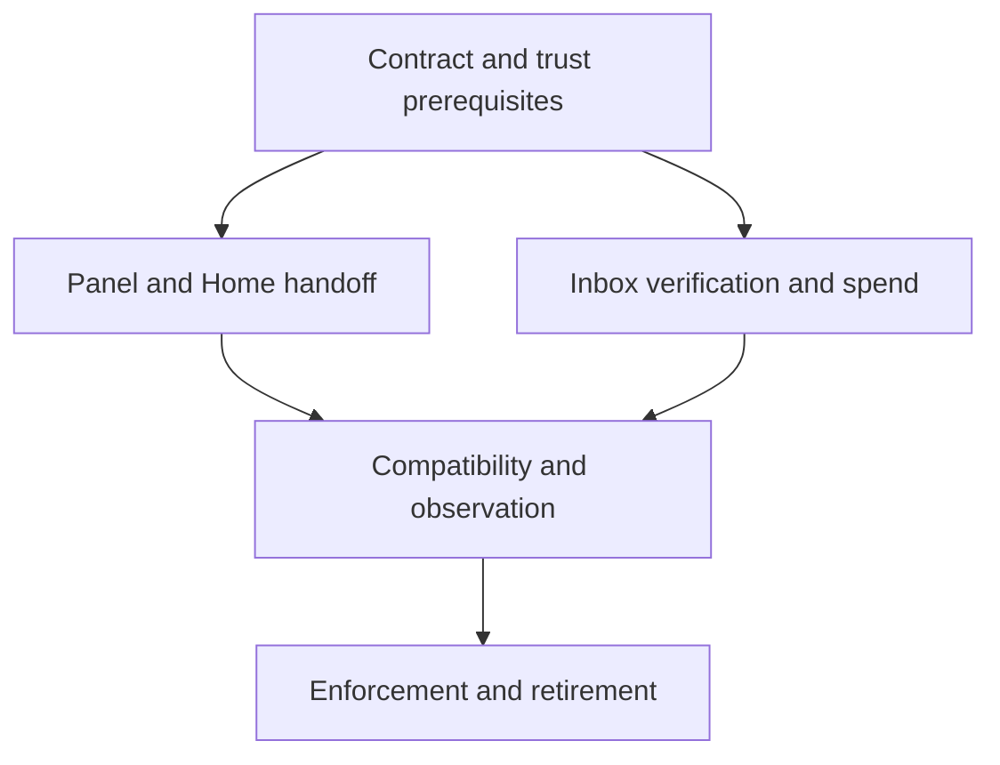

# Mail approval rollout without breaking the inbox panel

**Target repository:** bb-plugin-unified-inbox. Paths prefixed **Home:** are relative to bb-plugin-home; all other implementation paths are relative to this repository.
**Authority origin:** authority workspace `specs/001-send-approval-authority/spec.md`, and the mail-only corrections from @thread:thr_xxvwzzmuep. Existing owner decision: [ADR 0005](../../decisions/0005-keep-sends-enabled-until-verified-approval.md).
**Planning only:** no verifier wiring, schema migration, tests, helper execution or real sends performed for this plan.

## Summary

Use an expand–migrate–require rollout for **personal and business Gmail only**. First make the authority and panel handoff ready without changing current sends. Then support signed mail alongside explicitly identified legacy mail for a reviewed migration window. Require envelopes only after the actual inbox panel and Home can use that path; never recover from a rejected envelope by trying `allow`.

The rollout shape is accepted by the coordinating thread, but this is not authorization to activate it. The issuer trust boundary and one-process-per-approval behavior remain release blockers. Chat and LinkedIn retain their existing behavior and explicitly remain outside the mail approval guarantee.

---

## Problem and requirements

Changing `send_gmail` to require an envelope today breaks every inbox mail composer: `src/inbox-session.ts` always sends `allow: 'send'`, and `app.tsx` only asks for a browser confirmation. Neither can obtain an assertion or supplies a durable draft revision. Replies, reply-all, forwards, new mail and attachment-bearing mail all use this path. Old open webviews remain old clients even after a backend reload. The initial research found Home spending locally before a refusal stub. The Home owner is removing that behavior now, before any handoff work; completion still needs confirmation. Home is not yet a working panel-signing bridge.

- **R1 — Keep sends available:** honor ADR 0005 until an explicit mail cutover; do not break other sources or imply their gaps are closed.
- **R2 — Exact binding:** compare the authority commitment with a payload rebuilt from the actual mail arguments, including attachment bytes, account, route, all recipients, subject, body and threading headers.
- **R3 — One spend owner:** only the inbox delivery boundary commits the approval-id primary-key insert before dispatch. Invalid assertions and failures to commit cannot dispatch; spent assertions cannot dispatch again.
- **R4 — Visible migration:** identify legacy mail requests while compatibility is active and visibly refuse them after enforcement. **Invariant: a bad envelope NEVER falls back to `allow` or any legacy delivery path, in any rollout stage.** Mixed envelope-plus-`allow` requests are refused.
- **R5 — Honest assurance:** resolve issuer trust and enforce one fresh helper process/context per approval, with an explicit policy gate bound to the signing key, before activation; record signature/key facts without claiming proven hardware backing or confirmed delivery.

### Scope and assumptions

Mail only. `action` chat replies, `linkedin_ui`, and `linkedin_replay` are unchanged in this slice. Therefore `approvalFor`, legacy chat spend checks and the LinkedIn recording-only path cannot disappear globally yet. Only the mail path stops using them at final cutover.

Accepted rollout shape: a short compatibility window and a Home-backed approval handoff for the existing inbox mail composer. Its duration, activation and final cutover still need explicit owner approval. A same-release hard cutover is an alternative only after that handoff exists and old webviews are handled. No new daemon, signing-key store or parallel approval ledger is proposed.

Deferred: chat recipient schemas; LinkedIn approval; deterministic Gmail Message-ID/reconciliation; WhatsApp delivery receipts; containment of direct provider access. At-most-one dispatch attempt is not an exactly-once delivery promise.

---

## Research and blockers

Local evidence: `src/rpc-contract.ts`, `src/gateway.ts`, `src/adapters/policy.ts`, `src/send-audit.ts`, `src/inbox-session.ts`, `src/inbox-drafts.ts`, `src/adapters/gmail.ts`, `src/gmail-mime.ts`, and `app.tsx`. Authority evidence: **Home:** `send-approval/canonical.ts`, `verify.ts`, `spend.ts`, `sign-client.ts`, `src/approval.ts`, and `server.ts`. Existing dependency-injected gateway and fake transport tests are the implementation pattern. No external research or fresh test results are claimed; the supplied code is the contract being evaluated.

1. **Issuer trust:** `verifyApproval` currently accepts an unpinned caller-supplied P-256 key. It proves signature consistency, not enclave origin, helper identity or human presence. A software key can produce the same accepted structure. Activation requires a reviewed trust anchor/attestation contract that rejects software self-signing, or a separately owner-approved pinned-key design. Merely obtaining an SE claim does not prove payload review or bind a key to the intended signing policy. Keep this blocked pending the authority team's result. The owner reportedly installed Xcode 27.2, but free Personal Team enrollment remains pending with **zero codesigning identities** reported; the persistent-key path is unbuilt. The transient path has measured local authentication behavior, not established issuer provenance. Neither Xcode installation nor those measurements supply an accepted issuer trust anchor.
2. **Explicit presence gate and process isolation:** authority measurements on **macOS 26.6.2** found that the key's `.userPresence` ACL caches authentication per key for at least **90 seconds**: nine signatures took 9–20 ms each without a new dialog. The approval must instead pass an explicit `LAContext.evaluatePolicy` gate immediately before signing, with the signing key bound to that same context through `kSecUseAuthenticationContext`. Reported bound behavior was one dialog (gate 8.6 s, subsequent ACL signature silent at 185 ms); unbound behavior was two dialogs. A **reused context** also bypasses a new gesture: `evaluatePolicy` returned in 4 ms. Each approval therefore needs one fresh helper process, one fresh context and, for the transient variant, a fresh key; produce at most one assertion and exit. Do not pool a signer, reuse contexts or memoize signatures across approvals. Home asserts that two approvals spawn distinct helper pids. Holding the original envelope pending its one dispatch does not authorize another approval. These are reported measurements, not tests run for this plan. The gate cannot infer presence or process isolation from a changing `keyId`; issuer trust remains a separate blocker.
3. **Panel bridge:** Home must accept an inbox mail snapshot, create or associate a real draft identity/revision and provenance, display every signed field, and return an envelope for the same snapshot. Existing Home `send_approve` is resource-based, not this bridge. New-mail provenance needs an explicit compose-snapshot meaning; do not invent a provider revision or reuse a list-success timestamp as body freshness.
4. **Single spend:** the Home owner is removing the spend-before-stub behavior immediately, not as deferred handoff work; verify that removal before proceeding. Home issues/verifies and later reads inbox outcome state. It never consumes an approval that the inbox is about to consume.
5. **Shared contract:** deliver the reviewed canonicalizer/verifier/spend code and vectors as a pinned, reproducible artifact. Do not runtime-import another developer checkout or independently rewrite the encoder. Packaging/extraction is an authority-team handoff decision before U1.

---

## Rollout and compatibility

| Stage | Current panel / legacy mail | Envelope mail | Spend owner |
|---|---|---|---|
| Prepare | Unchanged and enabled | Home can verify, but real envelope delivery is explicitly refused | No envelope spend; existing legacy audit behavior remains |
| Migrate, after blockers clear | Temporarily accepted with a legacy authorization marker/warning | Validated, exact-bound and dispatched; any refusal stays refused | Inbox only, for envelope sends |
| Require, explicit cutover | Visibly refused with a migration error; no adapter call | Required for every Gmail send | Inbox only |

**Recommendation:** use the migration window because the panel currently has no envelope path and browser assets/backend deployment are not atomic. Set its review deadline and owner before activation; a zero legacy count is evidence, not proof that a dormant CLI or old tab no longer exists. Do not quietly turn compatibility off on a timer while the owner expects sends to work.

A request with both an envelope and `allow` is an ambiguous protocol request and should be refused, not treated as legacy. Missing, malformed, expired, mismatched, untrusted or spent envelopes never invoke the legacy branch. During migration, the caller must choose one explicit protocol; selecting legacy is still an acknowledged bypass until the Require stage.

After Require, keep a short-lived deprecated-field tombstone for `allow` solely to emit an audited `legacy_authorization_not_supported` refusal. It is not authorization. Later remove it from the mail schema once compatibility telemetry and client updates are reviewed. Strict-schema rejections happen before gateway audit, so final field removal requires transport error visibility; do not claim those failures land in the gate audit automatically.

Rollback after enforcement must keep the mail envelope requirement and durable spend rows. Roll back UI/helper availability by preserving drafts and reporting unavailable approval; never deploy an older bypass-capable backend or silently restore `allow`. Any deliberate return to legacy sending is a new owner security decision.

---

## Implementation units

### U1. Freeze the mail contract and release prerequisites

**Goal / requirements:** R2, R3, R5. Establish the authoritative artifact and a real issuer acceptance policy before production enforcement. **Dependencies:** authority-team trust and fresh-gesture decisions.
**Files:** proposed inbox `src/send-approval/canonical.ts`, `src/send-approval/verify.ts`, `src/send-approval/spend.ts`, `tests/send-approval-contract.test.ts`; **Home:** `send-approval/canonical.ts`, `send-approval/verify.ts`, `send-approval/test/verify.test.ts`, `send-approval/test/helper.test.ts` and shared vectors.
**Approach / pattern:** use the exact reviewed contract and its vectors, with provenance/version recorded. Mail transport/account/route are independently allowlisted by the inbox; `stub`, chat and LinkedIn envelopes cannot dispatch Gmail. Unstable key ids are identities to record, not a fixed constant to compare unless the chosen trust policy explicitly pins a persistent key.
**Test scenarios:** identical canonical bytes/hashes across consumers; unsupported route/account/version refusal; software-generated self-signed assertion rejected by the accepted issuer policy; altered key/attestation rejected; two approvals less than 90 seconds apart use distinct helper pids and fresh contexts, with fresh keys for the transient variant; each explicit policy gate prompts once, and signing bound to that same context does not prompt again. Include negative controls showing that a reused context or ACL-only signing cannot satisfy per-approval presence. A helper refuses a second assertion in the same process. Test time boundaries, including future-issued and exactly-expiring assertions, against the frozen contract.
**Verification:** authority owner supplies reviewed vectors and trust-policy acceptance evidence. A working signature alone does not satisfy this unit.

### U2. Make the real inbox mail composer approval-capable

**Goal / requirements:** R1, R2. Preserve the existing composer while adding the missing review/signing handoff. **Dependencies:** U1; until activation, all delivery is fake/refused on this new path.
**Files:** inbox `src/inbox-session.ts`, `src/inbox-drafts.ts`, `app.tsx`, `tests/inbox-session.test.ts`, `tests/mail-approval-handoff.test.ts`; **Home:** `server.ts`, `src/approval.ts`, `src/store.ts`, `app.tsx`, `send-approval/sign-client.ts`, `send-approval/test/helper.test.ts`, `test/approval.test.ts`, `test/rpc.test.ts`.
**Approach / pattern:** freeze a complete send snapshot before approval. Home starts a fresh helper process and `LAContext` for each approval request, plus a fresh key in the transient variant. Immediately before signing, the helper requires successful `evaluatePolicy` and binds the key to that same context using `kSecUseAuthenticationContext`. It requires one assertion then process exit, and never serves a new approval from a cached signature, context or signer. Home associates it with a real draft revision and displays To/Cc/Bcc, account, subject, exact body, attachment metadata/commitments and threading context. The inbox retains the actual bytes for dispatch; both sides hash decoded attachment bytes rather than trusting a caller's digest. Do not persist file bytes in localStorage. An edit during signing discards the result for the changed draft. Cancel, timeout, missing Home or missing helper preserves the draft and produces no new-path send.
**Test scenarios:** new mail, reply/reply-all/forward and attachments can acquire an envelope for the displayed snapshot; changes to any field or same-sized attachment bytes invalidate it; concurrent edits cannot install an old approval; repeated approval clicks start distinct helper processes rather than reusing a signer/signature; cancellation, timeout or duplicate helper output cannot install an approval or cause a legacy retry; Home reload/helper cancellation never falls back to `allow`; old cached webviews remain usable in compatibility and get a visible refresh/migration error after Require.
**Verification:** a fake-transport end-to-end panel handoff works, including attachment bytes and draft revisions. Home verified-envelope preparation performs zero spend inserts and zero real dispatches.

#### Approval UX acceptance condition

> One dialog per send, produced by the presence gate bound to the signing key — not by the key ACL alone, which caches for 90 s.

This promise is conditional on **one fresh context per helper process and one helper process per signature**; a pooled signer or reused context can silently reduce it to zero dialogs. An unbound policy gate can cause two dialogs. Cancellation or policy failure yields no assertion and no send, never a legacy retry. This is the intended approval interaction, not a claim that authentication guarantees delivery. Keep the inbox verification/spend logic independent of transient versus persistent key custody; issuer acceptance still needs its own reviewed trust policy.

### U3. Put verification, the sole spend and mail outcomes at the inbox boundary

**Goal / requirements:** R2, R3, R5. **Dependencies:** U1; no production enablement until U2 is ready.
**Files:** inbox `src/adapters/policy.ts`, `src/gateway.ts`, `src/rpc-contract.ts`, `src/send-audit.ts`, `src/adapters/gmail.ts`, `tests/adapters/policy.test.ts`, `tests/gateway.test.ts`, `tests/send-audit.test.ts`, `tests/mail-approval-spend.test.ts`; **Home:** `server.ts`, `src/approval.ts`, `test/rpc.test.ts`.
**Approach / pattern:** rebuild the expected payload from actual Gmail arguments and attachment bytes, not just `envelope.payload`. Compare before spending, validate issuer/time, acquire the SQLite write lock, recheck expiry after lock wait, insert the approval id as the primary key and commit before invoking transport. No awaited external work inside the spend transaction. Invalid or uncommitted approvals never dispatch. Home does not spend; its dispatch handoff and post-timeout/reload status read the inbox's durable state.
**Audit/outcomes:** record assertion and payload hashes, key id, route, authorization model and typed refusal; no body or bytes, and no assertion of proven hardware backing. Keep audit attempts separate from the unique spend ledger. Dispatch or outcome-write uncertainty never deletes/refunds a spend. Preserve Gmail's ambiguous outcome as uncertain, not delivered or safe to retry. A pre-dispatch audit/storage failure must not permit an unrecorded send; if the spend already committed, it remains consumed.
**Test scenarios:** mismatched recipient/cc/bcc/subject/body/thread/header/account/file bytes never reach the adapter; missing/bad/untrusted/expired envelope never falls back; replay across reload and two independent SQLite connections yields at most one dispatch; lock/commit/audit failure yields no unrecorded dispatch; crash after spend before provider call remains spent/uncertain; timeout or outcome-store failure never re-enables the approval; a Home handoff spends exactly once, in inbox storage only.
**Verification:** fake-transport and separate-connection tests show committed-before-dispatch ordering, durable replay refusal and accurate recovery. No real recipient is used by this validation.

### U4. Expand safely and observe every legacy mail caller

**Goal / requirements:** R1, R4. **Dependencies:** U2 and U3, and all activation blockers cleared.
**Files:** inbox `src/rpc-contract.ts`, `src/gateway.ts`, `src/send-audit.ts`, `_tools/check-send-audit.ts`, `tests/rpc-contract.test.ts`, `tests/gateway.test.ts`, `tests/check-send-audit.test.ts`; **Home:** `server.ts`, `test/rpc.test.ts`.
**Approach / pattern:** enable the two explicit protocols only for the owner-approved migration window. Label legacy mail requests with a machine-readable legacy reason/model even though the old path mints an approval UUID. Add counts/ids for these rows to the existing warning-only check; its current missing-approval-id query alone misses them. Notify the originating caller that legacy mail authorization is deprecated. Expose active mail authorization mode/protocol support for panel and Home negotiation; do not infer caller identity from UI origin. Never include message content in telemetry.
**Test scenarios:** old panel/CLI send still works in compatibility and is marked legacy; valid envelope uses only the new spend path; invalid or mixed-protocol requests cannot select legacy; account/route mismatches are visible refusals; warning includes legacy rows with minted ids and never fails on history; audit field migration preserves old rows and treats unknown historical models honestly.
**Verification:** both updated clients and deliberately stale clients have a known, tested outcome; exact observed legacy attempts can be reviewed by ids. Compatibility is visibly still unsafe, not reported as completed approval enforcement.

### U5. Require envelopes for mail and retire only mail legacy authorization

**Goal / requirements:** R1, R4, R5. **Dependencies:** U4 and explicit owner cutover approval.
**Files:** inbox `src/rpc-contract.ts`, `src/gateway.ts`, `src/adapters/policy.ts`, `src/inbox-session.ts`, `tests/gateway.test.ts`, `tests/inbox-session.test.ts`, `tests/rpc-contract.test.ts`, `PLUGIN_OVERVIEW.md`, `README.md`, successor ADR under `decisions/`; **Home:** `server.ts`, `src/approval.ts`, `test/rpc.test.ts`.
**Approach / pattern:** switch personal/business mail to Required after updated panel/Home handoff and recovery are proven. Mail sends stop minting approvals from `allow`; retain the refusal-only tombstone briefly, then remove it with transport visibility. Keep chat `action`, its legacy gate helpers and LinkedIn recording intact; their eventual removal belongs to later source-specific rollouts. Publish the exact narrower guarantee and retire only the mail-related portions of ADR 0005 through a successor record.
**Test scenarios:** envelope-free/stale-client mail refuses visibly and preserves drafts; every invalid-envelope case still refuses with no fallback; cached assets and Home/helper outage do not restore legacy sends; rollback preserves enforcement and spent ids; WhatsApp/iMessage and LinkedIn retain their prior behavior and are not labelled approved by this release.
**Verification:** signed mail succeeds only through the accepted trust policy and unique spend; old mail calls have explicit refusal/audit evidence; non-mail characterization tests stay unchanged. Any owner-authorized live canary is a separate release action, not permission granted by this plan.

---

## LinkedIn and cross-system impact

LinkedIn remains the ADR 0004/0005 recording-only exception. The current click can send DOM-held content and has no durable reviewed draft revision; Home deliberately maps it to `stub/stub`, and the canonical transport has no LinkedIn variant. Do not invent a revision, sign a stub and then deliver LinkedIn, or fabricate an approval id on `observe`. Keep UI/audit language explicit: recorded, not verified human approval. A later LinkedIn rollout needs a reviewed content snapshot and page-confirmed target binding, or its sending must be separately disabled by owner choice.

Mail approval changes two repositories, old open clients, helper availability and the delivery database. Spending stays entirely in the inbox even during transition. Home must replace its local spend/outcome source with an inbox handoff/status view; do not maintain a second authoritative ledger for convenience.

## Release decisions and remaining unknowns

Before implementation activation, obtain: the accepted issuer trust policy; fresh-helper/context-per-approval, same-context key binding and one-dialog acceptance evidence (including fresh keys for the transient variant); confirmation that Home no longer spends; a frozen artifact/vector version; agreement on Home's compose/draft provenance bridge; and owner approval of the compatibility window and enforcement cutover. These are explicit blockers, not assumptions that the existing signature proof settles.

During implementation, determine final bridge/status method names, migration column names and compatible package distribution. Those details must preserve the decisions above. Do not widen this mail-only plan to chat or LinkedIn to remove legacy helpers sooner.

## Planning review

Self-review focused on authorization, client skew and persistent spend boundaries. It caught and incorporated: no Home spend even in transition; no claim that unpinned signatures prove presence; account/route restrictions; post-lock expiry checking; legacy UUID telemetry; strict-schema errors occurring before gate audit; and rollback that cannot restore the bypass. No independent agent review or execution-time proof is claimed. The accepted rollout shape includes the no-fallback invariant and one-helper/context-per-approval lifecycle with explicit same-context policy gating. The UX wording distinguishes that gate from cached key-ACL authentication, without treating local presence measurements as issuer provenance. Issuer trust, lifecycle acceptance evidence and activation/cutover decisions remain open; the plan is not ready to activate.
