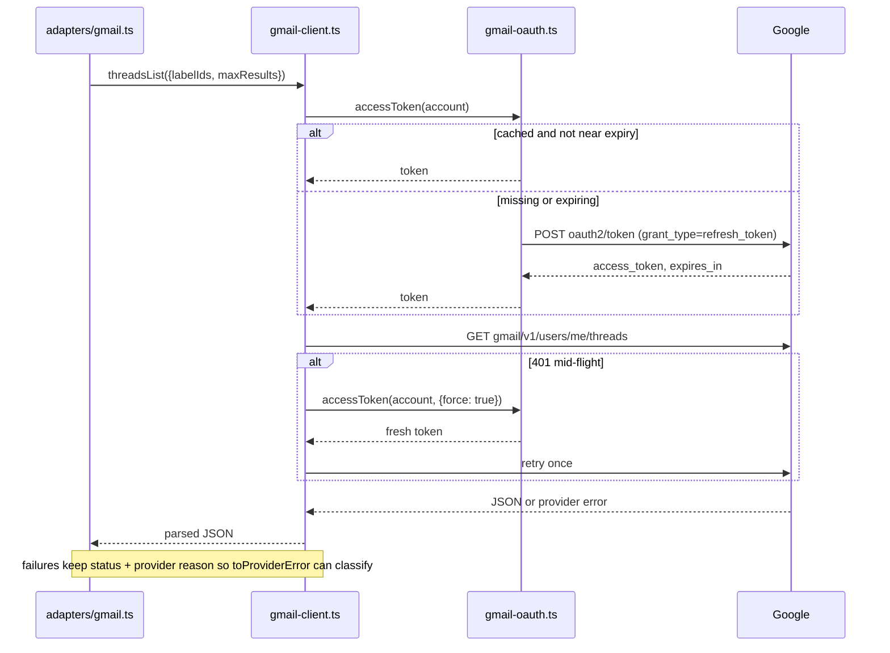

# Own the Gmail transport instead of shelling out to `gws`

**Target repository:** bb-plugin-unified-inbox. All paths are relative to this repository.
**Planning only:** no code, no credential migration and no live send performed for this plan.

## Summary

The plugin currently borrows three external agents for its three message sources: `/usr/local/bin/gws` for Gmail, the WhatsAgent desktop app for WhatsApp, and `imsg` for Messages. Each of the three also owns the credentials, so the plugin can only run on a machine where all three are installed and already signed in. This plan replaces the **Gmail** one with an in-process HTTPS client and a plugin-owned token store, behind the transport seam that already exists. Gmail goes first because its entire REST surface was proven from this machine with `curl`: a refresh grant, `users.getProfile`, `messages.list` and a metadata read, all with `fetch` and no CLI.

WhatsApp and Messages are named below as the two follow-on foundations, not planned in units here.

## Problem and requirements

The dependency is not just a binary path. `src/adapters/gws.ts` spawns the CLI once per call (8 call sites in `src/adapters/gmail.ts`), and the CLI holds the OAuth client, the per-account config directory, and the login flow. Consequences measured today:

- A `gws` refresh token issued by a project whose consent screen is in *Testing* dies after 7 days. The personal account's token died at exactly that boundary and every read now fails with exit code 2, surfaced as `Personal Gmail gmail gmail-personal request failed (2; expired, invalid, keyring, token)`.
- Nothing in the plugin can see or renew a credential. Recovery means a human typing `gws auth login` in a terminal.
- No other machine can use the plugin without installing the CLI and creating a Google Cloud project first.

- **R1 — Own the credential.** The plugin stores, renews and reports the state of its own Gmail credentials. No `gws` process is required to read, send, or recover.
- **R2 — Keep the seam.** `src/adapters/deps.ts` and `src/adapters/index.ts` keep the same shape; the panel, `src/adapters/gmail.ts` layout rules and every other source are untouched. Transport differences stay inside one implementation of one interface.
- **R3 — Nothing about send safety moves.** `src/adapters/policy.ts` (the send gate, the 5-minute window, the audit row written before delivery) and `src/mail-approval.ts` are not modified. A transport change may not alter when a send is allowed, only how its bytes leave.
- **R4 — Failures stay classifiable.** `src/adapters/provider-error.ts` keeps turning a provider failure into a scrubbed `ProviderError`. A rejected refresh token must still produce `expired`/`invalid`/`token` hints, so an HTTP status plus the provider's own message has to reach the factory — not a bare `TypeError: fetch failed`.
- **R5 — Reversible migration.** Both live accounts keep working while they move from `~/.config/gws{,-inhouse}` to the plugin store, and the CLI remains the fallback until both have moved.
- **R6 — Same reads, byte for byte.** Threads, messages, attachments, HTML bodies, label modification and RFC 822 sends return the same shapes the adapter consumes today; the adapter is not rewritten to a new message model.
- **R7 — Prove it live.** One account must read and one send must be exercised through the new transport on this machine, with `gws` removed from `PATH`, before the CLI implementation is deleted.

### Scope and assumptions

Gmail only. WhatsApp (Baileys) and Messages (bundled `imsg` binary) are separate foundations with their own unknowns: Baileys brings protocol churn and a pairing UX, and Messages needs a macOS Full Disk Access grant surfaced as a capability. Planning them here would pretend their questions are settled.

Assumptions, all verified in this session:

- A Desktop-type OAuth client's `client_secret` is not confidential, so a credential file may be read and copied by the plugin at runtime. Tokens stay per-machine.
- The plugin server is ordinary Node inside the host process: outbound HTTPS works, and a loopback listener is available for a future login flow. Neither is exercised by this plan.
- The Gmail API surface the adapter needs is closed: `users.getProfile`, `users.threads.list`, `users.threads.get`, `users.threads.modify`, `users.messages.get`, `users.messages.attachments.get`, `users.messages.send`.
- A working refresh token (`gmail.modify`, `gmail.send`) can be obtained from `gws auth export --unmasked` on this machine for migration. Export masks secrets unless `--unmasked` is passed.

Non-goals: OAuth consent-screen publishing, a login UI, account pairing, per-user Google projects, panel or onboarding work, Gmail quota/backoff tuning, and any WhatsApp or Messages implementation.

## Key technical decisions

**D1 — A typed client, not an argv shim.** The eight `gmail([...])` call sites speak CLI argv (`['users','threads','get','--params', json]`). Keeping that shape would preserve a dependency on `gws`'s interface long after the binary is gone. The interface becomes `GmailTransport` with one method per endpoint the adapter needs. `src/adapters/gmail.ts` changes at eight call sites and nowhere else.

**D2 — The interface lives with the shared contract.** `GmailTransport` moves into `src/adapters/types.ts` beside `Account`. `src/adapters/deps.ts` then depends on a named contract instead of on an implementation module, and both the CLI runner and the HTTPS client can implement it during migration.

**D3 — One 0600 file per account, in the plugin data dir.** A record of `{client_id, client_secret, refresh_token, access_token?, expires_at?, scopes?, source}` written atomically, mode 0600, under the plugin's data directory. `bb.settings` secrets are single-valued and cannot hold two accounts; the plugin database would put refresh tokens in a file that `bb plugin logs` and storage tooling also read. A file per account is the smallest thing that is both per-account and inspectable.

**D4 — Refresh is single-flight per account.** A 401 triggers one refresh for that account, and concurrent reads wait on the same in-flight promise. Gmail reads already overlap six at a time (`READ_CONCURRENCY`), so an unserialised refresh would fire six grants at once and risk invalidating itself.

**D5 — The client never synthesizes failure text.** It throws the raw cause: HTTP status, provider `error.errors[].reason`, and the provider `message`. `toProviderError` then classifies it. This is the existing rule (`src/adapters/gws.ts` header) preserved across the transport swap.

**D6 — `gws` survives until both accounts have moved.** The runner stays as the fallback implementation and is deleted in its own unit, after R7's live proof. A single commit cannot both break the current inbox and be the thing that fixes it.

*Directional guidance for review, not implementation specification.*

## Implementation units

### U1. Token store and refresh

**Goal:** Own the Gmail credential: read, write, renew, and report its state without a CLI.
**Requirements:** R1, R5, R7.
**Dependencies:** none.
**Files:** `src/gmail-oauth.ts` (new), `tests/gmail-oauth.test.ts` (new).
**Approach:** `src/gmail-oauth.ts` owns the credential record's shape, its file location (plugin data dir, one file per `GmailAccount`), atomic 0600 writes, the access-token cache with an expiry margin, and a single-flight refresh per account. It takes `fetch` as an injectable dependency so tests never touch the network. The record carries `source` (`'gws-import' | 'login'`) so a later login flow can label provenance without a schema change. It exposes the credential state the way `gws auth status` does today — present, has refresh token, last error — because a dead token has to be inspectable from a log line, not a terminal.
**Patterns to follow:** `src/imsg-client.ts` (a client that owns its own reconnect state), `src/inbox-cache.ts` (a module that owns one persisted shape), `createAsyncGate` in `src/async-gate.ts`.
**Test scenarios:**
- Loads a stored record and returns its access token while unexpired, without calling the token endpoint.
- Requests a refresh when `expires_at` is inside the margin, and stores the new token plus expiry.
- Two concurrent `accessToken()` calls during an expired token produce exactly one token request.
- A refresh answered `400 invalid_grant` surfaces that status and reason to the caller, and marks the record's last error without deleting the file.
- Missing file for an account yields a clear "no credential for this account" error, not `ENOENT` text.
- A written record is mode 0600 and a rewrite replaces it atomically (no partially written JSON observed by a reader).
**Verification:** a test can drive a full expiry → refresh → cached-token cycle with a fake `fetch`, and the record on disk round-trips.

### U2. Typed Gmail client

**Goal:** One method per Gmail endpoint the adapter needs, over HTTPS, with a single 401 retry.
**Requirements:** R1, R4, R6.
**Dependencies:** U1.
**Files:** `src/gmail-client.ts` (new), `tests/gmail-client.test.ts` (new).
**Approach:** `profile()`, `threadsList()`, `threadGet()`, `threadsModify()`, `messageGet()`, `attachmentGet()`, `sendRaw()` — the seven calls behind the adapter's eight call sites (`attachmentGet` serves both call sites). Each builds its URL and query from typed inputs, so `format`, `metadataHeaders`, `labelIds`, `maxResults` and `pageToken` stop being JSON blobs passed through argv. `sendRaw` posts the base64url RFC 822 payload with optional `threadId`. A 401 triggers one forced refresh and one retry; a second 401 is a failure. Thrown errors carry status, provider reason and message.
**Patterns to follow:** `src/adapters/gws.ts` (concurrency and error pass-through posture), `src/adapters/provider-error.ts` (what the cause must look like), `src/gmail-mime.ts` (already builds the raw message).
**Test scenarios:**
- `threadsList` encodes `labelIds`, `maxResults` and `pageToken` into the query and returns the parsed page, including `nextPageToken` when present.
- `threadGet` with `format: 'metadata'` and `metadataHeaders` sends both, and `format: 'full'` omits the header parameter.
- `attachmentGet` decodes a base64url `data` field to the same bytes the CLI path returns today.
- `sendRaw` sends `raw` plus `threadId` when replying, and omits `threadId` for new mail.
- A 401 on the first attempt triggers exactly one refresh and one retry, and the second response is returned.
- A 401 that persists after the retry throws an error whose text still contains the provider reason, so `toProviderError` yields the `expired`/`invalid`/`token` hints.
- A 404 for a message throws rather than returning an empty object, so the adapter's cache path does not mistake it for a message with no body.
- A 429 or 5xx body's provider message reaches the caller unchanged.
**Verification:** every method is exercised against a fake `fetch` whose recorded URL and headers are asserted, and the adapter's existing Gmail tests can run against this client instead of the CLI runner.

### U3. Move the adapter onto the typed interface

**Goal:** Make `src/adapters/gmail.ts` speak `GmailTransport`, with no behavior change.
**Requirements:** R2, R3, R6.
**Dependencies:** U2.
**Files:** `src/adapters/types.ts`, `src/adapters/deps.ts`, `src/adapters/gmail.ts`, `src/adapters/gws.ts` (interface extraction only), `tests/adapters/gmail.test.ts` (updated), `tests/adapters/provider-error.test.ts` (updated).
**Approach:** `GmailTransport` lands in `src/adapters/types.ts`; `src/adapters/gws.ts` implements it by translating to argv, so both implementations satisfy one contract during migration. The eight call sites become typed calls; the surrounding caching, body picking, HTML limits and `SELF` mapping are untouched. `send` keeps returning a message id and keeps its existing "outcome unknown" failure text — that text is a delivery-honesty guarantee, not a transport detail.
**Patterns to follow:** the existing `Covers`-style scenario naming in `tests/adapters/gmail.test.ts`; `src/adapters/index.ts` as the only place transports are chosen.
**Test scenarios:**
- The existing Gmail adapter suite passes unchanged against a fake `GmailTransport` (no CLI, no network).
- `threadsList` paging still stops at `nextPageToken` absence and still respects the declared page size.
- A transport rejection still becomes one scrubbed `ProviderError` message at the source boundary, with no raw provider text.
- `send` with a missing message id still fails with "Send failed or its outcome is unknown. Check Gmail Sent before trying again."
- No `account === 'gmail-personal'` branch appears in the gateway or panel as a result of this change.
**Verification:** `npm run typecheck` and `npm test` pass with the CLI runner still the wired implementation; the diff of `src/adapters/gmail.ts` touches only the eight call sites and the import.

### U4. Import the live credentials

**Goal:** Move both live accounts onto the plugin store so the CLI is no longer needed to read mail.
**Requirements:** R1, R5, R7.
**Dependencies:** U1.
**Files:** `src/account-import.ts` (new), `tests/account-import.test.ts` (new), `server.ts` (CLI registration), `docs/plans/2026-11-04-001-refactor-own-source-transports-plan.md` (this file, if the command shape changes).
**Approach:** One plugin CLI command imports an account from an existing `gws` config directory by reading `gws auth export --unmasked` once and writing a `source: 'gws-import'` record. It never runs on a timer, never runs when a token still works, and refuses to overwrite an existing record without an explicit flag. This is the one place that still invokes the CLI, and it exists so the CLI can be removed.
**Patterns to follow:** `bb.cli` registration in `server.ts`; the redaction rules in `src/adapters/provider-error.ts` (the command must never print a token).
**Test scenarios:**
- Imports a supplied export payload into a record with `source: 'gws-import'` and 0600 permissions.
- Refuses to overwrite an existing account record without the explicit flag, and says which account blocked it.
- An export with a masked `client_secret` (`GOCS...ytLc` form) is rejected with a message naming `--unmasked`, rather than storing an unusable credential.
- Command output never contains a refresh token or client secret.
- A malformed export leaves the previous record untouched.
**Verification:** after running it once for `gmail-business`, the new transport reads that mailbox while `gws` is still installed; the personal account still uses the CLI until its own credential exists.

### U5. Cut over and delete the CLI runner

**Goal:** Remove the `gws` dependency and prove the plugin reads and sends without it.
**Requirements:** R1, R5, R7.
**Dependencies:** U3, U4.
**Files:** `src/adapters/gws.ts` (deleted), `src/adapters/deps.ts`, `server.ts`, `PLUGIN_OVERVIEW.md`, `src/CONTEXT.md`, `docs/_index.md` (regenerated).
**Approach:** Wiring selects the HTTPS transport for every account; the CLI runner and its temp-file send path are deleted. `PLUGIN_OVERVIEW.md` stops describing a `gws` requirement and states what the plugin now stores and where. `src/CONTEXT.md` gains the credential-invariant row: `src/gmail-oauth.ts` owns whether a Gmail credential exists and when it is renewed — no other module reads the token file.
**Patterns to follow:** `decisions/README.md` conventions if this becomes an ADR (see Deferred).
**Test scenarios:**
- No test imports `src/adapters/gws.ts`; the suite passes with the module gone.
- A read for an account with no credential produces the same scrubbed `ProviderError` shape as before, and the panel's existing stale-cache message still explains it.
- `PLUGIN_OVERVIEW.md`'s install requirements no longer mention `gws` (documentation assertion, checked by review rather than a test).
**Verification:** with `gws` renamed out of `PATH` on this machine, a refresh of both accounts returns threads, one message opens with its body, and one send through `policy.ts` reaches Gmail and returns a message id. `npm run check` passes.

## Risks

- **A refresh token that dies mid-run** must not strand the account. Mitigation: the record keeps the last error and the panel's existing stale-cache path already tells the user; U1's scenarios assert the error shape.
- **Credential files are a new secret at rest.** Mitigation: 0600, plugin data dir, never logged, never returned over RPC; U4 asserts command output is clean.
- **Two transports live at once.** Mitigation: the interface is the only thing `gmail.ts` sees, and U5 deletes the runner in one commit rather than leaving a switch.
- **Gmail's shape assumptions rot.** `nextPageToken`, `payload.parts` and `labelIds` are consumed today by `src/adapters/gmail.ts`; a transport bug here looks like an empty inbox. Mitigation: U2's paging and metadata scenarios plus U3's existing-suite-pass scenario.
- **Rate limits.** A 429 currently surfaces as a failed refresh attempt, which the panel already renders as stale. Backoff is deliberately out of scope; it is cheap to add later behind the same client.

## Scope boundaries

- **Non-goals:** onboarding, consent-screen publishing, login UI, panel changes, WhatsApp, Messages, multi-user credential sharing, quota/backoff tuning.
- **Deferred to follow-up work:** the Baileys WhatsApp foundation; the bundled-`imsg` Messages foundation; an in-plugin OAuth login flow (loopback listener already known to be available); a `decisions/` ADR recording that credentials are plugin-owned, if the team wants the invariant frozen outside `src/CONTEXT.md`; a per-account "bring your own client" override.
- **Unchanged by this plan:** `src/adapters/policy.ts`, `src/mail-approval.ts`, `src/adapters/provider-error.ts`, `src/gateway.ts`, `app.tsx`.
