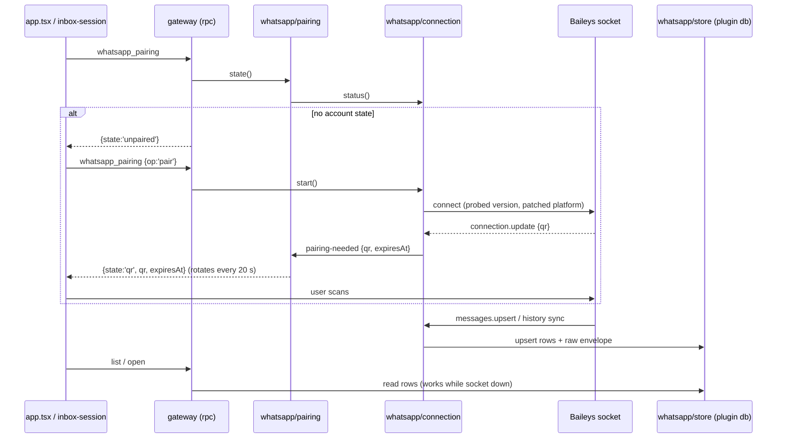

# Carry the WhatsApp transport inside the plugin

**Target repository:** bb-plugin-unified-inbox. All paths are relative to this repository.
**Planning only:** no code changed, no dependency installed, nothing paired, nothing sent. The research behind
every number here is
[`docs/research/2026-11-05-whatsapp-transport-a-stranger-can-install.md`](../research/2026-11-05-whatsapp-transport-a-stranger-can-install.md);
this document does not re-argue it, it divides the work.

## Summary

WhatsApp is not shipped. The source exists only on a machine that already runs our other program, WhatsAgent,
which is why a plugin installed by anyone else has four sources and no fifth. This plan puts the transport in
the plugin's own process — Baileys, the same library WhatsAgent already drives — with the account state in the
plugin's data directory, the shape [decisions/0008](../../decisions/0008-the-plugin-owns-the-gmail-credential.md)
set for the Gmail credential. A stranger's onboarding becomes: open the source, read three sentences about ban
exposure, scan a code, and their WhatsApp is in the inbox.

Two of the three things that make this cheap are already measured. Baileys 7.0.0-rc13 bundles into one 7.9 MB
ESM file with no unresolved imports and imports cleanly in Node 22, and `bb plugin build` ships dependencies as
bundle (`dist/server.js` carries zod and the MCP SDK; `dist/` has no `node_modules`). The third is that 2,318
lines of the transport are ours already, and the split between what lifts and what does not is in the research
note, file by file.

## Problem and requirements

The dependency is not a path to a binary. It is a program that owns the socket, the account state, the message
store and the send queue, and that program is not installable with the plugin. Consequences, measured:

- On a machine with no WhatsAgent the source cannot start at all, so the panel's fifth source is dead weight.
- `src/adapters/whatsagent.ts` (102 lines) discovers that program through
  `~/Library/Application Support/whatsagent-desktop/mcp-runtime.json` and speaks MCP plus four loopback HTTP
  routes; `src/adapters/whatsapp.ts` (311) and `whatsapp-{chat,media,send}.ts` (98) are shaped by that
  coupling. 511 lines that cannot run anywhere else.
- The plugin's cache cannot stand in for a message store: `inbox_thread` holds mapped messages as JSON,
  rewritten wholesale on open, with no raw protobuf envelope — and Baileys requires the client to answer
  `getMessage(key)` for messages it has already seen.

- **R1 — Ship the transport.** With only BB installed, the WhatsApp source pairs, lists, opens, serves media
  and replies. No WhatsAgent, no second process, no CLI, no MCP neighbour.
- **R2 — The plugin owns the account state.** One directory in the plugin data dir, `0700`, written and read
  by one module, never exported over RPC and never logged.
- **R3 — Nothing about send safety moves.** `src/adapters/policy.ts` and `src/mail-approval.ts` are not
  modified; a send still carries the caller's `allow: 'send'` and still writes its audit row before delivery.
- **R4 — Failures stay classifiable and redacted.** `src/adapters/provider-error.ts` keeps turning a failure
  into a scrubbed `ProviderError`; a socket that will not open must not read as an opaque `Error`.
- **R5 — Unpaired is a state, not an error.** An unpaired source produces neither a provider error nor an
  `InboxErrors` line on every poll. The panel can tell *unpaired* from *connecting* from *logged out*.
- **R6 — One socket per data directory.** A `bb plugin reload`, a second BB against the same plugin directory,
  or a crashed service must never leave two live sockets on one device identity.
- **R7 — Prove it on a machine with no WhatsAgent.** The live proof runs with WhatsAgent stopped and its
  runtime file unreachable, before anything else is built on top. This is unit U1, not the last step.
- **R8 — The user is told about ban exposure before they scan.** Three sentences, in the pairing card, in the
  same terms the research note defends — and no automatic or bulk sending, ever.

### Scope and assumptions

Assumptions, each verified in this checkout or in the research note:

- `bb.storage.database()` is a `better-sqlite3` database in the plugin's data directory — the same class
  WhatsAgent opens — so a lifted store runs against it with its own DDL.
- `bb.background.service(name, {start(signal)})` is the host-owned lifetime for a socket, exactly as
  `refresh-${account}` uses it today.
- Baileys bundles: measured at 7.9 MB, no unresolved imports, `makeWASocket` and `proto` present after import.
- `requestPairingCode(phoneNumber)` exists in rc13 and needs no QR rendering, which is what makes U1 provable
  before any panel work.

Non-goals: audio and document playback, archived chats, avatars from the protocol, older-than-page history
beyond what the store happens to hold, a send queue, multi-account WhatsApp, and any change to Gmail, Messages
or LinkedIn.

## Key technical decisions

**D1 — In-process Baileys, not a bundled child binary.** The child-binary shape has no precedent here: the
Messages source does not bundle `imsg`, it asks the user to install it (`README.md` line 26). Making WhatsApp
work that way would mean publishing per-platform artifacts from a plugin that ships two JavaScript files, and
re-creating the process boundary this plan exists to remove. Cost accepted: ~8 MB of bundle, the protocol's
churn in the plugin's log, and a build-time patch step.

**D2 — The account state is the plugin's, in a 0700 directory, with a 0600 key beside it.** `bb.dataDir`
already hosts `data.db` and `gmail-credentials`; the WhatsApp state joins them. The AES-256-GCM blob code lifts
from WhatsAgent's `auth-store.ts` unchanged; the key does **not** come from a keychain, because BB is not
macOS-only and a keychain grant is a human step the panel cannot own. Stated honestly: a key beside its
ciphertext is not a secret store — the `0700` directory is the protection, and the docs say so.

**D3 — One socket, enforced in-process.** An exclusive lock file in the state directory, held for the life of
the socket, with a stale-lock rule and a dispose hook. Today this invariant is held by an external fact (one
WhatsAgent process per machine); in the plugin it is a module's job, because a second socket presenting one
identity gets `connectionReplaced` (440), flaps the session, burns a device slot, and re-pairing is the ban
lever.

**D4 — Pairing is drawn in the panel: QR first, pairing code as fallback.** The QR payload is Baileys' `qr`
string; it is not an image, so the panel renders it. Baileys keeps the first QR 60 s and rotates later ones
every 20 s, and a stale QR is a dead QR — so rotation is state the pairing module owns, not a re-render the
panel attempts. `requestPairingCode` is both U1's proof path and the fallback. A second device is allowed and
explained ("this counts as a linked device, like WhatsApp Web"); `loggedOut` is terminal and offers a fresh
pair.

**D5 — Reads come from a store the transport writes, not from a neighbour.** WhatsAgent's message, chat and
contact tables move into the plugin database with their upserts and the raw-envelope loader, so `getMessage`
answers, replays are idempotent, and a read works while the socket is down. `inbox_cache`/`inbox_thread` stay
what they are — the panel's projection — and `clear_cache` clears both, because the privacy promise in the
README covers the copies.

**D6 — Sends are synchronous and honestly reported; no outbox in v1.** `sendMessage` resolving means WhatsApp
accepted it; a throw is classified by the lifted `failure.ts` (`offline` / `transient` / `terminal`, with the
deliberate rule that an unknown error means *retry is safe*, so the panel says the outcome is unknown rather
than pretending it failed). The old silent-loss failure was a property of the queue-shaped coupling; in-process
it becomes a visible failure at the click. The pacer's 452 lines are deferred, not lost.

**D7 — The pin and its patch are a build step.** `_tools/patch-baileys.mjs` rewrites `Utils/validate-connection.js`
so a Desktop/Mac-OS browser tuple reports `MACOS` and `syncFullHistory` is honoured; it must run before
bundling, and `--check` must fail the build when the surrounding text moved. A `postinstall` cannot be relied
on in a plugin package.

*Directional guidance for review, not implementation specification.*

## Implementation units

### U1. The socket, in the plugin, with no WhatsAgent on the machine

**Goal:** prove the thing works at all — one process, the plugin's own account state, a pairing code, and a
received message — with WhatsAgent stopped.
**Requirements:** R1, R2, R6, R7.
**Dependencies:** none.
**Files:** `src/whatsapp/connection.ts` (lifted from WhatsAgent), `src/whatsapp/auth.ts`, `src/whatsapp/version.ts`,
`src/whatsapp/send.ts`, `src/whatsapp/failure.ts`, `src/whatsapp/message-edit.ts`, `src/whatsapp/lock.ts`,
`_tools/patch-baileys.mjs` (new build step), `package.json` (`baileys` dependency, build script order),
`server.ts` (one CLI command), `tests/whatsapp/*.test.ts`.
**Approach:** lift `connection.ts` with its injectable collaborators intact — `socketFactory`, `createAuthStore`,
`resolveWaVersion`, `reconnectDelayMs`, `maxReconnectDelayMs`, `onError` — and drop the `AppDatabase` parameter
in favour of the option that is actually used. `src/whatsapp/auth.ts` carries the AES-GCM blobs and the key
file; `0700` directory, `0600` files, atomic replace, and a truncated blob is refused rather than parsed.
`version.ts` keeps the 10 s probe and the fallback constant together, because they are one decision. `lock.ts`
is an `O_EXCL` lock file with the pid and a stale rule. The CLI command `bb unified-inbox whatsapp-link
<phone-number>` starts the connection, prints the pairing code, and logs each received event as its type and
chat JID — never the text — because that is enough to prove ingest and leaks nothing.
**Patterns to follow:** `src/imsg-client.ts` (a client that owns its own reconnect state and disposes),
`src/linkedin-chrome.ts` (a long-lived connection with an idle stop and a dispose hook),
`src/gmail-oauth.ts` (one module owning one credential's lifecycle).
**Test scenarios:**
- With a fake `socketFactory`, the reconnect delay doubles from 5 s to a 60 s ceiling and a `loggedOut` close stops the ladder.
- A version probe that times out resolves the fallback constant, and the resolved version is what reaches the socket.
- The auth store round-trips creds and one key type, writes a 0700 directory with 0600 files, and refuses a truncated blob.
- A second `acquire()` on the same state directory is refused while the lock is held, and succeeds after the holder disposes.
- `failure.ts` classifies 408/411/428/429/440 as transient, an unknown error as transient, and a rejected payload as terminal.
**Verification:** with WhatsAgent's backend stopped and its `mcp-runtime.json` not reachable, `bb unified-inbox
whatsapp-link <number>` prints a pairing code, the phone accepts it, a message sent to that number from another
phone is logged within a second, and restarting BB reconnects without a new code. **If this does not work, the
rest of the plan is speculation and stops here.**

### U2. The store the transport needs

**Goal:** durable messages, chats, contacts and raw envelopes in the plugin database, so `getMessage` can
answer and reads survive a restart.
**Requirements:** R1, R4.
**Dependencies:** U1.
**Files:** `src/whatsapp/store.ts`, `src/whatsapp/ingest.ts` (lifted), `src/whatsapp/history.ts` (lifted),
`src/whatsapp/media.ts` (lifted), `tests/whatsapp/store.test.ts`, `src/inbox-cache.ts` (`clear_cache` scope).
**Approach:** the tables and single-statement upserts lift from WhatsAgent's `server/store/{messages,chats,
contacts,identity}.ts`, renamed with a `wa_` prefix so they cannot collide with `inbox_*`, created with the
same `CREATE TABLE IF NOT EXISTS` idiom `src/inbox-cache.ts` uses (the plugin has no migration runner) plus an
explicit note on how a future column addition is handled. `createStoredMessageLoader` comes across so
`connection.ts` can answer Baileys' retry/decrypt/re-upload asks. `ingest.ts` lifts with its store calls
rewired; `history.ts` stays for older-history fetches. `clear_cache` clears the WhatsApp message and chat rows
and the envelopes, and leaves the account state intact.
**Patterns to follow:** `src/inbox-cache.ts` (one module owns one persisted shape and its DDL),
`tests/inbox-cache.test.ts` (behaviour asserted through the module, not through SQL).
**Test scenarios:**
- The same batch ingested twice leaves the row count unchanged and keeps the stored envelope of the first write.
- A reaction and an edit arriving after the message update the stored row rather than adding one.
- A late LID mapping merges the two chat rows and the messages move with it.
- `getMessage(key)` returns the stored envelope for a message the transport has seen; an unknown key returns nothing rather than throwing.
- `clear_cache` empties WhatsApp rows and envelopes, keeps the account state, and leaves Gmail and Messages rows untouched.
**Verification:** replay a captured envelope fixture twice; row count stable, envelope retrievable; `npm test`
green with no socket and no network.

### U3. Reads move onto the store and the WhatsAgent client goes

**Goal:** `src/adapters/whatsapp.ts` reads from the local store behind a named interface, and the 511 lines of
coupling are deleted.
**Requirements:** R1, R4, R5.
**Dependencies:** U2.
**Files:** `src/adapters/types.ts` (`WhatsAppTransport` beside `GmailClient`), `src/adapters/whatsapp.ts`,
`src/adapters/deps.ts`, `src/adapters/index.ts`, `server.ts`, `src/adapters/whatsagent.ts` (deleted),
`src/whatsapp-chat.ts` / `src/whatsapp-media.ts` / `src/whatsapp-send.ts` (rewritten against it),
`tests/adapters/whatsapp.test.ts`.
**Approach:** one interface with the calls the adapter actually makes — `listChats`, `openChat`, `loadMedia`,
`markRead`, `sendText`, `status` — implemented by the store plus the socket, so the adapter stops knowing
whether an answer came from WhatsApp or from last night's sync. Group preview senders come from the stored
row, not a second request: the 9-of-11 round trips the old note measured disappear with the transport. The
adapter's declaration (`label`, `icon`, `pollIntervalMs`, `pageSize`) and its capabilities stay as they are;
`followsList` can stay true because a local read is cheap.
**Patterns to follow:** the Gmail transport seam (`docs/plans/2026-11-04-001-refactor-own-source-transports-plan.md`
U2/U3), `src/adapters/index.ts` as the only place a transport is chosen.
**Test scenarios:**
- The whole adapter suite passes against a fake `WhatsAppTransport` — no socket, no HTTP, no fixture server.
- `list` returns newest-first with the offset cursor, and a group row's preview is `sender: body` from the stored row.
- `open` returns the newest 60 with `fromMe` and display names, and a thread with no stored rows returns an empty list and no error.
- A media request with no cached bytes reports unavailable; the adapter never throws for a missing image.
- No user-visible string mentions WhatsAgent, MCP or a loopback port.
**Verification:** `npm run check` green; `grep -rn "whatsagent" src server.ts` returns nothing; `dist/server.js`
still builds.

### U4. Pairing in the panel

**Goal:** a stranger pairs from the tab, and an unpaired source is a state rather than a red line.
**Requirements:** R2, R5, R8.
**Dependencies:** U1, U3.
**Files:** `src/rpc-contract.ts` (`whatsapp_pairing`), `src/gateway.ts` (handler), `src/whatsapp/pairing.ts`
(state machine over connection events), `src/inbox-session.ts` (snapshot field and intent), `app.tsx` (card),
`components/ui/qr.tsx`, `package.json` (`qrcode`), `tests/pairing.test.ts`, `tests/jsdom-harness` panel test.
**Approach:** `whatsapp_pairing` answers `{state: 'unpaired' | 'connecting' | 'qr' | 'code' | 'connected' |
'logged-out', qr?, expiresAt?, code?, message?}` and accepts `{op: 'pair' | 'unpair' | 'request-code', phone?}`.
The pairing module is the only writer of that state; it subscribes to the connection's `pairing-needed` event
and rotates on each emission. `qr.tsx` turns the payload into a rendered code with the same library WhatsAgent's
`PairingScreen.svelte` uses for the same job. The card carries the three-sentence exposure note, the state, and
one action per state. The session exposes it as data the panel draws — no `account === 'whatsapp'` branch, and
`freshness.lastError` is left null while unpaired.
**Patterns to follow:** `src/linkedin-page-session.ts` (one module owns a stateful session's life),
`src/rpc-contract.ts` strict-object style, the existing `ui-notice` and `ui-empty` panel idioms.
**Test scenarios:**
- Unpaired, `list` and `cached` produce no `errors` entry and no `InboxErrors` row, and the card renders the pairing action.
- Each `pairing-needed` event replaces the payload and the expiry; a payload older than its expiry is not offered.
- `logged-out` renders a re-pair action, not a retry.
- `pair` while already connected asks before replacing, and a refusal leaves the session untouched.
- The exposure sentence is in the DOM before any QR is rendered.
**Verification:** jsdom tests green; `npm run check` green. The live pairing run is the owner's, on a real
account, and is not part of this unit's automated proof.

### U5. Sends that report the truth

**Goal:** a reply goes out over the socket, and what the panel says about it is true.
**Requirements:** R1, R3, R4.
**Dependencies:** U3.
**Files:** `src/whatsapp-send.ts` (rewritten: the loopback POST is gone), `src/adapters/whatsapp.ts` (send),
`src/whatsapp/failure.ts` (U1's lift, wired here), `tests/whatsapp-send.test.ts`.
**Approach:** build the draft, pass the gate, send, and map the outcome: resolved means accepted by WhatsApp;
`offline` means nothing left the machine; `transient` means the outcome is unknown and the text says so in the
same words Gmail's send uses; `terminal` means refused, with the reason classified. No queue, no automatic
retry, one attempt per click. The audit row is already written before dispatch by `policy.ts` — untouched.
**Test scenarios:**
- No socket: refused with the offline reason, and the gate's audit row exists.
- A 428 thrown mid-send produces the unknown-outcome text and sends exactly once.
- A terminal rejection produces a refusal naming the class, not the provider's raw text.
- Text beyond the encoded-message ceiling is refused before dispatch (`decisions/0002`).
- A successful send returns the accepted status and the conversation id.
**Verification:** fake-transport tests green; one live send only on the owner's explicit go.

### U6. Media from the store

**Goal:** pictures and stickers render from what the transport already stored, and a permanent failure stays
permanent.
**Requirements:** R1, R4.
**Dependencies:** U2, U3.
**Files:** `src/whatsapp/media.ts` (U2's lift, wired here), `src/whatsapp-media.ts`, `src/media-cache.ts`,
`tests/whatsapp-media.test.ts`.
**Approach:** the adapter asks the store first; a miss asks the socket once and stores the bytes. The expiry
classes carry across unchanged — 404/410 permanent ("no longer available"), 412/418 attempt one re-upload,
5xx temporary — because that classification is the whole lesson of
[`docs/bugs/2026-11-04-media-download-failure-is-not-temporary.md`](../bugs/2026-11-04-media-download-failure-is-not-temporary.md).
Video stays a play tile.
**Test scenarios:**
- A stored image serves twice from the cache with no second fetch.
- 404/410 report permanent unavailability and are not retried on the next open.
- 412/418 trigger exactly one re-upload request; a second failure is permanent for that message.
- A 5xx reports temporary and allows a later retry.
**Verification:** fixture-driven tests green; one live image opened by the owner after U4.

### U7. Lifecycle, the end of the coupling, and the documents

**Goal:** the shipped plugin holds one socket, stops it when idle, survives a reload, and describes itself
correctly; nothing in the repository still expects WhatsAgent.
**Requirements:** R1, R6, R8.
**Dependencies:** U1–U6.
**Files:** `server.ts`, `PLUGIN_OVERVIEW.md`, `README.md`, `src/CONTEXT.md`, `docs/_index.md` (regenerated),
`docs/research/2026-11-05-baileys-whatsapp-transport.md` (already marked superseded by the research note).
**Approach:** the socket is a `bb.background.service('whatsapp-connection', …)` that starts lazily on first use
and stops after an idle window, the way `src/linkedin-chrome.ts` handles its browser; `bb.onDispose` releases
the lock. `PLUGIN_OVERVIEW.md` and `README.md` stop saying WhatsApp comes from another program and start
saying what the plugin stores, where, and what the user is agreeing to when they scan. `src/CONTEXT.md` gains
the invariant row: `src/whatsapp/pairing.ts` owns pairing state, `src/whatsapp/auth.ts` owns the account state,
`src/whatsapp/lock.ts` owns "one socket".
**Test scenarios:**
- A reload disposes the connection, releases the lock, and the next start reconnects from stored state.
- The idle stop closes the socket and a later read reopens it without a re-pair.
- No document claims WhatsAgent is required for WhatsApp.
**Verification:** `npm run check` green, `node --experimental-strip-types _tools/docs-index.ts` leaves the index
unchanged, `grep -rn "whatsagent" .` finds only history in `docs/`.

## Risks

- **The bundler, not esbuild.** The probe used esbuild; BB's own bundler has to carry 7.9 MB, `pino` and an
  inlined WASM module. Mitigation: U1 builds the real bundle as its first act and fails loudly.
- **The pin rots.** WhatsApp rejects a stale client version before it emits a QR. Mitigation: the probe and the
  fallback constant ship together, `_tools/patch-baileys.mjs --check` fails the build when the patch stops
  applying, and the pairing card shows what the socket said rather than a bare spinner.
- **Two sockets.** A reload race or a second BB flaps the session and burns a device slot. Mitigation: U1's
  lock, U7's dispose, and a test that refuses the second acquire.
- **The account state is a new secret at rest.** Mitigation: `0700` directory, `0600` files, never over RPC,
  never logged, and the README states the real protection rather than implying encryption is one.
- **A stranger's first impression is an error line.** Mitigation: R5 and U4 — an unpaired source produces no
  `errors` entry, and `freshness.lastError` stays null until pairing has succeeded once.
- **Ban exposure.** Not removable in code. Mitigation: one socket, durable state, deliberate re-pair, no
  automatic sends, and the exposure note drawn before the QR.

## Scope boundaries

- **Non-goals:** audio and document playback, archived chats, contact avatars from the protocol, a send queue
  or outbox, multi-account WhatsApp, history older than what the store holds, and any change to the other four
  sources.
- **Deferred to follow-up work:** WhatsAgent's `pacer.ts` (452 lines) if the owner later wants queued sends; an
  ADR recording that the plugin owns the WhatsApp account state and the socket lives in-process, the way
  `decisions/0008` records the Gmail credential; message receipts (delivered/read), which neither program
  subscribes to today; a migration path for anyone who wants their existing WhatsAgent session moved into the
  plugin rather than pairing again.
- **Unchanged by this plan:** `src/adapters/policy.ts`, `src/mail-approval.ts`, `src/adapters/provider-error.ts`,
  `src/gateway.ts`'s paging and deadline rules, and the panel's bubble geometry.
