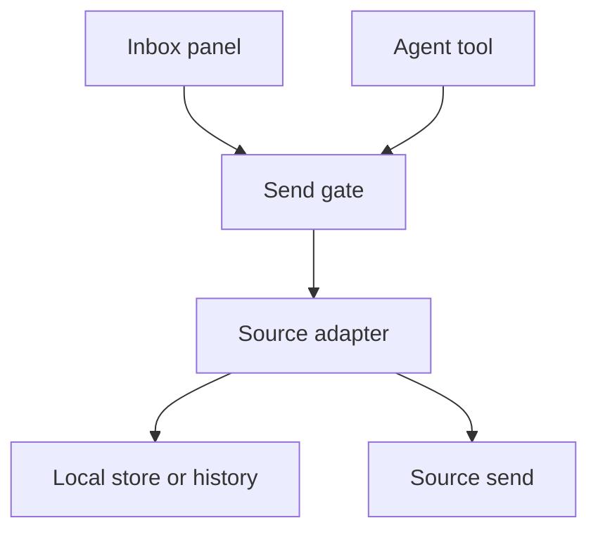
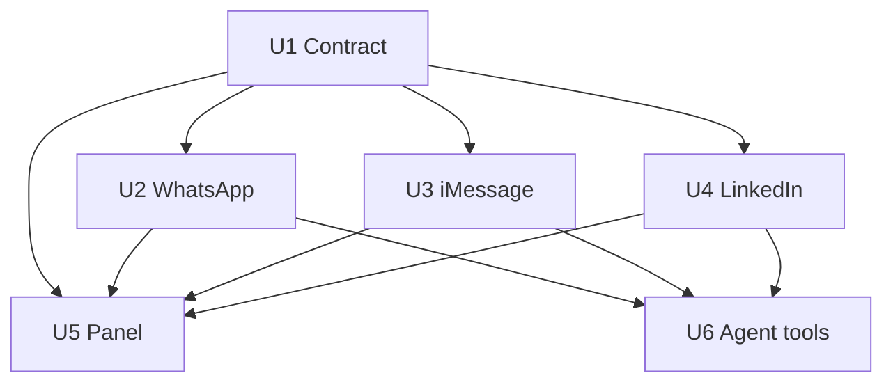
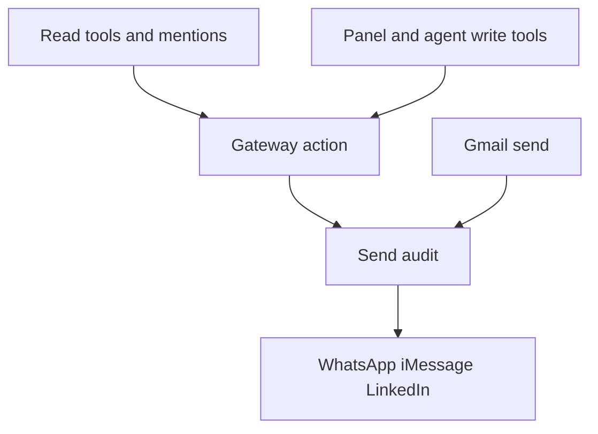

# React and reply to one message

## Summary

The inbox and an agent can put one of four shared reactions on a single message in iMessage, WhatsApp, and LinkedIn, and can reply to that one message where the source can target it. Reactions and quote text that arrive show on the open message. A source that cannot target a message refuses, and the product does not send an ordinary conversation reply or an untargeted reaction in its place.

---

## Problem Frame

Chat replies today go to the open conversation. The owner cannot react to one message, and cannot attach a reply to one message, on iMessage, WhatsApp, or LinkedIn. WhatsApp already stores reactions and quote text, and its socket can send both, but the panel never sees them. iMessage already shows reaction labels and a one-line reply marker, and cannot target a send. LinkedIn can send a conversation reply and does not carry a message id or a reaction on the shared message. Agents can read a thread and cannot react or reply.

---

## Requirements

- R1. On an open thread, each message shows the reactions the source already returned, with a sender label when the source has one.
- R2. On an open thread, a reply that quotes another message shows that quote's sender and text when the source has them. When iMessage only has a target id, the existing one-line marker stays.
- R3. Where a source declares reactions, the owner can set one of the four shared reactions on one message that has a stable id.
- R4. Tapping the reaction the owner already left removes it when that source can remove one. When it cannot, the tap is refused and the existing reaction stays.
- R5. Where a source declares reply-to-one-message, the owner can send a text reply that targets that message.
- R6. When the owner or an agent asked for a targeted reaction or reply and the source cannot target that message, nothing is sent.
- R7. An agent can react and can reply to one message through tools that use the same send gate the panel uses for that source. A mention stays draft-first and does not gain a send recipe.
- R8. Gmail send, edit, delete, forward, and conversation-level reply stay as they are.
- R9. A request the gate refuses never reaches the source. An emoji outside the four, or a reaction or targeted reply with no message id, is refused before an allowed audit row is written.
- R10. An unknown send outcome is not retried. A second tapback attempt can remove the reaction, so an uncertain iMessage result stays uncertain.

---

## Scope Boundaries

- Gmail is unchanged, including reply, reply-all, and forward.
- Edit, delete, unsend, forward, pin, and chat creation stay out.
- The reaction control is the same four on every source that declares reactions: heart, like, dislike, and laugh. Emphasis and question stay off the control. There is no free emoji picker and no per-source picker. A reaction that arrives as emphasis or question still shows on the message.
- List rows do not gain a reaction badge. Search excerpts do not gain quote text.
- Mentions do not tell the agent to call the new tools. The tools exist for an explicit request.
- LinkedIn page clicks (`linkedin_ui`) and recorded replays (`linkedin_replay`) are not the reaction path.
- The `imsg react` command is not used. It applies a tapback to the last or selected message.

### Deferred to Follow-Up Work

- A LinkedIn reaction stays off until a captured request is in the repo. That capture is part of U4, not a later project, but the rest of the plan ships if the capture is not yet in hand.
- A LinkedIn reply to one message stays off unless a capture shows a target-message field. No later unit invents one.
- Removing a LinkedIn reaction stays off unless that same capture, or a second one, shows the removal request.

---

## Context & Research

### Relevant Code and Patterns

- `src/adapters/capability.ts` names every capability once. The panel learns behavior from `src/ui-capabilities.ts`, not from an account name in `app.tsx` or `src/gateway.ts`.
- A chat reply is `action` `reply` with `allow: 'send'`. `src/gateway.ts` runs that through `src/adapters/policy.ts` before the adapter. The allowed audit row is written before delivery. `ActionOptions` is text only, and the `action` schema is strict (`src/rpc-contract.ts`).
- `reply` is not a capability flag. `react` and reply-to-one-message need flags, because the panel has to know whether to draw the control. Gmail declares both false.
- WhatsApp already has the storage and the socket. `wa_message_reactions` keeps one emoji per actor per target; a falsey emoji deletes the row (`src/whatsapp/store.ts`). Quote columns are filled in `src/whatsapp/ingest.ts`. `src/whatsapp/send.ts` can send `{ quoted }` and `{ react }`. `src/whatsapp/transport.ts` drops both on the way to `Message`, and `sendText` does not pass a quote. A read must not open a socket (`src/CONTEXT.md`, `docs/solutions/logic-errors/avatar-fetched-on-the-read-path-2026-11-05.md`).
- iMessage maps `reactions` onto `Message.reactions` and sets `replyContext` from a target guid (`src/imsg-mapping.ts`). The bubble shows the labels and the sentence "Reply to an earlier message" (`app.tsx`). `src/imsg-client.ts` permits only `send`. `src/imsg-send.ts` sends `{ chat_id, text }`.
- LinkedIn reply is `createMessage` with a conversation urn and no message target (`src/linkedin-write.ts`, `docs/research/linkedin/writes.md`). The read model can see a message id and the adapter does not copy it onto `Message`. A new LinkedIn write is built from a captured request and checked against those bytes (`docs/solutions/logic-errors/recorded-writes-read-back-empty-2026-11-02.md`).
- Agents have five read tools (`src/inbox-agent-tools.ts`). `inbox_read` already spreads `reactions` and `replyContext` when the adapter set them. Mentions say to draft a reply and that the mention does not authorize sending (`src/inbox-mention.ts`).
- `decisions/0005` keeps the panel and agents on one RPC. `allow: 'send'` mints an approval; it is not a separate human authority. `decisions/0004` records a LinkedIn page click or replay with no approval id. A panel `action` reply uses the approving gate, then the adapter builds the request. This plan uses that panel path for a LinkedIn reaction, not `observe`.
- `decisions/0009` and `decisions/0010`: one WhatsApp socket, and no second product to gain reactions.

### Institutional Learnings

- An empty LinkedIn write list is not proof the product has no reaction. It means the page expression and the adapter disagreed, or the request was never captured.
- A WhatsApp sender name from history can stay "Unknown". A reaction actor is the same kind of identity. Show the emoji anyway.
- Do not open a WhatsApp socket to decorate a read.
- A new strict RPC field is a schema change. Unknown fields stay refused (`decisions/0007`).

### External References

- iMessage GUID targeting is the RPC `tapback` method, and a threaded reply is `send` with a reply target. Both fail closed when the IMCore bridge is absent, rather than falling back to an untargeted send. The six classic tapbacks are heart, like, dislike, laugh, emphasis, and question, sent as ❤️ 👍 👎 😂 ‼️ ❓. Documented in `docs/research/imessage/sources/imsg-rpc.md` and the current `imsg` RPC reference. The CLI `react` command is a different path and targets the last or selected message (`docs/research/imessage/sources/imsg-send.md`).
- This machine's earlier research found the bridge disabled (`docs/research/imessage/imessage-integration-research.md`). The installed binary was not probed during planning. Exact-target iMessage actions depend on that helper.
- LinkedIn's public partner Messages API is thread-level and is not the path this plugin uses. A 2023 Voyager capture shows `action=reactWithEmoji` with a message urn and an emoji. This repo has no capture of that request, and `docs/research/linkedin/writes.md` records `createMessage` without a target message. The plan does not treat the 2023 body as a builder.

---

## Key Technical Decisions

- **One shared list of four.** The list is ❤️ 👍 👎 😂. iMessage can also send emphasis (‼️) and question (❓). The owner omitted those two. WhatsApp can send each of the four as an emoji. iMessage sends the matching classic tapback. LinkedIn sends the same emoji only after a capture proves that call. An emoji outside the four, including ‼️ and ❓, is refused. Rationale: the owner asked for one short list, then cut the two iMessage tapbacks they do not want on the control.
- **Capabilities, not account branches.** Add `react`, `reactRemove`, and `quoteReply` to `CAPABILITY_KEYS`. All five adapters declare them. The panel and the agent tools read those flags. Gateway and panel do not grow `account ===` checks for this feature. `reactRemove` is false until the same change that implements removal. The gateway refuses `remove: true` before the gate when that flag is false, so a known-impossible removal does not write an allowed row.
- **Same gate, validated before the row.** A reaction and a targeted reply use the approving `action` gate, with `allow: 'send'`, one spend, row before delivery. The gateway rejects a missing message id, an emoji outside the four, a targeted reply when `quoteReply` is false, and `remove: true` when `reactRemove` is false, all before `gate()`, so those requests do not write an allowed row. A transport failure after the gate stays an allowed attempt whose outcome may be unknown, which matches a conversation reply today.
- **No untargeted fallback.** If the stored WhatsApp envelope for the target is missing, the quote reply is refused. If `imsg` reports that the bridge is required, the tapback or threaded send is refused. If LinkedIn has no captured reaction, `react` stays false. The conversation composer, with no target selected, still sends today's conversation reply.
- **Agents get tools; mentions do not.** `inbox_react` and `inbox_reply` call the same `action` the panel calls. `inbox_reply` always sends a message id and refuses when `quoteReply` is false. It does not become a conversation reply. Mention text is unchanged. This is a narrower change than putting a send recipe back into the mention, which `decisions/0005` removed. After the tools land, `decisions/0005` gets a current-state note that these two tools send under the existing gate. The decision text stays frozen.
- **LinkedIn reaction is capture-first.** U4 may add the message id on the read model while `react` and `quoteReply` stay false. The builder is enabled only when a fixture in the repo matches a real captured request byte for byte, the same rule as `createMessage`. A guessed `reactWithEmoji` body does not ship.
- **Show stored data without a socket.** WhatsApp reactions and quotes are read from `wa_*` inside the existing open-chat read. iMessage keeps using `messages.history`. No list-path fetch is added.
- **Removal is a targeted request, not a retry.** The action carries the emoji and `remove`. The panel sets `remove` when the bubble shows that reaction on the owner's own message. WhatsApp sends an empty emoji. iMessage sends `tapback` with remove. LinkedIn refuses `remove` until a capture shows how. A failed or unknown attempt is not sent again.

---

## Open Questions

### Resolved During Planning

- **Who can act:** the owner in the inbox, and an agent through new tools on the same gate. Confirmed in this planning session.
- **Incoming display:** reactions and quote text that arrive are shown. Confirmed in this planning session.
- **Which reactions:** one shared list, not each source's native picker. Confirmed in this planning session. On review, the owner kept heart, like, dislike, and laugh, and omitted emphasis and question.
- **Gmail, edit, delete, forward:** out. The request named three chat sources.

### Deferred to Implementation

- **Whether this machine's `imsg` has the bridge.** Planning did not run the binary. U3 treats a bridge-required error as a refusal. The wording of that error is whatever the installed binary returns; the test uses a fake client with a stable refusal string the adapter maps.
- **Which iMessage history field carries the quoted body.** The mapper today keeps only a boolean. U3 reads the history fixture already in `tests/imsg-mapping.test.ts` and, if the quoted body is absent there, shows the existing marker. It does not invent a field.
- **How the owner's own reaction is labeled.** The panel sends `remove` only when the reaction sender matches the label that source already uses for `fromMe`. If a fixture has no self label, the panel sends a new emoji and does not guess removal.
- **The LinkedIn reaction request, its removal, and whether a message can be a reply target.** Unknown until a capture exists. U4 does not enable those actions without one.
- **Whether every one of the four is accepted by LinkedIn.** The shared buttons still show once `react` is true. An emoji the captured API rejects is refused with the source error and is not replaced with a different emoji.

---

## High-Level Technical Design

> *This illustrates the intended approach and is directional guidance for review, not implementation specification. The implementing agent should treat it as context, not code to reproduce.*

A reaction or a targeted reply enters one `action`. The gate runs only after the request names a message and, for a reaction, one of the four. The adapter then either reads stored rows or performs one send. A refusal returns before the wire, and the caller keeps the draft.

| Source | Show reactions | Show quote | Set reaction | Reply to one message |
|---|---|---|---|---|
| WhatsApp | From `wa_message_reactions` | From the stored quote columns | Socket react, empty emoji removes | Socket send with the stored quoted message |
| iMessage | Already mapped | Marker today; quote text only if history already carries it | RPC `tapback` to the guid; refuse without the bridge | RPC `send` with the reply target; refuse without the bridge |
| LinkedIn | Only after the read payload actually contains them | Only if a capture shows a quote | Only after a captured fixture | Off unless a capture has a target message |
| Gmail | Unchanged | Unchanged | Refused | Refused; conversation mail reply stays |

---

## Implementation Units

U2, U3, and U4 can land in any order after U1. U5 and U6 wait until the sources they exercise have their flags set. The panel can land against U1 alone for the hidden-control cases, and is verified again when a source turns a flag on.

### U1. Contract for a targeted reaction and reply

**Goal:** The RPC, the message shape, and the capability flags can name a message, a quote, and one of the four reactions. No source sends a new kind of write yet.

**Requirements:** R3, R5, R6, R8, R9

**Dependencies:** None

**Files:**
- Create: `src/reaction-set.ts`
- Modify: `src/adapters/types.ts`, `src/adapters/capability.ts`, `src/ui-capabilities.ts`, `src/rpc-contract.ts`, `src/gateway.ts`, `src/adapters/gmail.ts`, `src/adapters/whatsapp.ts`, `src/adapters/imessage.ts`, `src/adapters/linkedin.ts`
- Test: `tests/rpc-contract.test.ts`, `tests/capability-keys.test.ts`, `tests/gateway.test.ts`

**Approach:**
- `src/reaction-set.ts` owns the four labels and the emoji characters. Adapters and the panel import that list. They do not keep a second copy.
- Add optional quote fields on the shared message for a target id, a sender, and a text. Leave `replyTo` as the Gmail header. Leave `replyContext` in place.
- Add `react` to the action enum. A reaction requires `messageId` and `emoji`. `remove` is optional. A reply may carry `messageId`; without it, the reply stays a conversation reply.
- All five adapters declare `react: false`, `reactRemove: false`, and `quoteReply: false` in this unit. Later units flip a flag only in the same change that implements that behavior.
- `src/gateway.ts` checks the new fields before the gate. Gmail `react`, a targeted reply when `quoteReply` is false, a missing message id, an emoji outside the four, and `remove: true` when `reactRemove` is false return a refusal and do not call the adapter. Conversation reply with no message id is unchanged.
- `src/ui-capabilities.ts` exposes the three new flags the way it exposes `canSend`.

**Patterns to follow:**
- `CAPABILITY_KEYS` and `tests/capability-keys.test.ts`
- The strict `action` schema and `tests/rpc-contract.test.ts`
- `canChange` stays limited to read, unread, and archive. The new flags are not folded into that map.

**Test scenarios:**
- Happy path: an action body with `react`, a message id, one of the four, and `allow: 'send'` passes the schema. A reply body with a message id passes the schema.
- Edge case: `remove: true` with a listed emoji passes the schema. A reply with no message id still passes, matching today's conversation reply.
- Error path: an emoji outside the four, an empty message id on `react`, and an unknown action field are rejected by the schema or by the gateway before the adapter runs. A Gmail `react` does not call the Gmail adapter. A targeted reply when `quoteReply` is false, and `remove: true` when `reactRemove` is false, do not call the adapter and do not write an allowed audit row.
- Integration: a gateway `react` for WhatsApp while the flag is still false returns the refusal and the fake deliver function is not called.

**Verification:**
- The suite's contract tests accept the new fields and reject an emoji outside the four.
- Every adapter still declares every capability key, including the three new ones, all false.
- A conversation reply with no message id still reaches the adapter after the gate, as it does today.

### U2. WhatsApp shows and sends a targeted reaction and reply

**Goal:** Opening a WhatsApp chat returns stored reactions and quote text, and a gated action can set, replace, or remove a reaction and can quote one stored message.

**Requirements:** R1, R2, R3, R4, R5, R6, R9, R10

**Dependencies:** U1

**Files:**
- Modify: `src/whatsapp/transport.ts`, `src/adapters/whatsapp.ts`, `src/adapters/types.ts` (`WhatsAppMessageRow` only if the transport row must grow), `src/whatsapp/send.ts` only if the existing methods cannot express replace and remove
- Test: `tests/whatsapp/transport.test.ts`, `tests/adapters/whatsapp.test.ts`, `tests/whatsapp/send.test.ts`

**Approach:**
- The open-chat read copies `listMessageReactions` and the quote columns onto the message. It does not call `ensure()` or the socket. A reaction row with an empty sender still produces a reaction whose label is the emoji.
- The text message's id on `Message` is the stored message id, including messages with no media. Today's media id behavior stays.
- `react: true`, `reactRemove: true`, and `quoteReply: true` flip in this unit.
- A reaction loads nothing from the network beyond the send itself. The adapter calls `sendReaction` with the target key. `remove` sends an empty emoji. A second emoji for the same actor replaces the stored one because the store already keeps one row per actor.
- A quote reply loads the stored envelope for that message id and passes it as the quoted message. If the row or the envelope is missing, the adapter refuses and does not call `sendText`.
- Failure classes stay in `src/whatsapp/failure.ts`. One attempt. No retry. The panel wording stays the adapter's existing wording.
- The read path and the send path stay on the one socket lifecycle. No new socket and no new table.

**Patterns to follow:**
- `tests/whatsapp/send.test.ts` for quoted send and `sendReaction`
- `tests/whatsapp/store.test.ts` for "a reaction is not a message row"
- `src/whatsapp/failure.ts` for offline, terminal, and unknown

**Test scenarios:**
- Happy path: a stored reaction and a stored quote appear on the transport message with no socket. A gated `react` with 👍 calls `sendReaction` once with that emoji and the target id. A gated reply with a message id calls `sendText` with the stored quoted message and the new text.
- Edge case: a falsey stored emoji does not appear. Two actors on one message produce two reactions. A reaction from history with no name uses an empty sender and still shows the emoji. `remove` calls `sendReaction` with an empty emoji.
- Error path: a missing envelope refuses the quote reply and `sendText` is not called. A disconnected socket returns the existing offline result and is not retried. An emoji outside the four, including ‼️, never reaches `sendReaction` (covered with U1, repeated here at the adapter if the gateway is not in this test).
- Integration: after a successful `react`, the next open-chat read shows the reaction only once the ingest path has stored it. The send itself does not invent a row ahead of the socket echo. If the test double can return the echo, the following read includes it; if it cannot, the test asserts the send did not write a reaction row by itself.

**Verification:**
- Opening a chat with fixture rows shows reactions and quote text while the socket factory is never asked.
- A quote reply without a stored target does not send.
- The WhatsApp declaration has `react`, `reactRemove`, and `quoteReply` true. The test asserts that declaration. It does not assert that every other adapter is still false, because U3 can land beside this unit.

### U3. iMessage targets a tapback and a reply, or refuses

**Goal:** A message can receive one of the four tapbacks, or a reply to its guid, through the permitted RPC methods. If the helper cannot target, the action is refused and no untargeted message is sent.

**Requirements:** R1, R2, R3, R4, R5, R6, R10

**Dependencies:** U1

**Files:**
- Modify: `src/imsg-client.ts`, `src/imsg-send.ts`, `src/imsg-mapping.ts`, `src/adapters/imessage.ts`
- Test: `tests/imsg-client.test.ts`, `tests/imsg-send.test.ts`, `tests/imsg-mapping.test.ts`, `tests/adapters/imessage.test.ts`

**Approach:**
- Permit `tapback` in addition to `send`. Do not permit `react`, `send.rich`, or any other mutation.
- Map the four emoji to the classic tapback kinds the RPC already accepts. Emphasis and question are not in the map. `remove` sets the removal flag on `tapback` and still names the same kind. The target is the message guid already stored as `messageId`.
- A targeted reply calls `send` with the existing chat id, the text, and the reply target. It does not call a second method.
- When the fake or live client returns a bridge-required failure, the adapter returns a refusal. It does not call `send` without the target, and it does not invoke the CLI.
- `react: true`, `reactRemove: true`, and `quoteReply: true` flip in this unit because the adapter implements them and fails closed. The control may still fail on a machine with no bridge; that failure is the honest outcome, not a hidden untargeted send.
- Quote text: extend the mapper only for a field the existing history fixture already contains. Otherwise leave `replyContext` as the marker and do not add an empty quote object.
- An uncertain or timed-out tapback is returned as unknown and is not sent again, matching the rule already written in `docs/plans/2026-10-28-003-feat-local-messages-inbox-plan.md`.

**Patterns to follow:**
- `tests/imsg-client.test.ts` for the allowlist (`messages.delete` stays rejected)
- `tests/imsg-mapping.test.ts` for reaction labels and `replyContext`
- `src/imsg-send.ts` for the text ceiling and a single RPC call

**Test scenarios:**
- Happy path: `tapback` is called with the guid and the like kind for 👍. A reply with a message id calls `send` once with that guid as the reply target and the trimmed text. History that already includes a quoted body maps sender and text onto the quote fields and still sets `replyContext`.
- Edge case: ❤️ 👎 and 😂 each map to their classic kind. `remove` for 😂 calls `tapback` once with removal set and does not call `send`. ‼️ does not call `tapback`. A history row that arrives with ‼️ still maps that label for display. A history row with only `reply_to_guid` still sets `replyContext` and omits quote text.
- Error path: a client error that names the bridge does not produce a second call. `react` as an RPC method name is still rejected by the client. A tapback timeout returns the unknown outcome and the adapter does not call `tapback` again.
- Integration: the adapter action with `allow` already checked at the gateway calls the client once. A bridge refusal does not change the chat's last message in the fake history.

**Verification:**
- The client allowlist is `send` and `tapback` only.
- A targeted reply cannot be observed as a plain `{ chat_id, text }` send in the fake client.
- Existing reaction mapping tests still pass.

### U4. LinkedIn keeps the message id, and sends a reaction only from a capture

**Goal:** Every LinkedIn message the inbox shows has the id the read path already parsed. A reaction send exists only when a captured fixture is committed. Reply-to-one-message stays off unless that capture, or another, includes a target message.

**Requirements:** R1, R3, R4, R6, R9

**Dependencies:** U1

**Files:**
- Modify: `src/adapters/linkedin.ts`, `src/linkedin-inbox.ts`, `src/linkedin-write.ts`
- Create: a fixture under `tests/fixtures/` only when a real capture exists
- Test: `tests/adapters/linkedin.test.ts`, `tests/linkedin-write.test.ts`

**Approach:**
- Copy the message id from the read payload onto `Message.messageId`. Do not synthesize an id. A message with no id has no reaction control later, because U1 refuses `react` without a message id.
- Leave `react`, `reactRemove`, and `quoteReply` false when no fixture is present. The unit is still complete: the id is on the message, and those actions refuse before the gate.
- If a capture is added, the builder follows `linkedinSendWrite`: same mailbox rule, a fresh origin token where the capture uses one, and a byte match against the fixture with randomness pinned. The recognized request is a message reaction for that conversation, and the panel path is `action` through the approving gate, then replay. It is not `linkedin_ui` and not `gate.observe`.
- `quoteReply` stays false unless the capture's body contains a target message field. A `createMessage` body that only has conversation urn and text does not count.
- `reactRemove` stays false unless the fixture is a removal, or a second fixture is a removal. `remove: true` is then refused by the gateway before the gate, from that flag, and `replay` is not called.
- A set-reaction fixture flips `react` only. It does not flip `reactRemove`.
- Do not copy a reaction onto the message unless the read payload already has one. No guessed JSON path.

**Execution note:** Do not invent a Voyager body from the 2023 `reactWithEmoji` note. Stop with the flags false if the owner has not captured a request.

**Patterns to follow:**
- `docs/research/linkedin/writes.md` and `tests/linkedin-write.test.ts` for the byte-for-byte builder
- `docs/solutions/logic-errors/recorded-writes-read-back-empty-2026-11-02.md` for an empty write list meaning a shape miss

**Test scenarios:**
- Happy path: a read fixture that includes a message id maps that id onto `Message`. With no reaction fixture, `react` is false and the adapter does not build a request.
- Edge case: a read message with no id stays without `messageId`. A payload that has no reaction field produces a message with no `reactions` array.
- Error path: `quoteReply` is false, so a targeted reply does not build a request. `remove: true` while `reactRemove` is false does not call `replay`. The allowed-row assertion for that refusal is the gateway test in U1, because the flag check sits before the gate. A builder test, if a fixture exists, fails when any field other than the pinned randomness differs from the capture.
- Integration: if a fixture exists, one gated `react` replays one request whose message urn is the id from the read, and a second emoji is not substituted when the fixture only contains the first.

**Verification:**
- LinkedIn messages in the adapter test carry ids when the fixture has them.
- Without a fixture, no new URL or body is introduced in `src/linkedin-write.ts`.
- With a fixture, the builder test matches it the same way the `createMessage` test matches its capture.

### U5. The open thread draws the four reactions and a targeted reply

**Goal:** A bubble shows reactions and quote text, offers the four reactions when `react` is true, and can aim the composer at one message when `quoteReply` is true.

**Requirements:** R1, R2, R3, R4, R5, R6, R8

**Dependencies:** U1. The hidden-control tests use the flags from U1. The send-click tests are verified again as U2, U3, and U4 turn flags on.

**Files:**
- Modify: `app.tsx`, `src/inbox-session.ts`, `src/inbox-appearance.ts` only if the bubble class needs a quote line, `src/composer-mode.ts` only if a targeted reply is a session fact rather than a composer mode
- Test: `tests/inbox-session.test.ts`, `tests/inbox-reactions.render.test.ts` (new, through `tests/jsdom-harness.ts`)

**Approach:**
- Keep today's conversation composer. Selecting Reply on a bubble stores that message id on the session and shows the quote line above the textarea. Clearing it, or sending, drops the target. Submit then sends `reply` with that message id, the text, and `allow: 'send'`. Submit with no target stays today's conversation reply.
- The four buttons come from `src/reaction-set.ts`. They render only when `react` is true and the message has a message id. The control is the same four for WhatsApp, iMessage, and LinkedIn. An arrived ‼️ or ❓ still renders as a label. Gmail has `threads: false` and does not gain the buttons.
- A click sends `react` with that emoji. If the bubble already shows that emoji on the owner's message, the click sends `remove: true`. Identification of the owner uses the same sender label the thread already uses for `fromMe`. When the label is missing, the click sends the emoji without `remove`.
- Quote rendering: when quote text is present, show the sender and the text. When only `replyContext` is set, keep the sentence "Reply to an earlier message".
- Do not add an `account ===` branch. Hide the reply control when `quoteReply` is false. Hide the reaction control when `react` is false.
- A refusal or an unknown outcome leaves the draft in place for a reply, and does not fire a second action. Use the session's existing send-notice path.

**Patterns to follow:**
- `ChatBubble` in `app.tsx` for the current reaction chips and the reply sentence
- `tests/inbox-session.test.ts` for `submit` sending `action: 'reply'` with `allow: 'send'`
- `tests/whatsapp-audio-player.test.ts` for a jsdom render of `ChatBubble`
- Page expressions in tests use `\\s` (`AGENTS.md`)

**Test scenarios:**
- Happy path: a WhatsApp-shaped message with two reactions renders both labels. A message with quote sender and text renders both. Clicking 👍 calls `react` with that emoji, the message id, and `allow: 'send'`. Choosing Reply and submitting "ok" calls `reply` with that message id and "ok".
- Edge case: `react: false` renders the incoming labels and no buttons. `quoteReply: false` renders no Reply control, and submit sends a conversation reply without a message id. A message with no message id renders no buttons. `replyContext` with no quote text still renders the existing sentence. Gmail's mail composer does not render the four buttons.
- Error path: a refused `react` does not issue a second call. A refused targeted reply leaves the typed text in the composer. `remove` is sent only when the rendered reaction sender matches the from-me label in the fixture.
- Integration: after a successful targeted submit, the target clears and the next submit without a new Reply click omits the message id.

**Verification:**
- The render test shows incoming reactions without a send call.
- The session test shows one targeted reply and one later untargeted reply.
- No new account-name branch is added in `app.tsx` for this behavior. Capability flags decide.

### U6. Agent tools react and reply to one message

**Goal:** An agent can set or remove a reaction and can reply to one message. Both go through `action` and the same gate. Mentions stay draft-first.

**Requirements:** R1, R5, R6, R7, R9

**Dependencies:** U1, U2, U3, U4

**Files:**
- Modify: `src/inbox-agent-tools.ts`, `src/inbox-mention.ts` only if a test shows the footer changed, `PLUGIN_OVERVIEW.md`, `decisions/0005-keep-sends-enabled-until-verified-approval.md` (current-state note only)
- Test: `tests/inbox-agent-tools.test.ts`, `tests/inbox-mention.test.ts` if that file covers the footer

**Approach:**
- Register `inbox_react` and `inbox_reply`. Each takes the account, the conversation id, and the message id. `inbox_react` also takes one of the four and an optional remove flag. `inbox_reply` takes the text.
- Both call the gateway `action` with `allow: 'send'`. They do not call `linkedin_ui`, `linkedin_replay`, or `imsg` themselves.
- `inbox_reply` refuses, before the gateway, when that account's `quoteReply` is false, and the error says the source cannot reply to one message. It does not send a conversation reply.
- `inbox_read` needs no new tool behavior once U2 and U3 put reactions and quotes on the message. Assert that those fields survive the spread, and that a LinkedIn message id survives it too.
- The tool instructions at the top of `src/inbox-agent-tools.ts` gain one sentence: these two tools send, and the read tools still do not. Mention footers are not edited. They continue to say the mention does not authorize sending.
- `PLUGIN_OVERVIEW.md` gains the two tools and the bubble behavior in the "What you get" and "For agents" sections. It stays the short current description, not a second copy of this plan.
- Add a current-state note to `decisions/0005` that `inbox_react` and `inbox_reply` send under the existing gate, and that mentions remain draft-first. Do not rewrite the decision.

**Patterns to follow:**
- The existing registrations in `src/inbox-agent-tools.ts`
- `tests/inbox-agent-tools.test.ts`
- `src/inbox-mention.ts` footer lines

**Test scenarios:**
- Happy path: `inbox_react` with 👍 calls `action` `react` with the conversation id, the message id, that emoji, and `allow: 'send'`. `inbox_reply` with text and a message id calls `action` `reply` with those fields and `allow: 'send'`. `inbox_read` returns a message that includes a reaction and a quote when the gateway message has them.
- Edge case: `remove: true` is passed through on `inbox_react`. A message id that the tool received from `inbox_read` is the id sent back, unchanged.
- Error path: `inbox_reply` on an account with `quoteReply: false` throws before `action`. `inbox_react` with an emoji outside the four throws before `action`. A gateway refusal is returned to the caller and is not retried. The mention footer still contains "This mention does not authorize sending." and does not name `inbox_react` or `inbox_reply`.
- Integration: the registered tool list includes the two new names and the five read tools. A test double that records gateway calls sees one call per tool invocation.

**Verification:**
- The agent tool test shows a targeted reply cannot run as a conversation reply.
- The mention snapshot or assertion is unchanged aside from whitespace the existing test already allows.
- `PLUGIN_OVERVIEW.md` names the two tools and still says mentions do not authorize sending.

---

## System-Wide Impact

- **Interaction graph:** The panel session, the two agent tools, and any existing CLI caller of `action` share `src/gateway.ts`. A new field on `action` is visible to every caller. Gmail's `send_gmail` path is not given these fields.
- **Error propagation:** A before-gate refusal is a normal action result or a tool error, and the audit has no allowed row. A after-gate transport failure uses the source's existing classes: WhatsApp offline, terminal, or unknown; iMessage unknown on timeout; LinkedIn the existing replay failure. The session does not retry.
- **State lifecycle risks:** WhatsApp must not write a reaction row only because the send returned. The echo through ingest remains the write, so a failed send cannot leave a reaction the phone does not have. A quote reply that loses the race with cache clear refuses because the envelope is gone. iMessage retry is the dangerous direction, because a second tapback removes the first.
- **API surface parity:** The panel and the agent tools are the two writers. `inbox_read` is the reader. Mentions stay readers. `linkedin_ui` stays out.
- **Integration coverage:** U2's open-then-send test and U6's tool-to-gateway test are the cross-layer checks. A live bridge proof and a live LinkedIn capture are not unit tests. U3 and U4 say so.
- **Unchanged invariants:** Policy still decides whether a send happens. The allowed row still precedes delivery. LinkedIn page clicks stay on `observe` with no approval id. WhatsApp still has one socket. The client still refuses every `imsg` mutation except `send` and `tapback`. Gmail approval envelopes stay strict and gain no reaction field. `replyTo` remains the mail header.

Reads never enter the audit. Gmail stays on its own send path.

---

## Risks & Dependencies

| Risk | Likelihood | Impact | Mitigation |
|---|---|---|---|
| iMessage exact target needs the bridge, and this machine may not have it | High | High | Fail closed. Never use `imsg react`. U3 tests the refusal. The control can still be offered and will say the helper is required. |
| A guessed LinkedIn body sends the wrong request or an empty write | High | High | No fixture, no send. Flags stay false. |
| A targeted reply falls back to a normal message and lands on the wrong context | Med | High | R6. Tests on WhatsApp, iMessage, and the agent tool assert the untargeted method was not called. |
| An uncertain tapback is retried and removes the reaction | Med | High | R10. One attempt. Unknown stays unknown. |
| `allow: 'send'` lets an agent react without a separate human prompt | High | Med | The owner asked for the tools. Mentions stay draft-first. The gate and the audit match a panel reply. `decisions/0005` gets a current-state note. |
| WhatsApp history reactions have no sender name | High | Low | Show the emoji. Do not block on a name lookup, and do not open a socket to find one. |
| A reaction send writes a local row the phone never accepted | Med | Med | The send path does not insert the row. Ingest does, after the echo. |

---

## Documentation / Operational Notes

- `PLUGIN_OVERVIEW.md` is updated in U6. It is the document that must stay current.
- `decisions/0005` gets a current-state note in U6. The decision body is not edited.
- This plan is a new file under `docs/plans/`. The generated `docs/_index.md` has to be regenerated before commit, or the index test fails.
- Live proof of an iMessage tapback and of a LinkedIn capture needs the owner at the machine. Unit tests do not replace that. Do not send from a name match, and do not message Robert Sinke (`AGENTS.md`).
- No new process and no new socket. iMessage still uses the supervised `imsg rpc` child.

---

## Alternative Approaches Considered

- **Per-source pickers.** WhatsApp could offer any emoji, and iMessage could offer its six classic tapbacks. Rejected because the owner asked for one shared short list, then kept four of those six.
- **`imsg react` for tapbacks.** It does not take a guid. A reaction would hit the last or selected message. Rejected.
- **Click LinkedIn's reaction control in the page.** Targeting a bubble in the live DOM is the failure mode `decisions/0004` already narrowed for sends, and a click the driver refuses still leaves an allowed row. A captured request on the panel `action` path matches how reply already works.
- **Put the send recipe back into mentions.** `decisions/0005` removed that. Tools cover an explicit request without teaching every mention to send.

---

## Sources & References

- Related code: `src/whatsapp/send.ts`, `src/whatsapp/store.ts`, `src/imsg-client.ts`, `src/linkedin-write.ts`, `src/rpc-contract.ts`, `src/inbox-agent-tools.ts`
- Prior deferral: `specs/001-unified-inbox-gateway/spec.md` non-goal 4, and `docs/plans/2026-10-28-003-feat-local-messages-inbox-plan.md` (exact-target reactions stayed out until a guid target was proven)
- Decisions: `decisions/0004-linkedin-writes-are-recorded-not-approved.md`, `decisions/0005-keep-sends-enabled-until-verified-approval.md`, `decisions/0009-the-plugin-owns-the-whatsapp-account.md`, `decisions/0010-a-source-transport-is-the-plugins-own.md`
- Learnings: `docs/solutions/logic-errors/recorded-writes-read-back-empty-2026-11-02.md`, `docs/solutions/logic-errors/avatar-fetched-on-the-read-path-2026-11-05.md`, `docs/solutions/2026-11-05-a-name-only-arrives-with-live-traffic.md`
- External: `docs/research/imessage/sources/imsg-rpc.md`, `docs/research/imessage/sources/imsg-send.md`, `docs/research/linkedin/writes.md`
