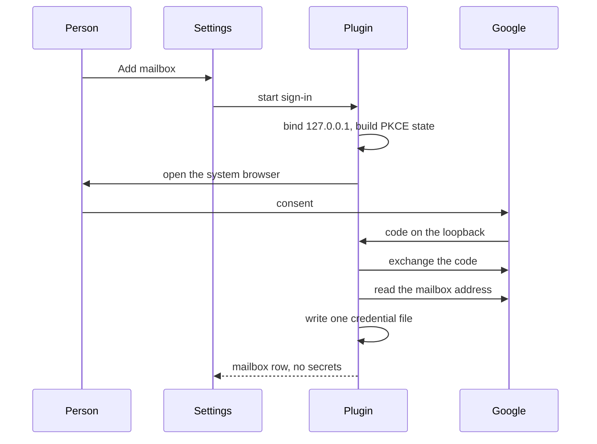

# Connect accounts from BB settings

## Summary

A person connects this plugin from its BB settings page, not from the inbox tab. They add and remove their own Gmail mailboxes, pair WhatsApp, open the LinkedIn sign-in window, and read whether Messages can run. The two fixed Gmail slots go away. Each install supplies one Google Desktop OAuth client. The plugin does not ship a client, and it does not put a refresh token in settings.

---

## Problem Frame

The inbox already reads five sources, but a person who is not this machine's owner cannot finish setup from the product. Gmail is two compile-time mailboxes whose From addresses are a specific person's, and the only way in is a one-shot import from that person's `gws` directories. WhatsApp pairing is a card on the inbox tab. LinkedIn sign-in is a CLI the panel never calls. Messages fails with a sentence about Full Disk Access. BB settings for this plugin today is only the mail-approval rollout.

---

## Requirements

- R1. BB settings for this plugin is where a person sees each source and starts the connect step that source can actually do.
- R2. A person can add more than one Gmail mailbox, and can remove one, without editing source. The mailbox address is the account id and the From address.
- R3. The two fixed ids `gmail-personal` and `gmail-business` are not the product model. An existing credential file keeps serving mail until it can be renamed to its mailbox address, including when the profile read fails.
- R4. Adding a mailbox is a Desktop OAuth sign-in on this machine: system browser, loopback on `127.0.0.1`, PKCE. A cancelled or failed sign-in writes no credential file.
- R5. The OAuth client id and client secret are one pair per install. The secret is never returned by an RPC, never logged, and never sent to the panel. Refresh tokens stay in the per-mailbox files that only `src/gmail-oauth.ts` reads and writes.
- R6. WhatsApp pairing moves onto that settings page and leaves the inbox. Pairing still uses the one lifecycle socket and the existing pairing RPC. A status check does not open a socket.
- R7. LinkedIn's settings action opens the plugin's own Chrome sign-in. The session stays in that profile. Messages shows whether it can run, and the existing install and Full Disk Access instructions. The plugin does not grant that permission and does not install `imsg`.
- R8. When nothing is connected, the inbox tells the person to open this plugin's BB settings. It does not deep-link. There is no navigation API from a thread tab to that page.
- R9. Mail-approval mode, enrolled key ids, and the send gate's meaning stay as they are. A new mailbox is allowed to send under the same rule the two Gmail slots use today.
- R10. A provider failure for a mailbox still shows the provider's reason. Account ids are opaque; the freshness line must not drop an email-shaped id.

---

## Scope Boundaries

- The inbox stays the place to read, search, and reply. This plan does not redesign it.
- No shared OAuth client is committed in the repo, and Google's consent-screen verification is not done here.
- No second WhatsApp account, no second LinkedIn profile, and no Messages account picker.
- Removing a mailbox deletes the local credential and that mailbox's cached rows. It does not revoke the grant at Google.
- `clear_cache` still does not delete account state.
- The plugin does not mark itself `needs-configuration` when zero mailboxes are connected. It keeps running.

### Deferred to Follow-Up Work

- Publishing and verifying a Google consent screen so a Testing client is not required.
- Revoking the Google grant when a mailbox is removed.
- A deep link from the inbox to the plugin settings page, if BB later offers one.
- Granting Full Disk Access or Automation from inside the plugin.

---

## Context & Research

### Relevant Code and Patterns

- `bb.settings.define` in `server.ts` is the only settings surface today (mail approval). Secret settings stay on the server; `useSettings` does not receive them. A custom block is `app.slots.settingsSection` on the plugin's settings page, with no props. Enabled plugins appear in the settings sidebar when they define settings or register a section.
- `src/gmail-oauth.ts` already has `status(account)` (present, refresh token, expiry, source, last error) and a record `source` of `gws-import` or `login`. Nothing writes `login` yet. No RPC returns the status or the file.
- `src/adapters/types.ts` fixes `gmailAccounts` to two ids. `Account` is that pair plus `whatsapp`, `imessage`, and `linkedin`. `src/rpc-contract.ts`, `src/inbox-agent-tools.ts`, `src/adapters/policy.ts`, `src/mail-approval.ts`, `src/inbox-menu.tsx`, and `server.ts` all branch on that closed list. `src/adapters/gmail.ts` maps the two ids to two From addresses.
- `src/gateway.ts` `DESCRIBED_FAILURE` already accepts a non-space account token (`\S+`). An email id fits. A test must lock that so it cannot regress to a word token.
- WhatsApp: `src/whatsapp/pairing.ts` owns the seven states. `src/whatsapp-pairing.tsx` draws the card above the inbox rows and renders nothing when connected. `whatsapp_pairing` is the RPC. `src/whatsapp/lifecycle.ts` is the one socket. `runWhatsAppLink` in `server.ts` builds a second connection for the CLI and must not be copied.
- LinkedIn: `linkedin_signin` calls `openLinkedInSignIn()` in `src/linkedin-chrome.ts`. The panel never calls it. Sign-in state is a failed read plus a CLI hint in `src/linkedin-page-session.ts`, not a cookie the plugin may read.
- Messages: a missing binary or a dead child becomes an instruction in `src/inbox-session.ts`. There is no connect RPC.
- `useBbNavigate` can open threads, projects, and this plugin's nav panels. It cannot open plugin settings.

### Institutional Learnings

- `decisions/0008-the-plugin-owns-the-gmail-credential.md`: one 0600 file per mailbox, only `src/gmail-oauth.ts` touches it, no refresh token in settings or on an RPC. A failed grant stays on the record and is not deleted. A Testing consent screen expired a refresh token after 7 days when the plugin could not see the credential. The decision's non-goal was a Google project per person and a vendor-held client. This plan reverses the "no login" half only as far as R4 and R5, and says so in a current-state note. It does not put refresh tokens in settings.
- `decisions/0009-the-plugin-owns-the-whatsapp-account.md`: one socket, re-pair only when asked, say the ban exposure before a code, unpaired is not an error line. Moving the card does not move those rules.
- `decisions/0003-the-session-is-minted-where-it-reads.md`: do not copy the LinkedIn profile or read its cookies. The sign-in window shares the profile with the headless reader; do not kill a process by profile path.
- `decisions/0010-a-source-transport-is-the-plugins-own.md`: do not treat "delete the data dir" as disconnect. Discarding WhatsApp state spends a device slot.
- `docs/bugs/2026-11-05-a-dead-socket-was-never-reopened.md`: connected means a live socket, not credential files. A settings idle stop must not apply to a linked device.
- `docs/solutions/logic-errors/avatar-fetched-on-the-read-path-2026-11-05.md`: do not call `ensure()` to test whether WhatsApp is up.
- `docs/bugs/2026-11-04-the-failure-line-hides-the-failure.md`: a matcher that cannot see the account id replaces every Gmail failure with "unavailable."
- `docs/solutions/integration-issues/one-rpc-call-arrives-as-null-and-as-empty-2026-11-04.md`: an empty connection RPC accepts `null` and `{}` and still rejects unknown fields.

### External References

- [OAuth 2.0 for Desktop Apps](https://developers.google.com/identity/protocols/oauth2/native-app): desktop apps are public clients, use PKCE, and receive the code on `http://127.0.0.1:<port>` (or localhost). The system browser is required. A Desktop client allows that loopback without a fixed port. Refresh tokens for an installed app are returned on the code exchange. An unverified app shows an unverified-app warning when it asks for user data. Restricted scopes such as `gmail.modify` are in that class.
- The scope set already documented in `README.md` is the one a new sign-in asks for: `openid`, `userinfo.email`, `userinfo.profile`, `gmail.modify`, `gmail.send`, `contacts.readonly`, `contacts.other.readonly`. Dropping the contacts scopes would turn every face lookup into a 403. `gmail.send` is not implied by `gmail.modify`.

---

## Key Technical Decisions

- **The mailbox address is the Gmail account id.** Chat accounts stay `whatsapp`, `imessage`, and `linkedin`. A Gmail id is the address from Gmail's profile, compared case-insensitively and stored lowercase. That address is the From address. Labels in the filter and the compose menu are that address. A closed TypeScript union cannot name mailboxes the compiler has never seen, so the RPC boundary accepts a chat id or a mailbox id that the registry currently holds. An unknown mailbox is a rejection, not an implicit add.

- **One Desktop OAuth client per install, typed into BB settings.** The client id is an ordinary setting. The client secret is a secret setting. Refresh tokens stay in the credential files. A client checked into the repo would be a vendor-held client, and a Testing or unverified client expires or warns in the way `decisions/0008` already hit. Each installer creates a Desktop client in their own Google Cloud project and, while that project stays in Testing, adds their own Gmail user as a test user. The settings page says that in one sentence when the client is missing, and it says the 7-day Testing limit when a refresh fails with `invalid_grant`.

- **Sign-in is a loopback listener in the plugin process, not a `bb.http` route.** `bb.http` is the app origin. The listener binds `127.0.0.1` on a free port, never `localhost`. It mints `state` and an S256 verifier after that bind. The system browser opens Google's authorization endpoint, with `redirect_uri` set to `http://127.0.0.1:<bound-port>/<fixed-path>`, `code_challenge` set from that verifier, and `code_challenge_method=S256`. The loopback only receives Google's redirect. The token post is skipped unless that challenge was on the authorization URL. It accepts one `GET` whose `state` matches, closes the port, and only then posts the code, that verifier, the client secret, and that same redirect URI to Google's token endpoint. The callback response is a local page with an empty query, no link back to BB, and no external request, so the code is not sent onward as a `Referer`. The opener URL, that page, and its `Location` header contain neither the code, the verifier, either token, nor the client secret. Those values are never logged and never placed on an RPC. `gmail_connect` takes no code, state, verifier, redirect, token URL, or mailbox address. The id is the profile `emailAddress`. If that is absent, the id is the userinfo email from the same grant. Any other email is ignored. The address is lowercased before the existence check and the path. If both are missing or the profile read fails, nothing is written and `lastError` on any existing file stays as it was. `replace` defaults to false, and Add does not send it. A rename replaces a file only when this call's `replace` names that same address. `prompt=consent` is sent because the address is not known until Google returns. If that address is already a mailbox and `replace` is false, the new refresh token is discarded and the existing file stays. The row says the mailbox is already connected. That discarded grant still counts toward Google's refresh-token limit, so the page confirms before a second add of an address it already lists.

- **Legacy files stay live until a profile read can rename them.** Startup lists every readable legacy credential before any profile attempt. A timeout or a failed refresh during that attempt leaves the legacy file unchanged, including its previous last error, and the mailbox stays listed under the legacy id with its previous From address. A successful profile read publishes the email-named file through the existing temp-file rename. While both files exist, startup moves rows still keyed by the legacy id onto that address without calling Google, then deletes the legacy file. Cache saves, sync-cursor updates, and search indexing for that legacy id pause from the moment the email-named file is published until the legacy file is deleted. One sqlite transaction moves `inbox_cache`, `inbox_thread`, `inbox_revision`, `inbox_sync`, `inbox_freshness`, `inbox_unread_mark`, `inbox_read_hold`, `inbox_attention`, and `gmail_faces`, and rewrites each `inbox_search` id from `legacyId` plus a separator plus the conversation id. When the target key exists, the target row stays and the legacy row is dropped. `inbox_send_audit` stays historical. Reply and mail drafts live in panel `localStorage`, so the email-named record remembers the legacy id it replaced and the panel copies `unified-inbox.reply-draft.v1` and `unified-inbox.mail-draft.v1` onto the new keys, keeps the later draft when both exist, and removes the old key only after the copy succeeds. A second startup does not register the legacy id once the email-named file exists. This checkout is the live plugin. A migration that hides both mailboxes when Google is unreachable is a failure.

- **The settings page reuses the pairing and LinkedIn RPCs.** It does not open a second WhatsApp socket and does not read LinkedIn cookies. The inbox stops rendering `src/whatsapp-pairing.tsx` and stops polling pairing. The settings section polls only while it is mounted and the state is connecting, showing a code, or showing a QR. Unmount stops that poll. It does not close a linked socket. The CLI `whatsapp-link` path stays as it is and is not what the page calls.

- **Messages and an empty inbox are words plus status.** The Messages row uses a live distinction between a missing binary and a permission failure when the supervised client can already tell those apart. When it cannot, the row shows the last freshness error plus the sentence the inbox already uses. The empty inbox names Settings and this plugin. It does not invent a link.

- **Send policy looks up a mailbox with one shared Gmail rule.** That rule is today's enabled state. Chat rows stay per id. `src/mail-approval.ts` treats "this id is a connected mailbox" as the mail check. Approval mode and key ids are untouched.

---

## Open Questions

### Resolved During Planning

- **How far does Gmail go?** The owner chose add and remove of their own mailboxes, with sign-in, in place of the two fixed slots.
- **Where does connect live?** BB settings. The inbox is not a second pairing door.
- **Can the inbox open settings?** No. `useBbNavigate` has no such method. The empty state is a sentence.
- **Who holds the Google client?** The installer, in server-side settings. Not the repo.

### Deferred to Implementation

- Whether `src/imsg-client.ts` can already separate a missing binary from Full Disk Access. The row's wording follows that discovery. The fallback sentence is the one the inbox uses now. The mailbox address rule is settled: profile `emailAddress`, then userinfo email, and no file if both are missing.

---

## High-Level Technical Design

> This illustrates the intended approach and is directional guidance for review, not implementation specification. The implementing agent should treat it as context, not code to reproduce.

The settings page has two layers. The host renders the existing mail-approval fields plus the OAuth client id and secret. Below that, one custom section lists Gmail mailboxes, the WhatsApp pairing card, the LinkedIn sign-in action, and the Messages status. Add stays disabled until both client fields are set.

A connected source is not one predicate. Gmail is "credential file present and the last refresh did not fail." WhatsApp is the pairing snapshot, and `connected` still means a live socket. LinkedIn is the last successful read versus a sign-in error. Messages is the binary and the last error. Unknown is allowed. The page must not open a WhatsApp socket or a LinkedIn cookie store to collapse those into one word.

---

## Implementation Units

### U1. Mailbox identity replaces the two fixed Gmail slots

**Goal:** The product addresses a Gmail account by its mailbox. Existing files keep working when Google cannot be asked. Chat account ids do not change.

**Requirements:** R2, R3, R9, R10

**Dependencies:** None

**Files:**
- Modify: `src/adapters/types.ts`, `src/adapters/gmail.ts`, `src/adapters/index.ts`, `src/adapters/policy.ts`, `src/mail-approval.ts`, `src/rpc-contract.ts`, `src/gateway.ts`, `src/inbox-agent-tools.ts`, `src/inbox-mention.ts`, `src/search-index.ts`, `src/inbox-menu.tsx`, `src/inbox-cache.ts`, `src/inbox-session.ts`, `src/gmail-oauth.ts`, `server.ts`, `app.tsx`, `src/CONTEXT.md`
- Test: `tests/adapters/gmail.test.ts`, `tests/adapters/policy.test.ts`, `tests/mail-approval.test.ts`, `tests/rpc-contract.test.ts`, `tests/gateway.test.ts`, `tests/inbox-cache.test.ts`, `tests/source-declaration.test.ts`, `tests/gmail-oauth.test.ts`

**Approach:**
- Chat ids stay a fixed set. Gmail ids come from the credential directory plus any legacy file that has not moved yet.
- `src/gmail-oauth.ts` remains the only reader and writer of credential files. Startup lists legacy files before any profile call. Profile success publishes the email-named file, pauses legacy-id cache writes, moves the sqlite rows named in the decision in one transaction, and deletes the legacy file only after that transaction commits. Profile or refresh failure leaves the legacy file byte-for-byte, including `lastError`. The panel moves its two `localStorage` drafts from the legacy id recorded on the new credential. Login and import share that same commit rule: lowercase the address first, and replace a file only when `replace` or `--force` names that address.
- Send policy for every mailbox id uses one enabled Gmail rule. Mail approval accepts a registry mailbox and rejects a chat id and an unknown id.
- The sources and capabilities RPCs return the live set. The inbox session follows that set instead of the compile-time tuple. Compose offers one action per mailbox. The filter lists mailboxes in address order.
- A provider line whose account token is an email still passes `DESCRIBED_FAILURE`.
- Do not start or stop refresh services in a way that drops a legacy mailbox Google could not rename.

**Patterns to follow:**
- `src/gmail-oauth.ts` `status` and the single-flight refresh.
- `src/inbox-cache.ts` account-scoped replace, which already isolates two accounts that share a conversation id.

**Test scenarios:**
- Happy path: a profile read that returns `ada@example.com` for the personal legacy file publishes that credential, moves a cached row, a search id, a freshness row, and a face off `gmail-personal` in one transaction, and a later startup does not create a second mailbox. A panel draft stored under the legacy id is copied to the new key and the old key is removed only after that copy.
- Happy path: a send for `ada@example.com` uses that address as From and is allowed by the same gate decision the old personal slot had.
- Edge case: the profile read throws, or the refresh it needs fails. `gmail-personal` still lists, still sends as the previous From address, the legacy file's previous `lastError` is unchanged, and no second file is written.
- Edge case: the email-named file exists and the legacy file still exists, with cache rows under the legacy id. Startup moves those rows without calling Google, then deletes the legacy file. A cache save for the legacy id during that window does not recreate the legacy rows.
- Edge case: two legacy files resolve to the same address. The second does not overwrite the first. The first mailbox stays, and the loser is reported without deleting its file.
- Error path: `send_gmail` and a mention for `nobody@example.com` are rejected when that mailbox is not in the registry. A WhatsApp id is rejected by the mail gate.
- Error path: a gateway failure whose text is `gmail ada@example.com request failed (401; invalid, token)` is stored and shown as that sentence, not as "unavailable."
- Integration: after a successful rename, search hits and the agent list use the new id only.

**Verification:**
- Existing mail still has a working account id when the profile endpoint is down.
- No RPC schema enumerates only `gmail-personal` and `gmail-business`.
- A test proves an email-shaped failure line is preserved.

---

### U2. Desktop sign-in adds and removes a mailbox

**Goal:** A person with a Desktop OAuth client can add a mailbox from the server and can remove one, without a secret leaving the server.

**Requirements:** R4, R5, R9

**Dependencies:** U1

**Files:**
- Modify: `src/gmail-oauth.ts`, `src/account-import.ts`, `src/rpc-contract.ts`, `src/gateway.ts`, `server.ts`
- Create: `src/gmail-login.ts`
- Test: `tests/gmail-login.test.ts`, `tests/gmail-oauth.test.ts`, `tests/account-import.test.ts`, `tests/gateway.test.ts`, `tests/rpc-contract.test.ts`

**Approach:**
- Define the client id as a normal setting and the client secret as a secret setting beside the existing mail-approval settings. Do not change those two mail fields.
- `gmail_connect` refuses, with a sentence that names the missing client, when either setting is empty. It binds `127.0.0.1`, opens the system browser, and waits. The RPC may block until success, timeout, or cancel. The component does not have to stay mounted for the file to be written.
- On success the profile address, or the userinfo email when the profile has none, is lowercased and becomes the id. `gmail_connect` takes no code, state, verifier, redirect, token URL, or mailbox address. The file is written only through `src/gmail-oauth.ts` with `source: 'login'`, and only when the address is new or `replace` names that same address. Scopes are the README set. Add does not send `replace`. If the address already exists, the new refresh token is discarded, the old file stays, and the row says the mailbox is already connected. The callback page has an empty query and does not link back to BB.
- Timeout, dispose, bad `state`, and a token response with no refresh token write nothing. A network failure after a file exists follows today's rule: keep the record and store `lastError`. That rule applies to later refresh, not to a sign-in that never got a refresh token.
- `gmail_remove` deletes that mailbox's credential and asks the cache to drop that account's rows and drafts. It does not call the all-source clear, and it does not touch WhatsApp or LinkedIn files.
- `connection_status` is the one read the settings page uses. It returns the client-configured flag, each mailbox's `status` fields, the WhatsApp pairing snapshot from the state machine without calling `ensure()`, the LinkedIn freshness line already stored for that source, and a Messages line. The Messages line is a live binary-versus-permission distinction when the supervised client can already make it, and otherwise the last freshness error plus the inbox's existing instruction. No token, secret, or client secret is included. Empty input accepts `null` and `{}` and rejects unknown fields. The system browser is opened with the platform opener. The plugin does not start a second browser.
- `import-gws-account` still copies a `gws` export and still refuses a masked secret. After a copy it names the file by the profile address when the profile read works. The old personal and business arguments remain selectors for the two local `gws` directories on this machine. They are not the stored account ids when the address is known. A profile failure during import writes nothing new and leaves any previous file.

**Patterns to follow:**
- `src/account-import.ts`: reject before write, never echo a secret, `--force` to replace.
- `src/gmail-oauth.ts` write path: 0600, atomic, last error kept on the record.

**Test scenarios:**
- Happy path: a fake token endpoint and a local redirect return a refresh token and `ada@example.com`. One file exists, `status` reports `source: 'login'`, and the RPC result has no token and no client secret.
- Happy path: remove then leaves no credential file and no cached row for that address. A WhatsApp auth directory created in the same fixture is still there.
- Edge case: a second connect for the same address without replace writes nothing and reports that the mailbox is already there. With replace, the new refresh token is the one on disk.
- Edge case: two overlapping connect calls. The second is refused while the first listener is up. After the first finishes, a new connect can bind.
- Error path: missing client id, missing client secret, timeout, wrong `state`, a token body with no refresh token, and a profile read that fails after the token response each leave the credential directory unchanged. A caller-supplied code, state, verifier, redirect, token URL, or mailbox address is rejected and writes nothing.
- Error path: the callback response and the URL opened in the browser do not contain the code, the verifier, either token, or the client secret. The listener is bound to `127.0.0.1`, not `localhost`.
- Error path: an error string thrown to the gateway does not contain the authorization code, the verifier, the refresh token, or the client secret.
- Integration: import of a fixture export plus a fake profile stores `ada@example.com`, not `gmail-personal`. A masked export still writes nothing.

**Verification:**
- A test double completes the loopback exchange without contacting Google.
- Grep of the test's captured logs and RPC payloads shows no secret material.

---

### U3. The settings page lists every source

**Goal:** The plugin settings page is the connect screen. The host form collects the OAuth client. The custom section does everything else.

**Requirements:** R1, R6, R7

**Dependencies:** U2

**Files:**
- Create: `src/account-settings.tsx`
- Modify: `app.tsx`, `src/whatsapp-pairing.tsx`
- Test: `tests/account-settings.render.test.ts`, `tests/whatsapp-pairing.render.test.ts`

**Approach:**
- Register `settingsSection` with a title and a one-line description. The component takes no props and reads through the existing RPC hook.
- Add is disabled while `connection_status` says the client is not configured, and the row says to fill in the client id and secret above.
- Each mailbox row shows the address, or the legacy id when the address is not known yet, plus the last error when there is one. Remove asks for confirmation, then calls `gmail_remove`.
- The WhatsApp block is the current card, including the ban sentence before a code. It calls `whatsapp_pairing`. It polls only in the connecting, code, and QR states. It draws nothing once connected, except a connected line and the explicit re-pair action the card already has. Leaving the page stops the poll and does not close a linked socket.
- LinkedIn shows the last error when the freshness line is a sign-in failure, and a button calls `linkedin_signin`. The button does not read or display cookies.
- Messages shows the Messages line from `connection_status`. The copy for a missing binary or a permission failure is the instruction the inbox already shows. There is no grant button.
- Mail-approval fields stay host-rendered and are not duplicated in the section.

**Patterns to follow:**
- `src/whatsapp-pairing.tsx` for the card's states and the warning before a code.
- `tests/whatsapp-pairing.render.test.ts` and `tests/jsdom-harness.ts` for a component test. A page expression that needs a whitespace class uses `\\s`.

**Test scenarios:**
- Happy path: status with one mailbox, a connected WhatsApp snapshot, a LinkedIn success, and a Messages binary found renders four blocks and no QR.
- Happy path: a WhatsApp snapshot in `qr` renders the ban warning and the code image. A click to pair calls `whatsapp_pairing` with the pair action.
- Edge case: `clientConfigured: false` disables Add and tells the person to set the client above. No connect RPC is sent.
- Edge case: unmounting the section during `qr` does not send a close or unpair.
- Error path: a mailbox `lastError` of `invalid_grant` is shown, including the Testing-client sentence. A LinkedIn sign-in RPC failure is shown on that row and does not clear the Gmail rows.
- Integration: Remove confirmation calls `gmail_remove` with that address and, on success, the row is gone. Dismissing confirmation sends nothing.

**Verification:**
- The inbox module is not imported by the settings section.
- The pairing render tests still pass for the warning, the hidden connected card, and the re-pair action.

---

### U4. The inbox stops owning pairing and points at settings

**Goal:** Opening the inbox no longer starts or draws WhatsApp pairing. A person with no connected source is told where to go.

**Requirements:** R6, R8

**Dependencies:** U3

**Files:**
- Modify: `app.tsx`, `src/inbox-session.ts`
- Test: `tests/inbox-session.test.ts`, `tests/inbox-list.render.test.ts`

**Approach:**
- Remove the pairing card from the inbox tree. `start()` no longer calls `refreshPairing` and no longer polls it.
- Refresh services and the session's source list already follow the registry from U1. This unit only removes the inbox's pairing clock.
- When the live source list is empty, or every source is an unconnected Gmail legacy gap and WhatsApp is unpaired and the other two have never succeeded, the empty copy names BB settings and this plugin. A filter that merely has no rows keeps today's "No conversations in this view." Search and unread keep their own sentences. An unpaired WhatsApp account remains a state, not a refresh error.

**Patterns to follow:**
- The empty-copy branch already in `app.tsx`.
- The U4 block in `tests/inbox-session.test.ts` that locks "an unpaired source is not a refresh failure."

**Test scenarios:**
- Happy path: session start with a connected WhatsApp transport does not call `whatsapp_pairing`.
- Happy path: a render with zero sources shows the settings sentence and no pairing card.
- Edge case: a list with rows and an unpaired WhatsApp snapshot shows the rows and does not show a QR.
- Edge case: unread filter with no unread rows still shows the unread empty sentence, not the settings sentence.
- Error path: a Gmail refresh failure still produces one error line per mailbox. The settings sentence does not replace that line.

**Verification:**
- No inbox render test looks for a QR image.
- The unpaired-is-not-an-error test still passes.

---

### U5. Owner docs match the new connect path

**Goal:** The current-behavior docs and the Gmail credential decision describe the settings page and the mailbox list.

**Requirements:** R1, R5

**Dependencies:** U3, U4

**Files:**
- Modify: `PLUGIN_OVERVIEW.md`, `README.md`, `decisions/0008-the-plugin-owns-the-gmail-credential.md`, `docs/_index.md`

**Approach:**
- `PLUGIN_OVERVIEW.md` describes connect as the settings page: installer-supplied Desktop client, mailbox files named by address, WhatsApp pairing on that page, LinkedIn sign-in button, Messages instructions. The inbox description no longer says pairing starts from the tab.
- `README.md` leads with that page. The `gws` import remains documented as the optional copy, not the only door. The scope list stays.
- Add a current-state note to decision 0008. Do not rewrite the decision. The note says a Desktop client may be supplied in settings, sign-in writes `source: 'login'`, refresh tokens are still files, and consent-screen verification is still not done.
- Regenerate the docs index so this plan is listed.

**Test scenarios:**
- Test expectation: none for the prose. The existing stale-index check fails if `docs/_index.md` is not regenerated.

**Verification:**
- A reader of `PLUGIN_OVERVIEW.md` can find where to connect each source without being told to use only the inbox or only `gws`.
- Decision 0008 still forbids refresh tokens in settings and on RPCs.

---

## System-Wide Impact

- **Interaction graph:** `sources`, `capabilities`, `send_gmail`, mentions, agent tools, the filter, compose, background refresh, and the send-audit account column all learn mailbox ids. The pairing RPC and `linkedin_signin` stay. The inbox session loses its pairing poll. The settings section is a new caller of those RPCs.
- **Error propagation:** Sign-in failures stay on the settings row and write no file. Refresh failures stay on the credential record and on the freshness line, with the provider reason intact. LinkedIn and Messages errors stay on their own rows.
- **State lifecycle risks:** Legacy rename moves credential, cache, search, and drafts, and it must not run twice. A crash after the new file is written and before the old file is removed must prefer the email-named file and not resurrect the legacy id as a second mailbox. Remove is one mailbox, never `clear_cache`. An in-flight QR is still the lifecycle's ten-minute unpaired stop.
- **API surface parity:** The panel, the agent tools, and `import-gws-account` all use the registry. A mailbox the registry does not hold is invalid on every one of them.
- **Integration coverage:** U1 covers rename plus cache and search. U2 covers the loopback exchange and import. U3 covers the page. U4 covers the inbox no longer polling pairing. A live Google consent and a live QR scan are manual checks after `npm run build` on the live tree, not unit tests.
- **Unchanged invariants:** The send gate still records before delivery and still requires `allow: 'send'` for the paths that require it today. Mail-approval mode and key ids stay. WhatsApp still has one socket and an explicit unpair. LinkedIn still does not export a session. `clear_cache` still leaves account state. Only `src/gmail-oauth.ts` reads and writes Gmail credential files.

---

## Risks & Dependencies

| Risk | Mitigation |
|---|---|
| Startup migration runs on the live plugin and Google is down, so both mailboxes disappear. | Legacy ids keep serving, including the old From address, until a profile read succeeds. |
| A crash mid-rename leaves two files, and the sqlite rows are still on the legacy id. | While both files exist, the next startup moves those rows without calling Google, then deletes the legacy file. Legacy-id cache writes pause until that delete. |
| The loopback accepts a code meant for another app, or the code leaks through the callback page. | Bind `127.0.0.1` only, mint `state` after the bind, accept one matching `GET`, close the port before the token post, and answer with a local page that has an empty query and no outbound link. Tests capture the error text and the callback body. |
| A Testing OAuth client dies after 7 days, which is the failure in decision 0008. | The settings row shows `invalid_grant` and says a Testing client expires. Verification stays deferred. The client is not hidden in the repo. |
| Restricted Gmail scopes show an unverified-app warning, or a Workspace admin blocks the client. | The sign-in error is shown on the row. The plan does not claim a public verified client. |
| The settings page and the inbox each open a WhatsApp socket. | The inbox card and its poll go away. The page uses `whatsapp_pairing` only. |
| Account-id churn breaks search, mentions, or audit history. | Rows move with the rename. Audit rows already stored under a legacy id stay as historical text. New sends use the new id. |
| Removing a mailbox is confused with WhatsApp unpair. | Remove touches that mailbox's credential and cache rows only. |

---

## Alternative Approaches Considered

- **Keep the two slots and only show status.** Rejected. The owner chose add and remove of real mailboxes.
- **Ship one OAuth client in the repo.** Rejected. Desktop clients are public, a shared client is vendor-held, and an unverified or Testing client recreates the 7-day outage for every installer.
- **Store refresh tokens in `bb.settings`.** Rejected again. One setting is one value, and decision 0008 already keeps tokens in per-mailbox files. The current SDK does keep secret settings off the frontend. That removes the old "the panel can read the setting" objection for the single client secret, and it does not make settings a mailbox list.
- **Leave the QR card on the inbox as a second door.** Rejected. The confirmed scope moves pairing to settings, and two doors are how a second socket gets opened.

---

## Phased Delivery

### Phase 1

U1 and U2. Mailbox identity and sign-in work at the RPC and the import command before the page exists. The live files survive a failed profile read.

### Phase 2

U3 and U4. The settings page becomes the only pairing door, and the empty inbox points at it.

### Phase 3

U5. Overview, README, the decision note, and the docs index land with the page so the current-behavior docs do not keep the old door.

---

## Documentation / Operational Notes

- An installer creates a Google Cloud Desktop OAuth client, puts the id and secret in this plugin's BB settings, and adds their Gmail address as a test user while the consent screen stays in Testing. The plugin cannot do that Google Cloud step.
- After the code is on the live tree, the check is `npm run build` and a reload, then the settings page. A child worktree is not the live plugin.
- The first reload on this machine attempts the legacy rename. If Google is unreachable, both existing mailboxes must still appear.

---

## Sources & References

- Related code: `src/gmail-oauth.ts`, `src/whatsapp/pairing.ts`, `src/linkedin-chrome.ts`, `server.ts`, `app.tsx`
- Related decisions: `decisions/0008-the-plugin-owns-the-gmail-credential.md`, `decisions/0009-the-plugin-owns-the-whatsapp-account.md`, `decisions/0003-the-session-is-minted-where-it-reads.md`, `decisions/0010-a-source-transport-is-the-plugins-own.md`
- External docs: https://developers.google.com/identity/protocols/oauth2/native-app
