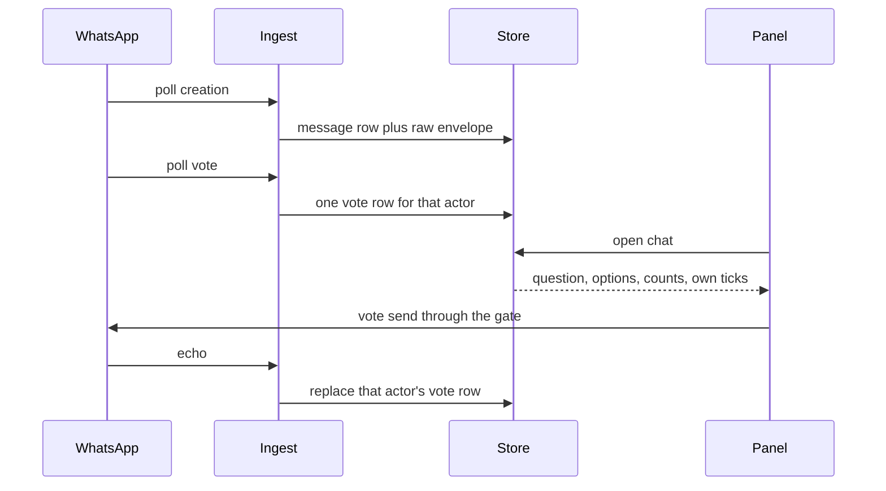

# Show a WhatsApp poll as a card

## Summary

An open WhatsApp chat draws a poll as one card: the question, the options, the vote counts, and the options the owner already chose. The owner can vote from that card. A vote is a send. A later vote updates the same card. The conversation list keeps the short label `Poll`. Creating a poll stays out.

---

## Problem Frame

A WhatsApp message that has no text of its own is shown as `[type]`. `classifyMessageType` in `src/whatsapp/ingest.ts` keeps an unknown `*Message` key by stripping that suffix, and `whatsappText` in `src/whatsapp-chat.ts` then wraps the type in brackets. A vote arrives as `pollUpdateMessage`, so the chat shows `[pollUpdate]`. The poll itself arrives as `pollCreationMessage`, `pollCreationMessageV2`, `pollCreationMessageV3`, or `pollCreationMessageV5`, and those become their own bracket labels. The question, the options, and the counts are in the stored envelope. Nothing reads them.

The owner can already send a reply and a reaction through one gate (`src/adapters/policy.ts`). A poll vote is another send on that same gate. The pinned client (`baileys` 7.0.0-rc13) can build a poll and can decrypt a vote. It does not offer a vote send. The path that would attach a decrypted vote to the poll is commented out inside the client, so this plugin has to fold the vote itself.

---

## Requirements

- R1. An open WhatsApp chat shows one card for a poll: the question, each option name, and the count for that option.
- R2. The card marks the options the owner already selected. It does not name any other voter.
- R3. The owner votes from the card. That vote is a send, and it passes the existing gate with `allow: 'send'`.
- R4. A later vote updates that same card. A vote-update message is not its own row, including a `[pollUpdate]` row already stored.
- R5. The conversation list uses the short label `Poll` for a poll, including when the question is known.
- R6. A vote the gate would refuse never reaches the socket. A missing message id, an option that is not on that poll, or a selection larger than the poll allows is refused before an allowed audit row is written.
- R7. One vote attempt is sent. The send does not write the vote row. The echo does, the same way a reaction echo does. An unknown outcome is not retried.
- R8. A vote that does not decrypt leaves the card in place and does not count that voter. Counts are the votes that did decrypt.
- R9. A list, an open chat, a search, and a mention learn a poll from stored rows. They do not open a socket to do it.
- R10. A mention and a search hit can carry the question and the option names. They do not carry who voted.
- R11. Gmail, Messages, and LinkedIn do not gain a vote. Each still declares the new capability key, and each declares it false.

---

## Scope Boundaries

- Creating a poll stays out.
- The card shows counts and the owner's own ticks. It does not show a list of voters.
- An agent can read the poll on the message the thread already returns. This plan does not add a vote tool.
- A quiz's correct answer is not marked. An option that is only a picture stays a text option when it has a name, and stays out when it has none.
- A result snapshot is not a second bubble. Joining a snapshot to a poll when the snapshot has no creation key is deferred.
- Other sources stay as they are, apart from declaring the new capability key false.

### Deferred to Follow-Up Work

- An agent vote tool on the same gate.
- Poll creation from the composer.
- Voter names on the card.
- Quiz scoring and option images.
- A result snapshot that cannot be tied to a stored poll.

---

## Key Technical Decisions

- **Votes are a side table, like reactions.** `wa_message_reactions` is one row per actor per target, and a later emoji replaces that row. A poll vote is the same shape: one row per actor per poll, holding the option names that actor selected. A later vote from the same actor replaces the row. An empty selection deletes it. `clear()` on the store deletes the new table with the other `wa_*` tables. The account state stays untouched.
- **The question and the options stay on the stored envelope.** The creation row already keeps the raw message for `getMessage`. The read builds the card from that envelope plus the vote rows. A second copy of the question would drift.
- **Decrypt when the vote is ingested, not when the row is drawn.** A read must not open a socket (`src/CONTEXT.md`, `docs/solutions/logic-errors/avatar-fetched-on-the-read-path-2026-11-05.md`). `decryptPollVote` from the pinned client is the decrypt. The key is the creation message's `messageSecret`, which is the secret the client's own disabled path uses and the secret `messageSecretFromRaw` in `src/whatsapp/message-edit.ts` already reads. A vote that arrives before its poll is kept until that poll is stored, then decrypted. A failed decrypt drops that voter and leaves the card.
- **The owner's tick is not a voter list.** The panel receives a count per option and a flag for "this option is one I selected". The actor id stays in the store so a revote can replace one person. It is not a field on the RPC message.
- **A vote replaces the whole selection.** The client aggregates `selectedOptions` as the voter's current set. The card sends the next full set, not a one-option delta. A single-choice poll sends that one option. A multi-choice poll sends the set that stays inside `selectableOptionsCount`. A count of `0` means every option may be selected: the pinned client accepts `0` and treats it as the multi-choice creation message.
- **The vote is a new action, not a reply.** `react` is the pattern: the gateway checks the shape before `gate()`, the audit records the attempt, and the adapter sends. The audit text is the chosen option names. The new capability key is `pollVote`. WhatsApp declares it true. The other adapters declare it false, because `CAPABILITY_KEYS` is exhaustive.
- **The outgoing vote uses the client's existing primitives.** Encrypt is the inverse of `decryptPollVote`, with `aesEncryptGCM` and `hmacSign`, which the package already exports next to that decrypt. The plugin does not invent a second poll cipher. `sendMessage` on this pin only builds a poll creation, and that relay adds a `polltype` meta node whose token is `creation`. The vote relay is the same kind of node. The vote token is an execution-time check: ship the token a captured stanza or a refused send proves, and do not guess one in advance.
- **Old `[pollUpdate]` rows disappear at read time.** New votes are not inserted as messages, matching reactions. Rows already stored stay until a re-sync replaces them, so the list and the open chat also drop a stored type that is only a vote update.

---

## High-Level Technical Design

This illustrates the intended approach and is directional guidance for review, not implementation specification. The implementing agent should treat it as context, not code to reproduce.

---

## Implementation Units

### U1. Remember one vote per person

**Goal:** The store keeps the latest option set for each actor on a poll, and a cache clear removes those rows.

**Requirements:** R1, R2, R4, R8

**Dependencies:** None

**Files:** `src/whatsapp/store.ts`, `tests/whatsapp/store.test.ts`

**Approach:** Add one `wa_*` table in the same constructor style as `wa_message_reactions`: create-if-missing, and `ALTER TABLE` only if a later column is required. The primary key is the chat, the poll message id, and the actor. The actor uses the same identity a reaction actor uses, passed through `canonicalChatJid` when it is a jid, so one person is not two voters. The stored value is the selected option names. Replacing the row is the revote. An empty set deletes the row. `clear()` deletes the table's rows and does not touch account state. A vote that cannot be decrypted yet can sit as pending ciphertext on that same table until the creation row exists. Once it decrypts, the ciphertext goes away.

**Patterns to follow:** `wa_message_reactions` in `src/whatsapp/store.ts`, including the replace-on-newer-timestamp rule and the delete inside `clear()`.

**Test scenarios:**
- Insert a vote for one actor and two option names. Read it back as those two names.
- Insert a second vote for the same actor with one different name. The read returns only the second set.
- Insert an empty set. The read returns no row for that actor.
- Two actors on one poll both remain. A third poll id does not see them.
- `clear()` removes the vote rows and leaves the account state files alone.
- A pending ciphertext row is readable as pending, and replacing it with option names leaves no ciphertext behind.

**Verification:** The store tests cover replace, delete, isolation by poll id, and cache clear. A read of the table does not open a socket.

### U2. Fold a vote into the poll at ingest

**Goal:** A poll creation is one message. A vote updates that poll and does not become a message. Counts come from decrypted votes.

**Requirements:** R1, R4, R8, R9

**Dependencies:** U1

**Files:** `src/whatsapp/ingest.ts`, `src/whatsapp/poll.ts`, `tests/whatsapp/poll.test.ts`, `tests/whatsapp/store.test.ts`

**Approach:** Add a small poll module beside `src/whatsapp/message-edit.ts`. It reads the creation payload from `pollCreationMessage`, `pollCreationMessageV2`, `pollCreationMessageV3`, and `pollCreationMessageV5` after `extractMessageContent`. It classifies those as one poll type so the panel does not grow a type per version. It decrypts with `decryptPollVote` and the creation `messageSecret`. Option hashes follow the client's own aggregate: SHA-256 of the option name, compared to `selectedOptions`. A vote message is handled like a reaction: update the side table and return, with no `upsertMessage`. When the creation row is not stored yet, keep the ciphertext via U1 and apply it when that creation is ingested. A decrypt error is contained the way a bad edit is contained: the handler does not throw into the socket loop. `pollCreationMessageV4` is a future-proof wrapper. Leave it as a non-card message until it unwraps to a creation payload. Do not add a second Baileys dependency.

**Execution note:** Start with a failing test around a fixture vote and a fixture creation secret, then make the fold pass. The cipher is the part a later reader cannot see from the UI.

**Patterns to follow:** The reaction branch in `handleMessagesUpsert` (`src/whatsapp/ingest.ts`), `decryptMessageEdit` containment in the same file, and `messageSecretFromRaw`.

**Test scenarios:**
- A creation fixture with a name and three options ingests as one message whose type is the single poll type, and whose envelope still carries the name and the options.
- A vote fixture whose secret matches that creation adds one vote row and does not add a message row.
- The same actor's second vote replaces the first row.
- A vote ingested before the creation adds no message. After the creation arrives, the vote row is the decrypted options.
- A vote with a bad secret adds no vote row, leaves any previous row for that actor, and does not throw.
- A creation with no `messageSecret` still stores the message. A vote against it adds no count.
- `pollCreationMessageV3` and `pollCreationMessage` both classify as the same poll type.
- A handler error inside the vote path is contained and later messages in the same flush still ingest.

**Verification:** Poll tests prove decrypt, order, and containment without a live socket. Store tests still pass for ordinary messages.

### U3. Put the card data on the message the panel already reads

**Goal:** The open chat, the list, search, and mentions receive the poll. A stored vote-update row no longer renders as `[pollUpdate]`.

**Requirements:** R1, R2, R5, R9, R10, R11

**Dependencies:** U1, U2

**Files:** `src/adapters/types.ts`, `src/rpc-contract.ts`, `src/whatsapp/transport.ts`, `src/adapters/whatsapp.ts`, `src/whatsapp-chat.ts`, `src/inbox-mention.ts`, `tests/whatsapp/transport.test.ts`, `tests/whatsapp-chat.test.ts`, `tests/inbox-mention.test.ts`, `tests/rpc-contract.test.ts`

**Approach:** Extend the shared message with an optional poll: question, selectable count, and options. Each option has a name, a count, and whether it is the owner's. No actor id and no voter name crosses the RPC. The transport fills that object from the envelope plus the vote rows while it builds the open-chat message. That fill is a store read. The list preview for a poll type is the word `Poll`, even when the question is known, and a group preview keeps the existing sender prefix in front of that word. `whatsappText` keeps today's bracket labels for call, audio, and document. A stored type that is only a vote update is dropped by the same read filter that already drops system and protocol noise, so an old `[pollUpdate]` row leaves the list and the open chat. Rows already stored under the old creation strings (`pollCreation`, `pollCreationV2`, `pollCreationV3`, `pollCreationV5`) are polls too. The read builds the card from their envelopes without waiting for a re-ingest to rewrite the type. Search documents include the question and the option names so a query can hit them, and the list row drawn from a hit still uses `Poll`. The mention excerpt names the question and the options and does not name voters.

**Patterns to follow:** How `reactions` and `quote` travel from `WhatsAppMessageRow` through `src/adapters/whatsapp.ts` into `message` in `src/rpc-contract.ts`. `isWhatsAppNoise` for the hide rule.

**Test scenarios:**
- An open chat of a poll message returns the question, three option names, counts from two stored voters, and `selected` only on the owner's options.
- A second actor's name is absent from that payload.
- A poll with votes that failed to decrypt returns the question and the options, and a count only for voters that did decrypt. Zero stored votes returns a count of zero per option.
- The list preview of a poll is `Poll`. A group poll preview is the sender prefix plus `Poll`.
- A stored vote-update row is absent from the open chat and from the list.
- A text message, a call, `[audio]`, and `[document]` previews stay as they are.
- A mention of a poll includes the question and each option name and does not include an actor id.
- The RPC schema accepts a message with a poll and still accepts a message without one.
- A stored row whose type is still `pollCreationV3` returns a card from its envelope. Its list preview is `Poll`.

**Verification:** Transport, chat, mention, and contract tests pass. Opening a chat in the test harness does not call the socket.

### U4. Draw the card and send the vote

**Goal:** The owner sees the card and can change their vote. The send is gated, checked, and attempted once.

**Requirements:** R2, R3, R6, R7, R11

**Dependencies:** U3

**Files:** `app.tsx`, `chat.css`, `src/adapters/capability.ts`, `src/adapters/types.ts`, `src/adapters/whatsapp.ts`, `src/adapters/gmail.ts`, `src/adapters/imessage.ts`, `src/adapters/linkedin.ts`, `src/gateway.ts`, `src/rpc-contract.ts`, `src/whatsapp/send.ts`, `src/whatsapp/transport.ts`, `src/whatsapp/poll.ts`, `src/inbox-session.ts`, `tests/whatsapp/send.test.ts`, `tests/whatsapp/poll.test.ts`, `tests/gateway.test.ts`, `tests/inbox-poll.render.test.ts`, `tests/adapters.test.ts`, `tests/adapters/whatsapp.test.ts`, `tests/adapters/imessage.test.ts`, `tests/inbox-session.test.ts`, `tests/ui-capabilities.test.ts`, `tests/inbox-reactions.render.test.ts`, `PLUGIN_OVERVIEW.md`, `README.md`

**Approach:** The bubble draws the poll inside the existing bubble for that account. Each option is a button. The button shows the name, the count, and a pressed state when it is the owner's. A single-choice poll sends a selection of that one option. A multi-choice poll sends the full next set and refuses a set larger than `selectableOptionsCount` in the gateway, before the gate. A count of zero allows a set up to the number of options. Clearing the last option sends an empty set. The panel calls the new action with `allow: 'send'`. The gateway requires `pollVote`, a message id, and option names that exist on the stored poll. Those checks throw before `gate()`, so a bad vote writes no allowed audit row. The audit text for a real vote is the option names. The adapter maps a socket failure through the existing WhatsApp send-failure classes. One attempt. The send path does not insert the vote row. The button stays busy until the action returns, and the count changes when the echo is ingested on the next read. The send socket gains one vote method. It encrypts with the inverse of `decryptPollVote` and relays a `pollUpdateMessage` aimed at the creation key. The relay includes the same meta tag the client's creation relay uses. The token on that tag is confirmed during implementation against a captured stanza or a refused send, and the unit does not ship a guessed token. Gmail, Messages, and LinkedIn declare `pollVote` false and refuse the action. Update `PLUGIN_OVERVIEW.md` and `README.md` so the current behavior names the poll card and stops calling this case a bracket label.

**Patterns to follow:** The `react` branch in `src/gateway.ts` and `src/adapters/whatsapp.ts`, `createWhatsAppSendTransport` in `src/whatsapp/send.ts`, and the reaction controls in `app.tsx`. Bubble geometry stays `bubbleClass` in `src/inbox-appearance.ts`.

**Test scenarios:**
- A poll message renders the question, each option name, and each count. The owner's options are pressed. Another sender's name is not in the markup.
- Choosing an option on a single-choice poll calls the vote action with `allow: 'send'` and that one option name.
- On a poll whose selectable count is 2, a third option is not sent. The gateway throws before the gate, and the allowed audit row is absent.
- An option name that is not on the poll is refused the same way.
- A vote with no message id is refused the same way.
- A policy refusal never calls the socket.
- A disconnected socket surfaces the existing offline failure and does not retry.
- After a successful send, the test socket received one poll update and the store's vote table is unchanged until an ingest echo.
- Encrypt-then-decrypt of a fixture selection returns those option hashes. A wrong secret fails decrypt.
- Gmail, Messages, and LinkedIn report `pollVote` false. Their action rejects a vote and does not send.
- A call bubble and a reaction control on a text message still render as they do today.
- Every test that deep-equals a full capability object includes `pollVote`, false except on WhatsApp.

**Verification:** Send, gateway, poll, and render tests pass. `npm run typecheck` passes with the new capability key on every adapter. The overview and the README describe the card.

---

## Risks

- The vote stanza can be refused even when the ciphertext is valid, because this pin never sends a vote. U4 keeps the token out of the plan until a capture or a refusal names it. A wrong token fails the send. It must not be retried.
- History can omit `messageSecret`. The card still shows the question and the options, and the counts stay short of the phone's counts. That matches R8.
- A LID and a phone jid for one voter would double-count. U1 uses the canonical jid on purpose. A test with both forms of one person belongs in U1 if a fixture can express the pair.
- `selectableOptionsCount` of `0` is easy to treat as "no voting". The decision above treats `0` as "any option". A fixture with `0` belongs in U4.

---

## System-Wide Impact

- The RPC message gains an optional poll object. The action enum gains a vote. Every adapter's capability object gains `pollVote`.
- `inbox_read` returns the poll when the message has one. Mentions change only for a WhatsApp poll. No new agent tool sends.
- The send audit gains rows whose text is the option names. The gate's meaning is unchanged.
- One WhatsApp socket remains the socket. A vote uses it the way a reply does. A read of the card does not.
- `clear_cache` deletes vote rows with the other WhatsApp store rows.

---

## Documentation Notes

`PLUGIN_OVERVIEW.md` is the document that must stay current. U4 updates it and `README.md`. This plan is historical once the work ships. Regenerate `docs/_index.md` when this file or those current docs change the index.

---

## Deferred Implementation Notes

- The exact `polltype` token on the vote relay.
- Whether a future-proof `pollCreationMessageV4` unwraps with the helpers already in the client. Until it does, it is not a card.
- How a result snapshot names its poll when it has no creation key.
