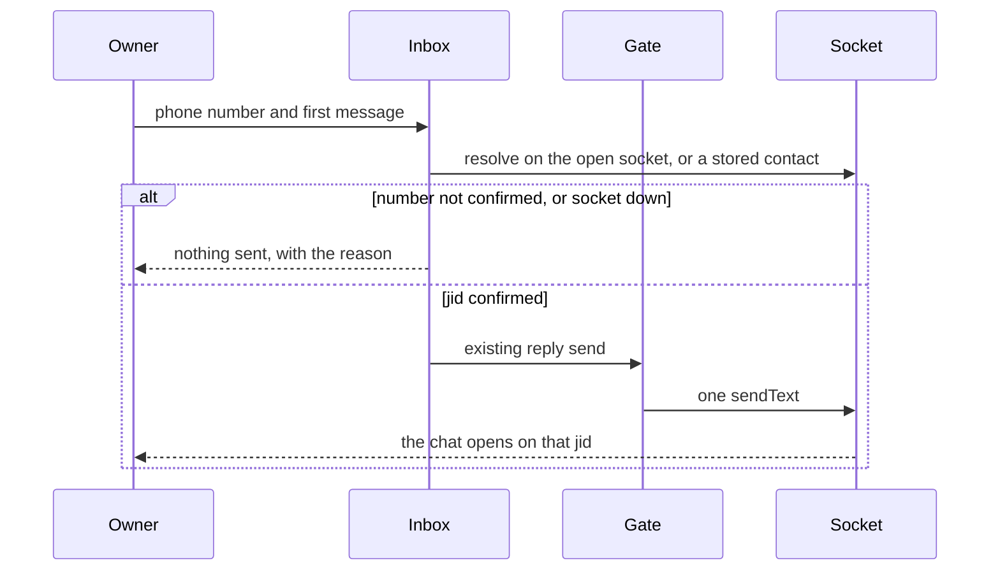
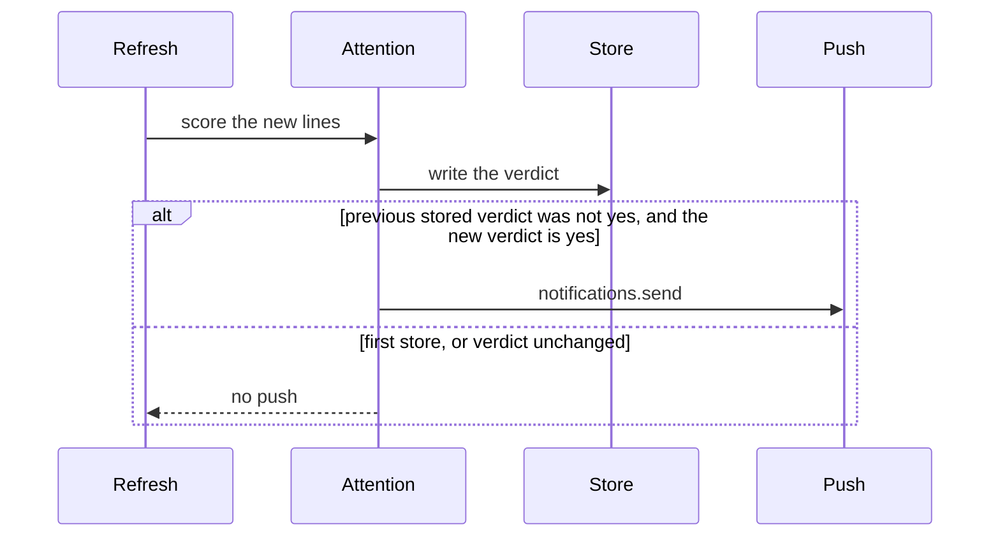

# feat: Make the inbox ready for a new person

## Summary

A person who installs this plugin can connect Gmail, WhatsApp, LinkedIn, and Messages from settings and use the inbox. Settings tells them what each source needs. The inbox can start a WhatsApp chat, and an open mail message shows its images. Attention labels and a push appear only when the other plugin that provides them is present. The public overview describes this inbox and does not depend on those plugins.

---

## Problem Frame

The inbox works after accounts on this machine are already connected. A new person gets one sentence that names Settings and cannot open that page from the inbox. Gmail setup is two fields and the line "Fill in the client id and secret above." LinkedIn success reads "The last read worked." Messages is one line about `imsg` and Full Disk Access. Compose says new WhatsApp chats are not supported. Mail files are download chips, including images. The inbox menu always lists Needed and None, and those words are scores from the Decisions plugin. A buyer who never installs Decisions still sees that menu. Nothing sends a push when attention flips to Needed, and that push would call the push-notifications plugin. `PLUGIN_OVERVIEW.md` is the maintainer map, and the marketplace copies that file onto the store page. The manifest description still says "early development."

---

## Requirements

### First run

- R1. An empty inbox, with no search and no unread filter, tells the person to open BB Settings for this plugin. The inbox does not deep-link. There is no navigation from a thread tab to plugin settings.
- R2. A list that already has rows, while WhatsApp is unpaired, names WhatsApp. It does not tell the person to connect an account as if nothing is connected.
- R3. When the Gmail client id and secret are empty, settings lists the steps to create a Desktop OAuth client in the installer's own Google Cloud project, including the People API, a Testing-mode expiry of 7 days, and Google's unverified-app warning. Those steps are hidden once the client is set. The secret never appears in the panel or on an RPC.
- R4. LinkedIn settings say the account is connected, that sign-in is still required, or the last error. Sign in still opens the plugin Chrome. The plugin does not read cookies.
- R5. Messages settings say where `imsg` is expected, that the host is macOS, and that the person grants Full Disk Access. The plugin does not install `imsg` and does not grant the permission.

### Inbox behavior

- R6. The owner can start a new 1:1 WhatsApp chat by a phone number with a country code, and send the first message through the existing send gate and the one socket. A number the account cannot reach is not sent. A disconnected socket is not sent. Group creation stays out.
- R7. An open mail message draws image files in the message. PNG, JPEG, GIF, and WebP under the existing image ceiling render. SVG and other types stay download chips. HTML stays sanitized. Image bytes are not stored in the thread cache.
- R8. When a conversation's stored attention verdict changes from a previous non-yes to yes, and the push-notifications plugin answers, the plugin sends one push through `notifications.send`. A later refresh of the same yes does not send again. The first time a row is stored, including rows already Needed at startup, does not send. A missing or failing push plugin does not change the verdict, does not surface an inbox error, and does not add a control that names the missing plugin.
- R11. Needed and None appear only on a conversation that has a stored verdict. The filter lists those words only when at least one row has a verdict. With no verdict, the menu is All, Unread, and the sources. A failed or absent Decisions ask is a log line. It is not an inbox error and it is not a sentence in the panel.

### Store page

- R9. `PLUGIN_OVERVIEW.md` is the public overview: at most 4000 characters, no leading H1, no tables, no raw HTML, https links only, no local paths, and no "how to read this repo." It describes connect, the new chat, mail images, one login per source, the owner's Google client, Full Disk Access, and the WhatsApp linked-device warning. It does not name Decisions, push-notifications, Needed, or None.
- R10. The manifest description no longer says "early development." It states the outcome a buyer gets.

---

## Scope Boundaries

- One login per source. No second WhatsApp account and no second LinkedIn profile.
- The Messages app keeps its own unread count.
- No shared Google client and no consent-screen verification.
- No Full Disk Access grant and no `imsg` install.
- Chat send stays on the existing gate. This plan does not add a second confirmation and does not close the approval gap in `decisions/0005-keep-sends-enabled-until-verified-approval.md`.
- Push fires on the attention verdict, not on every new message. Decisions remains the scorer. No verdict means no push and no attention UI.
- This plugin does not require another BB plugin. Gmail, WhatsApp, Messages, and LinkedIn work when Decisions and push-notifications are not installed.

### Deferred to Follow-Up Work

- A deep link from the inbox to plugin settings, if BB later offers one.
- An inline PDF viewer. Non-image files stay chips.
- Creating a WhatsApp group.
- Publishing a verified Google OAuth client.

---

## Key Technical Decisions

- KTD1. Setup sentences live in the settings section and the empty-state copy. The host settings fields stay an id and a secret. The custom section already owns connect actions, and the secret must not be repeated in React.
- KTD2. The unpaired-with-rows hint is a WhatsApp sentence. The empty-inbox sentence stays for a list with no rows. Search, unread, and error empties keep the sentences they have. `tests/inbox-list.render.test.ts` currently expects the install sentence on a non-empty unpaired list, and that expectation changes with R2.
- KTD3. A new WhatsApp chat resolves a phone number to a jid, then uses the existing reply send. The phone field accepts 7 to 15 digits, the same bound as the pairing fallback. A stored contact phone match uses that contact's canonical jid and does not open a socket. Any other number is checked on the already-open socket. No socket, or a number WhatsApp does not accept, refuses before `sendText`. The plan does not assume `digits@s.whatsapp.net` is the chat id.
- KTD4. Mail images reuse the attachment `media` RPC. A returned image data URL is drawn. A download path, a non-image, or an SVG stays a chip. `cid:` images are resolved in the panel after the message is drawn, by matching a content id carried on the message to that same RPC, then writing the data URL into the sandboxed frame. The cached HTML stays free of image bytes.
- KTD5. Push is a side effect of `watchNewConversations` after a verdict is stored, using the same plugin RPC shape as the Decisions ask in `server.ts`. Title is the source and the conversation name, cut to 80 characters. Body is the list preview, cut to 180 characters. No `threadId`, because the inbox is not a BB thread. The call is skipped unless a stored verdict already existed and was not yes.
- KTD6. `PLUGIN_OVERVIEW.md` becomes the buyer page the marketplace copies. Agent invariants stay in `AGENTS.md` and `src/CONTEXT.md`. `README.md` loses sentences that contradict the shipped product. It does not grow a second full behavior document.
- KTD7. Optional plugins add a surface only after they have produced a result. `src/inbox-menu.tsx` always inserts Needed and None today. Those entries, and the chips, render only when a row already carries `needsAttention`. The gateway already omits that field when no verdict is stored. Absence is an empty field, not a disabled chip and not an error row. A later successful ask fills the field and the menu gains the entries on the next paint.

---

## High-Level Technical Design

This illustrates the intended approach and is directional guidance for review, not implementation specification. The implementing agent should treat it as context, not code to reproduce.

---

## Implementation Units

### U1. First-run copy

**Goal:** A new person can tell, from the inbox and from settings, what to do for each source.

**Requirements:** R1, R2, R3, R4, R5

**Dependencies:** none

**Files:** `app.tsx`, `src/account-settings.tsx`, `src/gateway.ts`, `tests/inbox-list.render.test.ts`, `tests/account-settings.render.test.ts`

**Approach:** Keep the empty-inbox sentence for a truly empty all-filter list. Change the hint above existing rows so it names WhatsApp only. Put the Google Cloud steps in the Gmail block when `clientConfigured` is false, and hide them when it is true. Keep the existing `invalid_grant` sentence on a mailbox error. LinkedIn copy uses `lastSuccessAt` and `lastError` only. Messages copy expands the existing hint with the install locations the README already names (`~/.local/bin`, `/opt/homebrew/bin`, `/usr/local/bin`, or PATH) and states that the plugin does not install `imsg` or grant Full Disk Access. One owner for that instruction: the settings component. The gateway keeps a short hint so `connection_status` still returns a sentence.

**Patterns to follow:** `src/account-settings.tsx` status blocks, `EXPOSURE_NOTE` in `src/whatsapp-pairing.tsx` as the model for a warning that is a sentence and not a tooltip, `tests/account-settings.render.test.ts`.

**Test scenarios:**

- An empty cached list, filter all, blank search, and no errors shows the Settings sentence.
- A search with no hits shows the search empty sentence and does not show the Settings sentence.
- A cached mail row plus WhatsApp `unpaired` shows the mail row, a hint that names WhatsApp, no QR, and a single pairing read that is not a poll.
- `clientConfigured: false` shows the Google steps, including the 7-day Testing limit and the unverified-app warning, and Add stays disabled.
- `clientConfigured: true` hides those steps and leaves Add enabled.
- LinkedIn with `lastSuccessAt` set and no error says the account is connected.
- LinkedIn with neither success nor error says sign-in is still required and does not say the last read worked.
- LinkedIn with `lastError` shows that error.
- Messages with an empty status string includes `imsg`, Full Disk Access, and that the plugin does not grant the permission.
- The settings tree and the connection RPC output contain no client secret.

**Verification:** The render tests above pass. A connected install does not show the long Google steps. The secret setting remains `secret: true` on `gmailClientSecret`.

### U2. New WhatsApp chat

**Goal:** The owner can send the first message to a phone number that this WhatsApp account can reach.

**Requirements:** R6

**Dependencies:** U1

**Files:** `app.tsx`, `src/inbox-session.ts`, `src/adapters/whatsapp.ts`, `src/whatsapp/transport.ts`, `src/whatsapp/store.ts`, `src/rpc-contract.ts`, `src/gateway.ts`, `tests/adapters/whatsapp.test.ts`, `tests/inbox-list.render.test.ts`

**Approach:** Remove the "not supported" compose sentence. When WhatsApp is connected, compose offers a phone field and a message. Submit resolves, then calls the existing reply action with `allow: 'send'`. Resolution order: a stored contact whose phone jid matches the digits, otherwise one lookup on the open socket. Refuse with the existing offline wording when the socket is down. Refuse without sending when the lookup says the number is not on WhatsApp. Do not create a group and do not send to the owner's own jid. The exact Baileys lookup method is an implementation discovery. The requirement is the refusal, not a particular method name.

**Execution note:** Add the resolve-and-refuse tests before changing the send path.

**Patterns to follow:** `action` reply in `src/adapters/whatsapp.ts`, `sendFailure` and `TEXT_LIMIT`, the phone field in `src/whatsapp-pairing.tsx`, `createSendGate` so this send is not a second path around policy.

**Test scenarios:**

- A stored contact for those digits sends `sendText` to that contact's canonical jid and does not open a socket for the lookup.
- Digits with no stored contact and an open socket that confirms a jid send once to that jid.
- Digits the socket cannot confirm throw before `sendText`, and the error says nothing was sent.
- No open socket throws the existing offline sentence and does not call `sendText`.
- Fewer than 7 digits, more than 15 digits, and an empty message do not call resolve or send.
- The owner's own jid is refused and does not send.
- A successful send is recorded by the send gate as allowed before delivery, the same as a reply in an open chat.
- The compose screen no longer contains the unsupported-chat sentence, and it shows the phone field when WhatsApp is connected.
- WhatsApp disconnected shows a reconnect sentence and no send call.

**Verification:** The adapter tests prove refusal before send. The render test proves the compose control. A send still requires `allow: 'send'`.

### U3. Mail images in the message

**Goal:** Image files in an open mail message are visible in the message. Other files stay chips.

**Requirements:** R7

**Dependencies:** U1

**Files:** `app.tsx`, `src/mail-html.ts`, `src/gmail-body.ts`, `src/rpc-contract.ts`, `tests/inbox-list.render.test.ts`, `tests/gmail-body.test.ts`

**Approach:** On an open mail message, request each image attachment through the existing `media` RPC with `kind: 'attachment'`. Draw a PNG, JPEG, GIF, or WebP data URL. Leave PDF and other types as the current chip, which still downloads or reports `savedPath`. Refuse SVG the same way `mediaDataUrl` refuses `image/svg+xml`. For `cid:` sources, carry the content id on the image part in the open message, fetch that part the same way, and set the frame image's `src` after the message is drawn. Leave a `cid:` with no matching part unchanged. Do not rewrite remote `https:` images. Do not write the data URL into the cached thread HTML.

**Patterns to follow:** `AttachmentChips` and `savedPayload` in the Gmail adapter, `sanitizeMailMarkup` in `src/mail-html.ts`, `mediaDataUrl` in `src/adapters/media.ts`.

**Test scenarios:**

- A PNG attachment under the image ceiling renders an image whose `src` is the returned data URL, and the chip is not the only control.
- A PDF attachment stays a download chip and does not render as an image.
- An SVG attachment stays a chip and is not drawn.
- A file that returns `savedPath` shows the Downloads sentence and no image.
- A failed image fetch shows the error on that file and still shows the mail text.
- HTML with a `cid:` that matches an image part ends up with a data URL in the frame, and the cached HTML stored for that thread does not contain that data URL.
- HTML with a `cid:` and no matching part keeps the mail text and does not fetch an arbitrary URL.
- An `https` image `src` in the mail is unchanged.
- A `javascript:` or non-image `data:` URL is still stripped by `sanitizeMailMarkup`.

**Verification:** The render tests show an image for a PNG and a chip for a PDF. A cache read of the thread does not contain a `data:image` URL introduced by this work.

### U4. Push when attention becomes Needed

**Goal:** One push goes out when a conversation starts needing attention, and nowhere else.

**Requirements:** R8

**Dependencies:** none

**Files:** `src/attention.ts`, `server.ts`, `tests/attention.test.ts`

**Approach:** After `store.put`, if the previous stored verdict existed and was not yes, and the new verdict is yes, call `notifications.send` on plugin id `push-notifications`. Title is the source label plus the conversation title. Body is the list preview. Both cuts follow the push plugin's 80 and 180 character limits. Omit `threadId`. A throw or an empty `channels` array is logged once per process and does not change the stored verdict. Do not call push from the panel.

**Execution note:** Add the transition tests before wiring the RPC.

**Patterns to follow:** the Decisions `bb.sdk.plugins.callRpc` block in `server.ts`, `watchNewConversations` in `src/attention.ts`.

**Test scenarios:**

- A stored verdict of no, then a new verdict of yes, calls send once with a title that includes the conversation name and a body that is the preview.
- A stored verdict of yes, then yes again, does not call send.
- A first `put` with verdict yes and no previous row does not call send.
- A verdict that stays no does not call send.
- A thrown push call leaves the stored verdict yes and does not throw out of classification.
- A title longer than 80 characters and a preview longer than 180 characters are cut before the call.
- The call input has no `threadId`.

**Verification:** The unit tests cover the transitions with a fake send function. Classification still completes when send throws.

### U5. Public overview and manifest description

**Goal:** The store page and the manifest describe the product a buyer gets.

**Requirements:** R9, R10

**Dependencies:** U1, U2, U3, U4, U6

**Files:** `PLUGIN_OVERVIEW.md`, `package.json`, `README.md`, `tests/overview.test.ts`

**Approach:** Replace the overview with a buyer page under 4000 characters. Use `##` sections for what the person gets, how to connect, and the limits. Mention the owner's Google client, Full Disk Access, one login per source, the Messages app unread count staying in Messages, and the linked-device warning. Do not mention Decisions, push-notifications, Needed, or None. Use https links only if a link is needed. Point agents at `AGENTS.md` by name in a sentence, without a relative link, because the marketplace rejects relative links. Update `bb.description` so the first sentence is the outcome and the word "early development" is gone. In `README.md`, correct the claims that WhatsApp audio and documents are still text placeholders, and the "work in progress" title, so they do not contradict `src/CONTEXT.md` and this plan. Do not rewrite the rest of the README.

**Patterns to follow:** the marketplace overview rules already applied in this plan's R9. `src/CONTEXT.md` wins where the README disagrees.

**Test scenarios:**

- `PLUGIN_OVERVIEW.md` is at most 4000 characters.
- It has no line that is a markdown table row, no raw HTML tag, and no leading `# ` title.
- Every link in it is an absolute `https://` URL.
- It does not contain a home-directory path or `docs/`.
- It names Gmail, WhatsApp, Messages, LinkedIn, the owner's Google client, and Full Disk Access.
- It does not contain "Decisions", "push-notifications", "Needed", or "None".
- `package.json` `bb.description` does not contain "early development."

**Verification:** `tests/overview.test.ts` passes. The overview can be read without the repo's document map.

### U6. Attention UI only after a verdict

**Goal:** A person who never installs Decisions sees an inbox with no attention controls and no message that something is missing.

**Requirements:** R11

**Dependencies:** none

**Files:** `src/inbox-menu.tsx`, `app.tsx`, `src/attention.ts`, `tests/inbox-menu.render.test.ts`, `tests/attention.test.ts`

**Approach:** Build the Needed and None menu entries only when some visible row has `needsAttention`. Draw a chip only when that row has the field, which is already how `AttentionChip` is gated. Do not add a placeholder, a disabled entry, or a settings row for Decisions. Keep the ask failure as the existing log line in `watchNewConversations`. Do not route it through `InboxErrors`. Stored verdicts from an earlier run still show, because a result exists. A process that has never stored a verdict shows All, Unread, and the sources.

**Patterns to follow:** the `needsAttention` omit in `src/gateway.ts` (`decorated`), and the menu list in `src/inbox-menu.tsx`.

**Test scenarios:**

- A menu whose rows have no `needsAttention` lists All, Unread, and the sources, and does not list Needed or None.
- A menu whose rows include one `needsAttention: 'yes'` lists Needed and None.
- A row without `needsAttention` does not render an attention chip.
- A row with `needsAttention: 'yes'` renders the Needed chip.
- A thrown Decisions ask logs and does not add an inbox error string.
- The panel text in the no-verdict case does not contain "Decisions".

**Verification:** `tests/inbox-menu.render.test.ts` covers both menus. The no-verdict inbox has no attention chip and no missing-plugin sentence.

---

## System-Wide Impact

- **Send gate.** U2 is another caller of reply, not a bypass. `src/adapters/policy.ts` still records the attempt before delivery.
- **WhatsApp socket.** Number lookup uses a stored contact or the socket `src/whatsapp/lifecycle.ts` already holds. It does not call `ensure()` to test whether WhatsApp is up. That rule is `docs/solutions/logic-errors/avatar-fetched-on-the-read-path-2026-11-05.md`.
- **Gmail quota.** Image fetches are `attachmentGet` calls on an open message, behind the existing per-account limit in `src/gmail-client.ts`. They are not done while drawing the list.
- **Cache.** Thread HTML and `inbox_attention` stay free of image bytes and of push payloads. A push body is the preview the list already stores.
- **Other plugins.** Push depends on `push-notifications`. Scoring still depends on Decisions. Either plugin being absent leaves the inbox readable and leaves no control, chip, or error that names the missing plugin. The menu in `src/inbox-menu.tsx` is the surface that currently violates that for Decisions.
- **Privacy.** The push body is the list preview, which is message text. It leaves this plugin for the notification channels the owner already enabled. It is not a new store of that text.

---

## Risks and Dependencies

- **Baileys number lookup.** The repo has no `onWhatsApp` call today. If the pinned client cannot confirm a number on the open socket, U2 ships the refusal and the stored-contact path, and does not guess a jid. A guessed jid can message the wrong person or burn a send.
- **Push plugin absent.** `callRpc` will throw. U4 treats that as a log, not an inbox failure. The owner sees no alert and no control that names the missing plugin.
- **Startup flood.** Classifying the cached inbox on load would otherwise push every Needed row. The first-store rule in KTD5 is the mitigation.
- **CID images and tracking.** Rewriting only `cid:` from parts this message already has avoids new remote fetches. Existing `https` images in mail stay as they are.
- **Overview drift.** U5 is last so the page describes the shipped behavior. The new test locks the marketplace constraints.
- **WhatsApp ban exposure.** A new chat is one owner-asked send, the same class as a reply. The settings card already states the linked-device risk. This plan does not add bulk send.

---

## Sources

- `docs/plans/2026-11-08-001-feat-account-connect-settings-plan.md` — settings is the connect surface, the inbox does not deep-link, and the installer holds the Google client.
- `decisions/0005-keep-sends-enabled-until-verified-approval.md` — chat send remains `allow: 'send'`.
- `decisions/0009-the-plugin-owns-the-whatsapp-account.md` — one socket, and a status check does not open one.
- `src/CONTEXT.md` — attention verdicts, mail HTML versus chat bubbles, and which module owns a send.
- `docs/solutions/logic-errors/avatar-fetched-on-the-read-path-2026-11-05.md` — do not call `ensure()` to test a socket, and do not put a network read on the list path.
- BB push-notifications `notifications.send` — title cut at 80, body cut at 180, `threadId` optional, empty `channels` means nothing was delivered.
