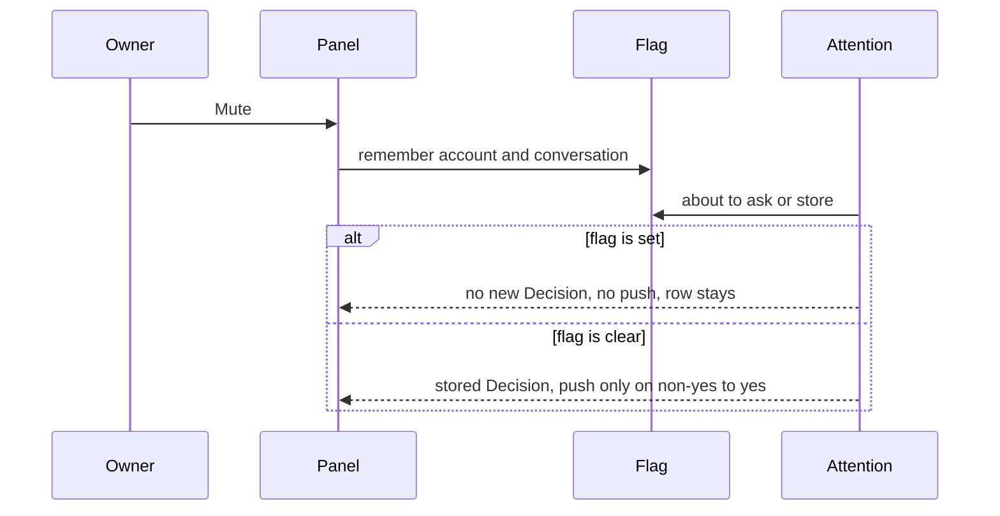

# feat: Mute a conversation so it cannot be Needed

## Summary

The owner can mute a conversation on any source, and can unmute it. The row stays in the list, including in Needed and in None. Mute does not remove it. While it is muted, the Decisions plugin is not asked, so the conversation cannot get a new Decision and it does not push. The Decision already stored stays on the row. Mute is a flag in this inbox. It does not read or write a source's own mute.

---

## Problem Frame

The inbox can mark a conversation None, and that mark ends when a later line is classified. That later line can become Needed and can push. The owner has no way to say that a conversation must not become Needed. WhatsApp's own mute is not stored. Archive removes a Gmail row from the list, and the other sources cannot archive.

---

## Requirements

- R1. The owner can mute a conversation, and can unmute it, from the list row and from the open conversation. This works for Gmail, WhatsApp, Messages, and LinkedIn.
- R2. A muted conversation stays in the list. It stays in All, in its source, in Needed, and in None. Mute is not archive and it is not a hide. Mute does not change which filter is selected.
- R3. While a conversation is muted, the Decisions plugin is not asked. The conversation cannot get a new Decision. The Decision already on the row stays on the row.
- R4. While a conversation is muted, a new yes is not stored and a push is not sent. An ask that was already in flight does not store and does not push after the mute.
- R5. Scores stored before the mute stay stored. Mute does not delete them and does not turn them into None. The owner can still dismiss or restore. The plugin cannot.
- R6. Unmute makes the conversation eligible again. If nothing new arrived, the stored Decision is shown and nothing is asked and nothing is pushed. If new lines arrived, they are classified. A push happens only when that classification changes a stored non-yes into yes, which is the rule that already exists.
- R7. The mute flag survives a sync and a cache clear. A Gmail account id change moves it with the other per-conversation rows. Forgetting the account deletes it.
- R8. With no Decisions plugin, mute still works. Needed and None stay hidden, as they do today.
- R9. The product word is Mute. The attention invariant names this exception. The buyer overview says the owner can mute a conversation and does not name Needed, None, Decisions, or push-notifications.

---

## Scope Boundaries

- Mute does not remove the conversation from search, from the agent list, or from reply.
- Mute does not change Unread.
- No second notification control. Push is suppressed because no new yes is stored, not because of a separate switch.
- No Muted filter.
- No bulk mute.
- No agent tool that mutes.

### Deferred to Follow-Up Work

- Honoring WhatsApp's own mute, or writing mute back to a source. Those fields were removed from ingest on purpose, and a list read must not open a socket to discover them.
- A Muted filter, if the mark on the row is not enough to find a muted conversation later.
- Following a mute when a WhatsApp conversation id changes shape.

---

## Key Technical Decisions

- KTD1. **The conversation stays in the list.** Archive already means "leave the list," and only Gmail can do it. Mute means the row remains, with a visible mark, so the owner can unmute it. That includes the Needed view and the None view. The owner said mute does not remove the row. Mute only excludes the conversation from the Decisions plugin.
- KTD2. **The flag lives beside the cache, and cache clear does not delete it.** `cache.save` rewrites list rows, so a column on `inbox_cache` would vanish on the next sync. `inbox_read_hold` and `inbox_unread_mark` are the pattern: a table keyed by account and conversation id. Read hold is cleared with the cache because it is derived from reading. Mute is the owner's choice, so `clear` must leave it in place. `forget` deletes it. `migrateGmailAccountIds` moves it in the same transaction as `inbox_read_hold` and `inbox_attention`. The flag is not WhatsApp's `muted` column and it is not a read hold.
- KTD3. **Mute skips the plugin. It does not hide the Decision.** `dismiss` stores None and the next `put` can become Needed and push. A LinkedIn invitation is the precedent for "this id is not asked." Mute uses that shape at schedule time, and again immediately before a store, so an ask that started earlier cannot publish after the mute. The stored attention row is left as it was. `decisionToShow` is unchanged, so a stored yes stays Needed on screen and the row stays in that filter.
- KTD4. **Unmute does not invent a push.** Unmute clears the flag and schedules one classification if the conversation is in the cache. The existing hash check returns before an ask when the lines are unchanged. The Decision already on screen stays. New lines are asked. `attentionPush` sends only for a previous non-yes that becomes yes, and the first store does not push. Unmute must not delete the attention row. A missing previous verdict is a first store, so a later yes does not push, and there is no stored Decision to keep on screen.
- KTD5. **The panel hears mute through the same RPC path as a list action.** The list item gains a muted mark. The decorator sets that mark and leaves `needsAttention` as it is. The session paints the mark and does not clear the chip. It restores the previous rows if the call fails, the same way `clearAttention` does. Mute and unmute are on the list menu and the open header for every source. They are not a capability flag. There is no new filter entry. The open header reads the selected row. A later list refresh must copy a mute-mark change onto that row, the same way it already follows `needsAttention`.

---

## High-Level Technical Design

This illustrates the intended approach and is directional guidance for review, not implementation specification. The implementing agent should treat it as context, not code to reproduce.

| State | On screen | Asked | Pushed | In the list |
|---|---|---|---|---|
| Muted | the Decision already stored | no | no | yes, including Needed and None |
| Unmuted, same lines | stored Decision | no | no | yes |
| Unmuted, new lines | new Decision | yes | only when a stored non-yes becomes yes | yes |

---

## Implementation Units

### U1. Remember mute across sync

**Goal:** A mute flag that outlives a sync and a cache clear, moves when a Gmail account id changes, and disappears when that account is forgotten.

**Requirements:** R7

**Dependencies:** none

**Files:** `src/inbox-cache.ts`, `tests/inbox-cache.test.ts`

**Approach:** Add the flag as its own account-and-id table, created the same way as `inbox_read_hold`. Set and clear are idempotent. `clear` does not delete this table. `forget` does. `migrateGmailAccountIds` includes the table in the same list as `inbox_read_hold` and `inbox_attention`. A lookup answers, for one conversation and for one account, whether the flag is set. No source adapter reads or writes it.

**Patterns to follow:** `inbox_read_hold` in `src/inbox-cache.ts`, the Gmail id migration test in `tests/inbox-cache.test.ts`.

**Test scenarios:**

- Setting mute for one account and id, then syncing that account with `save`, leaves the flag set.
- Setting mute twice leaves one row. Clearing mute when it was never set leaves no row and does not throw.
- `clear` removes cached rows and leaves the mute flag set.
- `forget` on that account removes the mute row and leaves a mute row for a different account.
- `migrateGmailAccountIds` from `gmail-personal` to a mailbox address moves the mute row and does not leave the old account id behind.

**Verification:** Those cache tests pass. A synced list row does not need a mute column of its own.

### U2. Stop a muted conversation from becoming a Decision

**Goal:** While the flag is set, the Decisions plugin is not asked, a new verdict is not stored, and nothing is pushed. The verdict already stored stays shown. Unmute restores eligibility without a push that unmute itself caused.

**Requirements:** R3, R4, R5, R6, R8

**Dependencies:** U1

**Files:** `src/attention.ts`, `server.ts`, `tests/attention.test.ts`

**Approach:** The watcher takes a mute lookup. `schedule` returns immediately when the flag is set, including the wording refresh and a new message arrival. A timer already waiting for WhatsApp or Messages is cancelled when the flag becomes set, so that wait cannot ask later. The flag is checked again at the start of classification and inside publish, before the store and before the push, including the path that republishes lines that already have scores. A muted conversation does not publish. `decisionToShow` does not learn about mute. The unmute RPC in U3 clears the flag and then schedules one classification. This unit honors that schedule. When the flag is clear, classification is unchanged. Do not implement this by calling `dismiss` or by deleting the attention row.

**Execution note:** Add the skip and the in-flight drop tests before changing `publish`.

**Patterns to follow:** the LinkedIn invitation return in `schedule` inside `watchNewConversations`, `decisionToShow`, `attentionPush` in `src/attention.ts`. The avatar solution `docs/solutions/logic-errors/avatar-fetched-on-the-read-path-2026-11-05.md` is the reason this unit does not consult WhatsApp.

**Test scenarios:**

- A muted conversation with a new preview is not asked and does not gain a stored verdict.
- A stored yes stays yes in the table when the conversation is muted, and `decisionToShow` still returns yes while Decisions is installed.
- An ask that resolves after the flag is set does not write and does not push.
- A mute that lands after schedule and before publish, on a conversation whose lines are already scored, does not write and does not push.
- A mute that lands while the WhatsApp or Messages wait is armed does not ask.
- A conversation that is not muted still stores yes and pushes when the previous stored verdict was no. The first store still does not push.
- With the flag clear and the same state hash, no new ask runs. With the flag clear and new lines, classification runs. A previous stored yes that is still yes does not push.
- `decisionToShow` still returns nothing when Decisions is not installed, muted or not.

**Verification:** `tests/attention.test.ts` covers the cases above. A muted conversation produces no push log and no new attention row.

### U3. Let the owner mute and unmute from the inbox

**Goal:** The owner can see and change mute on every source, and the list matches R2 and R3.

**Requirements:** R1, R2, R3, R8, R9

**Dependencies:** U1, U2

**Files:** `src/rpc-contract.ts`, `src/gateway.ts`, `src/inbox-session.ts`, `server.ts`, `app.tsx`, `src/inbox-menu.tsx`, `UBIQUITOUS_LANGUAGE.md`, `src/CONTEXT.md`, `PLUGIN_OVERVIEW.md`, `tests/inbox-list.render.test.ts`, `tests/inbox-menu.render.test.ts`, `tests/inbox-session.test.ts`, `tests/overview.test.ts`

**Approach:** Add mute and unmute RPC methods keyed by account and id, matching the shape of `clear_attention`. The decorator sets the muted mark from the flag and leaves `needsAttention` unchanged, on the list and on search hits. The session paints that mark before the call returns and puts the previous rows back if the call fails. It does not clear the chip. The unmute call clears the flag and then schedules one classification when the conversation is still in the cache, through the watcher in `server.ts`. The list menu and the open header offer Mute or Unmute for every source. The row and the open header show a mute mark. The Needed and None filters do not gain a new sibling, and a muted row stays in the filter it already matched. The language file defines Mute as the owner's mark that a conversation stays in the list and is not sent to the Decisions plugin, and says not to call it a notification setting, an archive, or WhatsApp's mute. The attention row in `src/CONTEXT.md` gains the skip. `PLUGIN_OVERVIEW.md` gains one sentence that the owner can mute a conversation and that it stays in the list. That sentence does not use the words the overview test forbids.

**Patterns to follow:** `clearAttention` in `src/inbox-session.ts`, the list row menu and the open header menu in `app.tsx`, `filterActions` in `src/inbox-menu.tsx`, `tests/overview.test.ts`.

**Test scenarios:**

- A list row menu for each source includes Mute. After mute, that menu includes Unmute and does not include Mute.
- The open conversation offers the same pair.
- After mute, the row stays in All, in its source, in Needed, and in None. It shows the mute mark. A Needed chip that was already there stays. A None chip that was already there stays.
- A failed mute call restores the previous menu label and does not drop the row.
- Unmute removes the mark. Lines that arrived while muted are classified. Unchanged lines keep the stored Decision and are not asked. A push happens only when that classification turns a stored non-yes into yes. The unmute response itself does not push.
- With no row carrying a Decision, the filter menu stays All, Unread, and the sources.
- The overview is still at most 4000 characters, still has no leading H1, and contains mute. It still does not contain Decisions, push-notifications, Needed, or None.
- The language file's Mute row names the conversation, says the row stays in the list, and says the Decisions plugin is not asked.

**Verification:** The render and session tests above pass. The overview test passes. An owner can mute from Needed, see that same row remain in Needed, and see the mute mark.

---

## System-Wide Impact

- The owner gains one menu action and one mark. Reply, unread, and Gmail archive stay as they are.
- The Decisions plugin is not asked for a muted conversation. A Decision already on the row stays visible.
- Push does not fire for a conversation that is muted, because no new yes is stored.
- The agent list does not return the Decision field today. It still returns the conversation. This plan does not add a mute tool.
- Account forget and a Gmail address rename must include the new table or the flag sticks to a dead account id.

---

## Risks & Dependencies

- An in-flight ask is the main race. The check has to happen both before the ask and before the store. A check only at schedule time loses.
- Copying `clear`'s delete list would wipe the owner's mute. U1's tests hold that line.
- A WhatsApp id that changes shape will not carry the flag. That is deferred, not solved here.
- U2 depends on the lookup from U1. U3 clears the flag and schedules the classification that U2 then honors. The decorator adds the mute mark and does not hide the Decision.

---

## Open Questions

None that block implementation. The exact control name in the menu can match the existing menu sentences during implementation. The table's identifier can follow the `inbox_*` names already in `src/inbox-cache.ts`.

---

## Sources & References

- Attention owner and the invitation skip: `src/CONTEXT.md`, `src/attention.ts`
- Flag tables that survive `save`: `src/inbox-cache.ts`
- Why None is the wrong tool: `dismiss` and `attentionPush` in `src/attention.ts`, push rule in `docs/plans/2026-11-09-002-feat-marketplace-inbox-ux-plan.md`
- Why source mute stays out: comments in `src/whatsapp/store.ts` and `src/whatsapp/ingest.ts`, and `docs/solutions/logic-errors/avatar-fetched-on-the-read-path-2026-11-05.md`
- Product words: `UBIQUITOUS_LANGUAGE.md`
