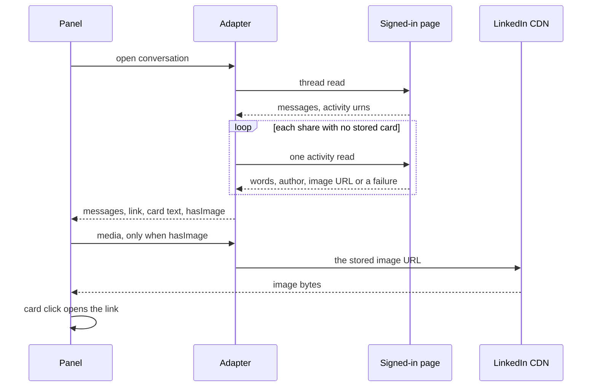

# feat: Show a LinkedIn shared post as a card

## Summary

An open LinkedIn chat draws a shared post as a card: the post's words, the author when the update has one, and the picture when the update has one. The card opens the post. A share with no words and no picture still shows the open control, so the bubble is not empty. The conversation list does not fetch posts.

---

## Problem Frame

A LinkedIn message that shares a post has no body. The page read already keeps the activity urn, and the thread turns that urn into a link (`activityOf` in `src/linkedin-page.ts`, then `linkedinMessages` in `src/linkedin-inbox.ts`). The live thread for the empty bubble carries that link and an empty `text`.

The open chat uses a bubble because LinkedIn declares `threads: true`. `ChatBubble` in `app.tsx` draws text and pictures. It never draws `link`. The "Open shared post" control lives on the document layout, which LinkedIn does not use. The bubble therefore shows the sender and the time, and no content.

The message payload has no title and no thumbnail. Slice E recorded that a `FEED_UPDATE` carries only `hostUrnData`, and stopped at the link (`docs/plans/2026-11-02-next-slices.md`). The card needs a second read of that activity, inside the signed-in page.

A mention copies `text` only (`src/inbox-mention.ts`), so the same share is a blank line there too.

---

## Requirements

- R1. An open LinkedIn chat shows one card for a shared post. The card shows the post's words, the author when the update names one, and the picture when the update has one.
- R2. The card opens the activity link the thread already stores. Words the person typed on the message stay in the bubble as message text, separate from the card.
- R3. A post with words and no picture shows the words. A post with a picture and no words shows the picture. A post with neither still shows the open control.
- R4. The picture is a LinkedIn CDN image under the same bounds as a message photo. The CDN URL stays on the cached message for the media fetch. It is not a field on the RPC message.
- R5. A failed post read does not fail the thread. The bubble keeps the open control. A stored failure is not asked again on every open.
- R6. List sync and the probe do not read posts. The list label stays "Shared a post".
- R7. A mention and `inbox_read` are not a blank line for a share. The line uses the post's words when they are stored, and the words "Shared a post" when they are not. `inbox_read` still returns the link.
- R8. The post read runs in the signed-in page session, on the same gate as the other LinkedIn reads, one activity at a time. The request is the one a captured update names. A guessed URL does not ship in its place.
- R9. A photo, a file, a video, a reply, and a forward stay as they are. A URL the person typed stays message text.

---

## Scope Boundaries

- The card does not play video. A poster image is the picture when the update has one.
- The card is one block. A reshare is not drawn as two nested posts.
- The list does not gain post titles.
- Search does not index the post's words.
- Other sources do not gain a share card.

### Deferred to Follow-Up Work

- A list preview that uses the post's words after a card is stored.
- Search over the post's words.
- A two-level reshare layout.
- Video playback inside the card.

---

## Key Technical Decisions

- **The card is a second read, not a richer parse of the message.** The message payload still has only the activity urn. Parsing it again will not produce a title or a picture.
- **The thread open asks for missing cards. The list never does.** A picture fetched where a row is drawn blocks the list (`docs/solutions/logic-errors/avatar-fetched-on-the-read-path-2026-11-05.md`). The same split applies here. `sync` and `probe` stay as they are. `open` returns the messages it already returns, and fills a card only for a share on that page that has no stored card.
- **A stored card is kept.** A later open of the same message does not read the activity again. A failed read is stored with the time it failed, and a later open skips it until that failure is old. The window copies the avatar failure window. It is not a new policy.
- **The image uses the media path. The click uses the link.** The card opens `link` itself. When a stored image exists, `media` returns that image through `readLinkedInImage` and does not return the activity URL. A share with no stored image keeps today's answer: the activity URL and no fetch. That is the answer `tests/adapters/linkedin.test.ts` already locks in.
- **The CDN URL stays off the RPC message.** `src/linkedin-inbox.ts` already treats a photo URL as a read-side detail. The post image follows that. The panel learns `hasImage` and then asks `media`. The words and the author are text and travel on the message.
- **The message text is not replaced by the post.** A caption and a share can both be present. The caption stays `text`. The card is a new optional object on the message, the way a poll is.
- **One activity at a time, on the existing page gate.** The LinkedIn session already runs one operation at a time (`src/CONTEXT.md`). The post read uses that gate. It does not fan out beside the thread read.
- **The request is captured, then pinned.** LinkedIn writes taught that a guessed call is the wrong shape (`docs/plans/2026-11-02-next-slices.md`, Slice D). U1 records one live feed-update response and pins that request. The fixture is that capture, with cookies removed.

---

## High-Level Technical Design

This illustrates the intended approach and is directional guidance for review, not implementation specification. The implementing agent should treat it as context, not code to reproduce.

---

## Implementation Units

### U1. Read one activity inside the page

**Goal:** One activity urn becomes the post's words, the author when present, and a CDN image URL when present.

**Requirements:** R1, R4, R8

**Dependencies:** None

**Files:** `src/linkedin-page.ts`, `src/linkedin-page-session.ts`, `tests/linkedin-page.test.ts`, `docs/research/linkedin/`

**Approach:** Add a page read that accepts only an activity urn of the form the thread already trusts. Anything else never reaches the page. The read uses the signed-in session, the same way the thread read does, and its answer passes through `linkedinReadResult`. Before the request is pinned, capture one live update the signed-in page returns for a shared post and write that capture under `docs/research/linkedin/` with cookies removed. The pinned request is that capture. The parser reads three things out of it: the post's words, the author, and one image URL. The image URL must pass `linkedinCdnUrl`. A missing image is an empty URL, not an error. A payload that is not an update is a failure the caller can store. The parser does not invent a title from the activity urn.

**Execution note:** Capture the live response before pinning the request. Test the parser against that fixture.

**Patterns to follow:** `activityOf` and `photoOf` in `src/linkedin-page.ts`. The urn bound on `linkedinOlderCursor`. `linkedinReadResult` in `src/linkedin-page-session.ts`. `linkedinCdnUrl` in `src/linkedin-media.ts`.

**Test scenarios:**
- A fixture update with words, an author, and a `licdn.com` image yields those three values.
- A fixture update with words and no image yields the words and an empty image URL.
- A fixture update with an image whose host is not LinkedIn's CDN yields the words and an empty image URL.
- An id that is not `urn:li:activity:` plus digits is refused before the page is asked.
- A page envelope of `{ok: false}` throws through `linkedinReadResult` and does not look like an empty post.
- The pinned request in the expression is the captured request, not a second URL.

**Verification:** The page tests pass against the fixture. A non-urn never becomes part of an expression the test sends.

### U2. Attach the card when the thread opens

**Goal:** A share on an opened thread carries the card, and a miss does not hide the thread.

**Requirements:** R1, R4, R5, R6, R7

**Dependencies:** U1

**Files:** `src/linkedin-inbox.ts`, `src/adapters/linkedin.ts`, `src/adapters/types.ts`, `src/rpc-contract.ts`, `tests/linkedin-inbox.test.ts`, `tests/adapters/linkedin.test.ts`

**Approach:** The thread message gains an optional share object: the words, the author when present, and whether an image was stored. The activity link stays. The image URL stays on the cached message next to the photo URL and is absent from the object the RPC schema accepts. `open` loads the thread as it does now. For each share on that page with no stored card and no fresh failure, it asks U1, one at a time, after the thread payload is in hand. It then stores the thread, including the card or the failure time. A throw from one activity becomes a stored failure. The open still returns the other messages. A share that already has a card, or a failure that is still fresh, is not asked again. `sync` and `probe` do not call U1. `media` returns the stored image through `readLinkedInImage` when the share has one, and does not return the activity URL in that case. A share with no stored image keeps the current answer: the activity URL and no fetch.

**Patterns to follow:** `open` and `media` in `src/adapters/linkedin.ts`. The cache fallback already in `open`. The poll object on the RPC message in `src/rpc-contract.ts`. The failure memory in `src/whatsapp/avatars.ts`, for the idea of remembering a miss, not for its socket rules.

**Test scenarios:**
- A thread payload with an activity urn and empty text becomes a message with the link and, after a successful post read, the words and `hasImage`.
- The image URL is on the cached message and is rejected by the RPC message schema if a caller puts it on the share object.
- Two shares on one thread cause two post reads, in order, and the second starts only after the first settles.
- A second open of a thread whose cards are stored causes no post read.
- A post read that throws still returns the thread, with the link and no card, and a second open does not ask that activity again while the failure is fresh.
- `sync` with a share in the newest page causes no post read.
- `media` for a share with a stored image returns image bytes and does not return the activity URL. `media` for a share with no image returns the activity URL and fetches nothing, as it does today.
- A caption plus a share keeps the caption as `text` and the post as the card.

**Verification:** Adapter tests cover one fetch, no refetch, a failed read, and the media split. A list sync test shows the post read was not called.

### U3. Draw the card in the bubble

**Goal:** The open chat shows the card, and the bubble is not empty for a share.

**Requirements:** R1, R2, R3, R4

**Dependencies:** U2

**Files:** `app.tsx`, `chat.css`, `tests/linkedin-share-card.test.ts`

**Approach:** `ChatBubble` draws the card when the message has a share or a link and has no picture of its own. The card shows the words and the author. When `hasImage` is set, the bubble asks `media` for that message as it mounts and draws the returned image inside the card. A media failure leaves the words and the open control. The card is one button. Activating it calls the existing `onOpenLink` with the activity link. Message text still renders above the card when the person typed a caption. A share that has no words, no author, and no image renders the open control and nothing else. The document-layout attachment is unchanged, because LinkedIn does not use it. The picture is not a second "Show photo" control beside the card.

**Patterns to follow:** The poll block inside `ChatBubble`. The source-level bubble contract in `tests/whatsapp-audio-player.test.ts`. `openLink` in `app.tsx`. Image bounds stay in `readLinkedInImage`.

**Test scenarios:**
- A bubble whose message has share words and a link renders those words and a control that opens that link.
- A bubble with `hasImage` asks for media for that message id and draws the image. It does not also render a separate photo button.
- A bubble with a link, empty text, and no share still renders the open control.
- A bubble with a caption and a share renders both, with the caption outside the card.
- A media failure leaves the words visible.
- A text message with no link and no share renders no card.
- A WhatsApp image bubble still uses its own image control.

**Verification:** The new bubble test fails on the current `ChatBubble`, which does not read `link` or a share. It passes once the card is drawn. Existing bubble tests still pass.

### U4. Say the share in a mention, and name it in the current docs

**Goal:** A mention of a share is not a blank line, and the overview matches the card.

**Requirements:** R7

**Dependencies:** U2

**Files:** `src/inbox-mention.ts`, `tests/inbox-mention.test.ts`, `PLUGIN_OVERVIEW.md`, `README.md`

**Approach:** The mention line uses the share's words when they are stored. When the message has a link and no words, the line says "Shared a post". It does not stay empty. `inbox_read` already spreads the rest of the message, so the link and the share object ride along once U2 puts them on the message. No new agent tool. Update `PLUGIN_OVERVIEW.md` and `README.md` so a LinkedIn share is described as a card in the open chat, and the list is still the short label.

**Patterns to follow:** The poll line in `src/inbox-mention.ts`. The overview sentence style already used for LinkedIn.

**Test scenarios:**
- A message with empty text and share words mentions those words.
- A message with empty text, a link, and no share words mentions "Shared a post".
- A message with a caption and share words mentions the caption, and the share words are still present on the line.
- A normal text message is unchanged.

**Verification:** The mention tests pass. The overview and the README describe the card and do not say the open chat only offers a link.

---

## Risks

- The feed request will move. U1 pins a capture and tests that fixture. A later LinkedIn change fails the post read, and R5 keeps the thread and the open control.
- The first open of a thread with several shares waits on those reads, one at a time. The list does not. A thread page is the newest messages only, which is the bound.
- A private or deleted post fails the read. That is a stored failure, not an empty inbox.
- Putting the image on the message as a photo would draw a second control. U2 keeps the image URL beside the photo URL. `media` returns image bytes only when that stored post image exists. A share with no image still answers with the activity URL, which is the answer the adapter test already requires.

---

## System-Wide Impact

- The RPC message gains an optional share object. The image URL is not part of it.
- `inbox_read` returns the share and the link. Mentions gain words for a share. No send tool changes.
- LinkedIn list sync and the probe are unchanged. Send, read marks, and invitations are unchanged.
- The post read uses the existing page session gate. A card does not open a second browser.

---

## Documentation Notes

`PLUGIN_OVERVIEW.md` is the document that must stay current. U4 updates it and `README.md`. The captured request lands under `docs/research/linkedin/` with the other LinkedIn notes. This plan is historical once the work ships. Regenerate `docs/_index.md` when this file is added.

---

## Deferred Implementation Notes

- The exact feed URL and the JSON paths for the words, the author, and the image. U1 takes them from the capture.
- How long a stored failure waits before another open asks again, within the avatar failure window this plan copies.
- Whether a poster image for a video update uses the same image field as a photo update. If the capture has no image, the card has no picture.
