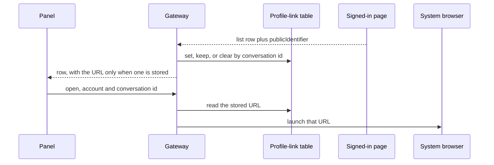

# feat: Link a LinkedIn name to the public profile

## Summary

An open LinkedIn conversation with one other member shows that person's name as a control when a safe profile URL is stored. The control opens `https://www.linkedin.com/in/{publicIdentifier}` in the system browser. The URL is learned from the profile read the list already performs, stored apart from the newest-page cache, and opened by the plugin process. A group, a company page, an invitation, a member with no safe identifier, a conversation that has not been read since this field existed, and every other source keep a plain name.

---

## Problem Frame

The open-thread header draws the conversation title as text (`app.tsx`, `.ui-conversation-name`). LinkedIn already asks the signed-in page for each counterpart's dash profile, and keeps the first name, the last name, and the picture (`nameOf` in `src/linkedin-page.ts`). It does not keep `publicIdentifier`, and nothing in the repo builds a `/in/` URL.

The header cannot use the message `senderUrn`. That urn is stripped before the panel, and a thread whose cached messages are all from the owner never carries the counterpart's urn. The list row is the place that already knows there is exactly one other participant.

A normal link in this panel is the wrong opener. `openLink` inserts a BB browser tab whenever the inbox sits beside a thread. `navigate.openUrl` follows the client's BB browser preference. The system-browser opener that exists today (`openSystemBrowser` in `src/gmail-login.ts`) is the Gmail sign-in path. The LinkedIn session stays in its own Chrome profile and is not exported (`decisions/0003`).

---

## Requirements

- R1. An open LinkedIn conversation whose only other participant is a member shows a control on that person's name in the thread header. The control opens that member's public profile in the system browser.
- R2. The URL is `https://www.linkedin.com/in/{publicIdentifier}` from the dash profile entity for that participant. The page read already requests that profile. This feature adds no second profile request.
- R3. A group, a company-page counterpart, an invitation, a member with no safe identifier, and a conversation that has never been read since this field existed show the name as plain text. Nothing opens.
- R4. The URL for a conversation survives a newest-page save that does not include that conversation. An older-page read stores the URL for a one-member conversation on that page, so a later click can resolve it.
- R5. A failed profile request keeps the last accepted URL. A successful read clears it when the conversation is no longer a single member counterpart, or when the matching entity has no safe identifier.
- R6. An already-open thread gains the control when the URL arrives, and loses it when the URL is cleared, without opening the thread again.
- R7. The next LinkedIn sync after this change performs a list read even when the probe matches the stored marker. A later matching probe still skips.
- R8. The click names the account and the conversation id. The server opens only a stored URL that passes the same check used when the URL was stored. A missing row, a rejected URL, or a failed launch is reported in the panel. The warm LinkedIn page is not navigated, and the plugin profile is not copied.
- R9. The inbox list, each message, Gmail, WhatsApp, and Messages do not gain this control.

---

## Scope Boundaries

- The control sits on the person's name in the open thread. The inbox list row stays text.
- One other member only. A conversation with two or more other participants, including one member and one company page, has no link.
- Invitations stay as they are.
- The profile is not drawn inside the inbox.
- The plugin's LinkedIn window is not sent to the profile.

### Deferred to Follow-Up Work

- A link for each participant in a group.
- A link on the inbox list row, or on each message.
- A link for a company page.
- A public profile whose identifier uses characters this plan rejects.

---

## Key Technical Decisions

- **The list read is the source of the identifier.** `rowsOf` in `src/linkedin-page.ts` already knows the other participants and already fetches a member's dash profile. The thread read does not rebuild the row, and `senderUrn` is the wrong id for a thread the owner has only sent in.
- **The page copies the identifier. Node builds and checks the URL.** The page expression returns the `publicIdentifier` string from the included entity whose urn is the participant just fetched. It does not build a URL and it does not run a character class. A `\s` or `\d` inside that template reaches the page as `s` or `d` (`docs/solutions/logic-errors/recorded-writes-read-back-empty-2026-11-02.md`). The first included entity that has a `firstName` is not specific enough: another named entity can sit in front of the requested profile.
- **A safe identifier is one path segment.** It is non-empty, at most 100 characters, and contains no `/`, `\`, `?`, `#`, whitespace, or control character. `.` and `..` are rejected. The stored value is `https://www.linkedin.com/in/` plus that segment percent-encoded, with no query and no hash. The same check runs at ingest and again before launch. An identifier outside that rule leaves the name as text.
- **The URL lives in its own table, not on `inbox_cache`.** `cache.save` deletes every row for the account and inserts the newest page. Older pages are drawn and never cached (`src/adapters/linkedin.ts`). A column beside `avatar_url` would miss an open conversation that is not on that page. The new table is keyed by account and conversation id. A newest-page replace does not delete it. A cache clear for the account does.
- **A failed profile request does not clear a stored URL.** `nameOf` swallows a profile error today so the row can still be drawn. That swallow must stay a failure, distinct from a profile that came back without a safe identifier. Only a successful read may set or clear the URL. Clear it when that read shows the conversation is no longer exactly one `fsd_profile` counterpart, or when the matching entity has no safe identifier.
- **One forced list read, by the existing marker.** `LINKEDIN_MARKER_PREFIX` is `linkedin-v1`. A stored marker from another prefix does not parse, and `linkedinDelta` then returns a full read. Bump the prefix once. Do not force a read on every later skip, and do not add a second backfill flag.
- **The header control is a button with no address.** Message links are anchors. A modified click falls through to the webview, and a plain click uses `openLink`, which opens a BB tab beside the thread. The name control handles every click, including modified clicks, by calling the server. Mute and the attention chip stay outside the control. When the conversation title and the participant name are the same string, the control is the header name. When they differ, the control is the line under the title, which is the participant name. The other copy of the name stays text.
- **The server opens the stored URL with the OS opener.** The panel does not send a URL. The opener is the one Gmail sign-in uses. A launch error is reported. The warm inbox page stays where it is (`decisions/0003`).

---

## High-Level Technical Design

This illustrates the intended approach and is directional guidance for review, not implementation specification. The implementing agent should treat it as context, not code to reproduce.

A probe that matches the current marker skips the page. After the prefix bump, the first sync is a list read, which fills the table for the newest page. An older page writes the table as it is drawn.

---

## Implementation Units

### U1. Copy the public identifier onto a one-member row

**Goal:** A list row for exactly one other member carries that member's public identifier. Every other row does not.

**Requirements:** R2, R3

**Dependencies:** None

**Files:** `src/linkedin-page.ts`, `src/linkedin-inbox.ts`, `tests/linkedin-page.test.ts`, `tests/linkedin-inbox.test.ts`

**Approach:** In the profile branch of the existing name lookup, read `publicIdentifier` from the included entity whose urn is the profile that was requested. A failed request stays a failure and does not invent an identifier. `rowsOf` attaches the identifier only when the other participants are exactly one `fsd_profile`. A company key, a group, and an empty participant list leave it off. The invitation path keeps using the name lookup and does not attach an identifier. `row()` in `src/linkedin-inbox.ts` turns a safe identifier into the profile URL and drops the field for an invitation id and for an unsafe identifier. The page script does not build the URL.

**Execution note:** This page expression has parsed as empty when the envelope or an escape was wrong. Extend the existing page test so the stub profile entity carries `publicIdentifier` on the requested urn, and assert the value that comes back through the envelope.

**Patterns to follow:** `nameOf` and `rowsOf` in `src/linkedin-page.ts`. `row()` in `src/linkedin-inbox.ts`. The activity URL built in `linkedinMessages` is the pattern for a LinkedIn URL this repo already constructs in Node.

**Test scenarios:**

- A list entity with one other `fsd_profile`, and a dash payload whose matching urn has `publicIdentifier` `ada-lovelace`, produces a row whose profile URL is `https://www.linkedin.com/in/ada-lovelace`.
- The same payload with `publicIdentifier` on a different included entity that also has `firstName` produces a row with no profile URL.
- A profile request that throws leaves the identifier unset and still returns the row.
- Two other participants, one `fsd_company` counterpart, and an entity with no participants produce rows with no profile URL.
- An identifier that is empty, `.`, `..`, longer than 100 characters, or that contains `/`, `?`, `#`, or a space is dropped by `row()`. A unicode identifier with no forbidden character is kept, percent-encoded, with no query and no hash.
- An invitation id that arrives with an identifier is stored with no profile URL.

**Verification:** The page test and the inbox-row test cover the cases above. A conversation row the panel would see has a profile URL only for one safe member identifier.

### U2. Remember the URL across the newest-page replace

**Goal:** The URL for a conversation stays available after the newest page is saved, including for a conversation that page does not contain, and the first sync after this change actually performs the list read that learns it.

**Requirements:** R4, R5, R7

**Dependencies:** U1

**Files:** `src/inbox-cache.ts`, `src/adapters/linkedin.ts`, `src/gateway.ts`, `src/linkedin-delta.ts`, `src/CONTEXT.md`, `tests/linkedin-delta.test.ts`, `tests/adapters/linkedin.test.ts`

**Approach:** Add a table in the plugin database, keyed by account and conversation id, holding the URL. `cache.save` does not touch it. Clearing the cache for an account removes that account's rows from it. The LinkedIn adapter writes it from a newest-page read and from an older-page read: set the URL when the row carries a safe one, keep the previous URL when the profile request failed, and clear it when the read succeeded and the conversation is no longer a single member counterpart or the matching entity has no safe identifier. Rows that leave the gateway for LinkedIn pick up the stored URL, the same way a cache-only decoration is applied wherever rows leave. Bump `LINKEDIN_MARKER_PREFIX` so a stored `linkedin-v1` marker does not parse and the next sync reads. Mention the table on the "what is remembered between runs" row in `src/CONTEXT.md`.

**Patterns to follow:** The `ALTER TABLE` additions and `CREATE TABLE IF NOT EXISTS` block in `src/inbox-cache.ts`. The comment on `list(cursor)` in `src/adapters/linkedin.ts` that older pages are drawn and never cached. `parseLinkedInMarker` rejecting a foreign prefix. The gateway's cache-only decoration seam.

**Test scenarios:**

- Saving a newest page that omits conversation A leaves A's URL in the profile-link table. A lookup by that id still returns it. The newest-page cache no longer contains A.
- An older-page read of a one-member conversation stores the URL. A later lookup by that id returns it. The newest-page table does not gain that conversation.
- A profile failure on a later read of A leaves A's URL in place. A successful read of A with two other participants removes it. A successful read whose matching entity has no safe identifier removes it.
- Clearing the cache for the LinkedIn account removes its profile URLs and leaves another account's rows in place.
- A stored marker that begins with `linkedin-v1` and matches the probe numbers now yields a full read. After a marker is written with the new prefix, an identical probe still skips.
- An invitation row is not written into the table.

**Verification:** A conversation that is open from an older page has a stored URL the click can resolve, and a quiet inbox performs one list read on the first sync after the prefix bump.

### U3. Open the stored URL in the system browser

**Goal:** A request that names the LinkedIn account and a conversation id launches the stored profile URL with the OS opener, or reports why it did not.

**Requirements:** R1, R8

**Dependencies:** U2

**Files:** `src/rpc-contract.ts`, `src/gateway.ts`, `src/gmail-login.ts`, `server.ts`, `tests/gateway.test.ts`

**Approach:** Add an RPC that accepts the account and the conversation id and returns whether the launch happened. The handler reads the stored URL, checks it again with the U1 rule, and launches it with `openSystemBrowser`. Any other account, a missing row, or a stored value that fails the check does not launch. A spawn error is a failure the caller can show. The handler does not accept a URL from the client, does not call into the LinkedIn page, and does not export the session. Wire the existing opener into the gateway the same way `openLinkedInSignIn` is wired. The RPC item may carry the optional profile URL so the panel knows a control is available. Agent list and search responses stay as they are.

**Patterns to follow:** `openSystemBrowser` in `src/gmail-login.ts`. Gateway methods that take an account and a conversation id, and the `openLinkedInSignIn` dependency on `createGateway`.

**Test scenarios:**

- A stored `https://www.linkedin.com/in/ada-lovelace` for the named conversation is the exact URL passed to the opener. The result says the launch happened.
- A missing row, a non-LinkedIn account, and a stored value that is not a `https://www.linkedin.com/in/` URL from a safe segment do not call the opener. The result says why.
- The opener reporting a launch error becomes a failed result and does not throw past the gateway.
- The handler's input schema has no URL field.

**Verification:** The gateway test shows the opener receives only a stored, re-checked profile URL, and a bad row never reaches it.

### U4. Put the control on the open thread's name

**Goal:** The open one-to-one shows the control on the person's name, and an already-open thread follows a URL that arrives or disappears.

**Requirements:** R1, R3, R6, R9

**Dependencies:** U2, U3

**Files:** `app.tsx`, `src/inbox-session.ts`, `tests/inbox-session.test.ts`, `tests/inbox-list.render.test.ts`

**Approach:** When the selected LinkedIn row has a profile URL, render a button with no `href` on the name. If the title and the sender are the same string, the button is `.ui-conversation-name`. If they differ, the button is the meta line that shows the sender, and the title stays text. The button's click, including a modified click, calls the U3 RPC and does not call `openLink`. A failure uses `session.notify`. Mute and the attention chip stay outside the button. In `reconcileSelected`, a change to the profile URL, the title, or the sender updates the open row and does not call `open`. A date or preview change keeps today's reopen behavior. A selected conversation that is no longer in the items stays as it is. List rows, message bubbles, and other accounts do not render this button.

**Patterns to follow:** The header block in `app.tsx`. `reconcileSelected` in `src/inbox-session.ts`, where an attention-label change updates the header and does not open the thread again. Render tests that mount the header through `tests/jsdom-harness.ts`.

**Test scenarios:**

- A selected LinkedIn row with a profile URL and a title equal to the sender renders a button on the header name. Activating it calls the open RPC with that account and id. The meta line stays text.
- A selected row whose title differs from the sender renders the button on the meta line. The header title stays text. The mute mark and the attention chip are not inside the button.
- A selected row with no profile URL, a group row, an invitation, and a Gmail row render the name as text and do not call the open RPC.
- A modified click on the button does not call `openLink` and does not navigate a `href`.
- A failed open RPC surfaces the failure text through the session notice.
- `reconcileSelected` with the same date and preview and a new profile URL replaces the selected row and does not call `open`. Clearing the URL does the same. A date change still calls `open`. A selected id missing from the new items is left in place.

**Verification:** The render test shows the control only on the person's name for a one-member LinkedIn row, and the session test shows an already-open thread gains the control without a second open.

---

## System-Wide Impact

- **RPC.** The item gains an optional profile URL. One new method opens a stored LinkedIn profile. Agent list and search stay unchanged.
- **Database.** One new table in the plugin database. `inbox_cache` is unchanged. A cache clear for an account removes that account's profile URLs.
- **LinkedIn sync.** The marker prefix bump makes the next sync a list read. Later identical probes skip, as they do today. The warm LinkedIn page is not navigated to the profile.
- **Sends.** No send path changes. The policy gate is not involved.

---

## Risks & Dependencies

- The live dash entity must carry `publicIdentifier` on the same object the name read already selects. If a captured response puts the slug somewhere else on that entity, read it from there. Do not add a second request, and do not build a `/in/` URL from the `fsd_profile` id or the display name.
- The prefix bump costs one full list read per LinkedIn account on the next sync. That is the read that fills the table on a quiet inbox.
- `openSystemBrowser` ignores a spawn error today because Gmail sign-in has its own timeout. This click has no timeout, so the gateway has to surface the error.
- A profile URL is personal data. It stays in the plugin database, on the list item the panel already holds, and in the system browser. It is not written to the send audit and not returned by the agent list.

---

## Documentation Notes

- `src/CONTEXT.md` gains the profile-link table on the row for what is remembered between runs (U2).
- No operator steps. The control appears after the next LinkedIn sync.

---

## Deferred implementation notes

- The exact helper names, and whether the identifier travels on the page row under a temporary field that `row()` consumes, are for the implementer.
- If the matching dash entity in a real response has no `publicIdentifier`, inspect that response before changing the request. The absence is a plain name, not a guessed URL.
